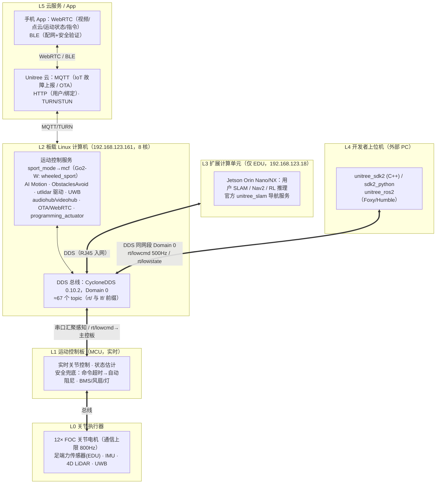
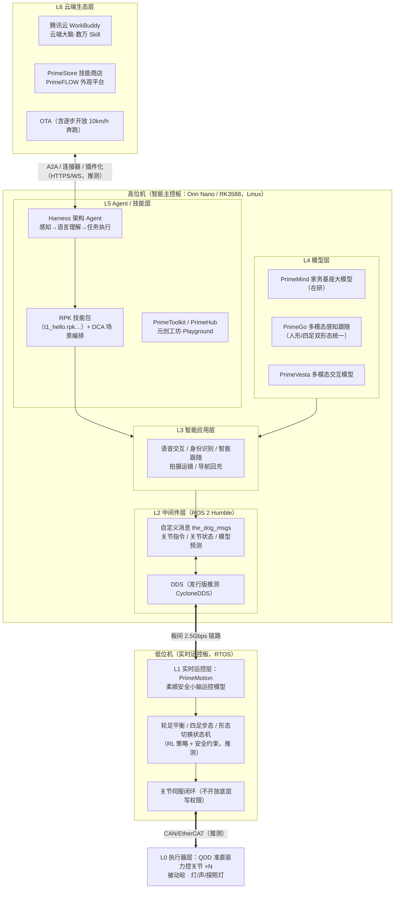
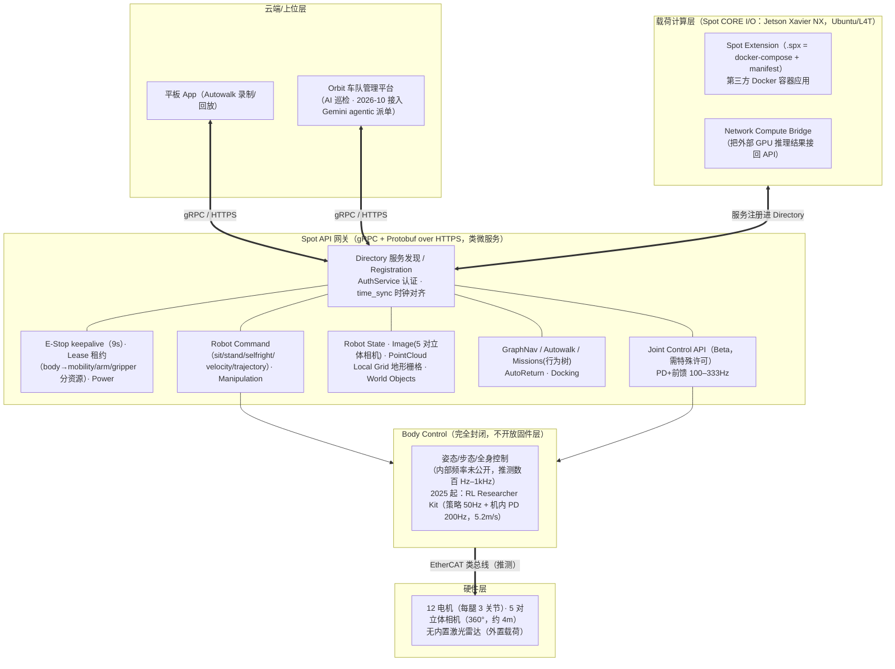
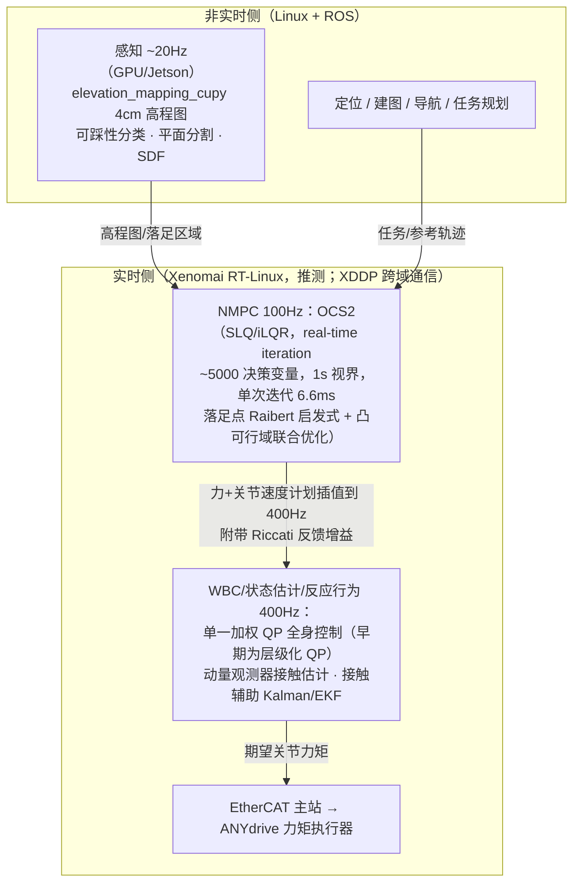
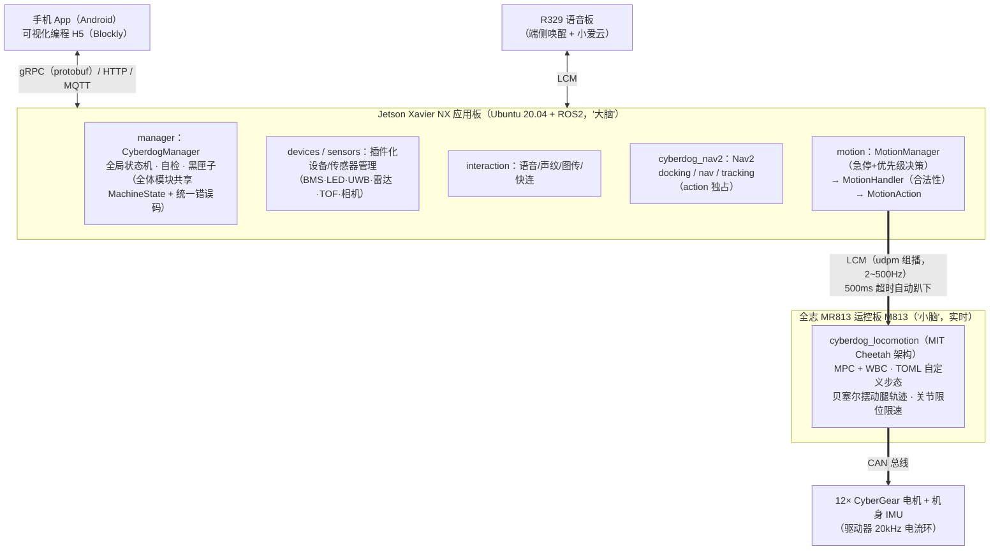
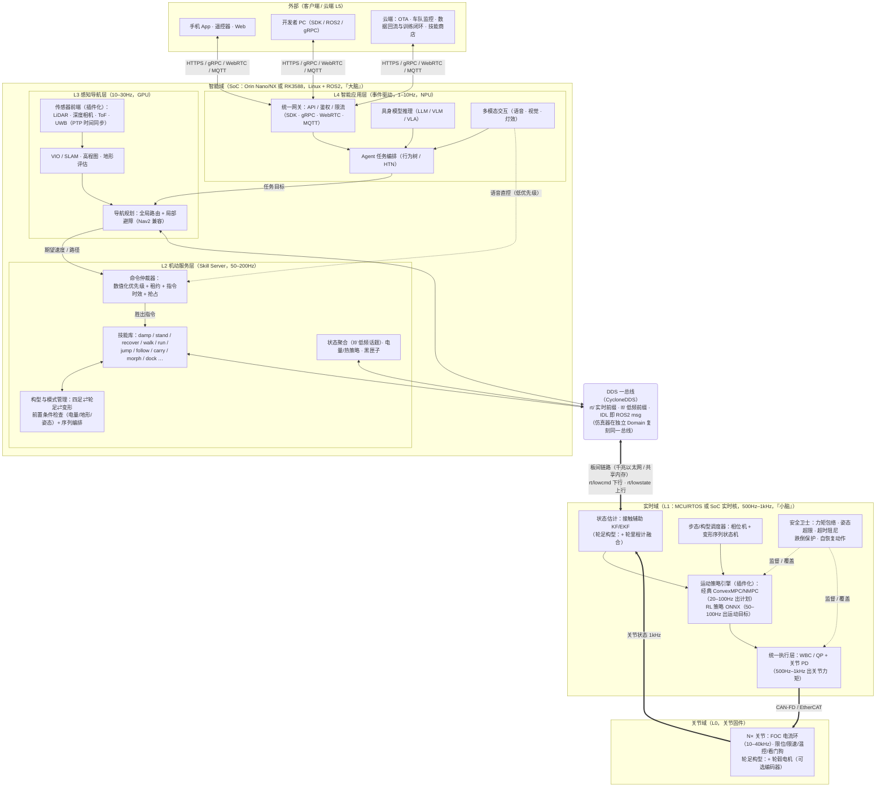
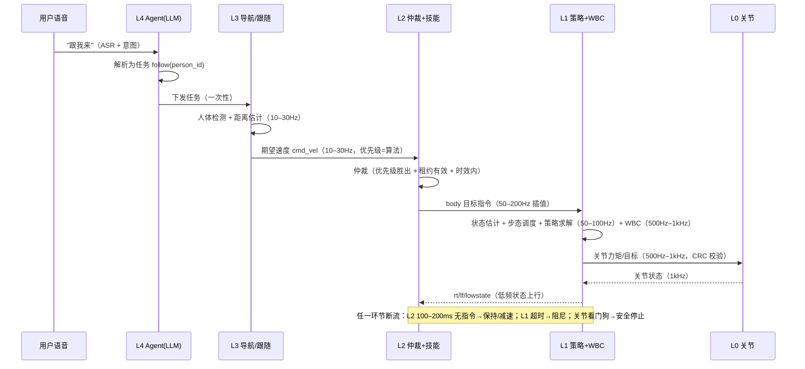
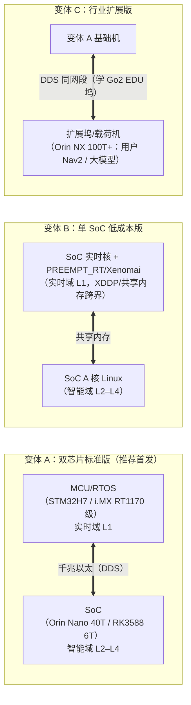

# 四足 / 轮足机器人软件架构设计说明书

| 文档信息 | |
|---|---|
| 版本 | v1.0（初稿完成） |
| 日期 | 2026-10-22 |
| 状态 | 业界调研（8 家产品 + 5 类学术开源）+ 共性分析 + 目标架构推导 全部完成 |
| 关联文档 | [embodied-ai-analysis.md](embodied-ai-analysis.md)（公司与产品级分析） |
| 备注 | 启元 T1 底层细节部分来自第三方对官方 SDK 的解读与智元同源体系推断，文中以〔解读〕〔推测〕标注；引用数字请以官方最新披露为准 |

---

## 一、引言

### 1.1 目的

为自研四足或四轮足（轮腿/wheeled-legged）机器人平台设计一套软件架构。方法：先调研业界主流产品的软件架构，提炼共性与关键设计点，再据此推导出目标架构，并给出推导逻辑、关键点、收益与取舍的完整论证。

### 1.2 范围

- 形态覆盖：纯四足（如宇树 Go2）与轮足混合/可变形（如启元 T1、逐际动力 W1）两类构型，同一架构需同时适配。
- 层次覆盖：关节执行器固件 → 实时运动控制 → 机动技能服务 → 感知导航 → 智能应用（Agent/大模型）→ 云端，全栈。
- 不覆盖：硬件电路设计、电机本体设计、结构设计；云端平台仅涉及端云接口。

### 1.3 术语

| 术语 | 含义 |
|---|---|
| WBC | Whole-Body Control，全身控制器（通常为基于动力学模型的 QP/逆动力学求解） |
| MPC | Model Predictive Control，模型预测控制 |
| RL Policy | 强化学习训练出的运动策略神经网络（常经 Sim2Real 部署） |
| 小脑 / 大脑 | 小脑=实时运动控制（balance/locomotion），大脑=感知认知与任务决策（Agent/LLM/VLA） |
| DDS | Data Distribution Service，实时发布/订阅中间件（ROS 2 默认底层，宇树 SDK2 直接使用） |
| QoS | Quality of Service，通信质量策略（reliable/best-effort、keep-last 等） |
| Sim2Real | 仿真训练 → 实机部署的迁移流程 |
| 技能（Skill/RPK） | 封装好的原子运动能力（站立、跳跃、跟随等），供上层调用 |
| 租约（Lease）/ 仲裁 | 多客户端控制权管理与指令冲突裁决机制 |

---

## 二、业界主流产品软件架构调研

> 调研对象：**宇树 Go2**、**启元 T1**（两大重点），以及 Boston Dynamics Spot、ANYbotics ANYmal（ETH 栈）、小米 CyberDog 2、云深处、逐际动力、众擎等，学术开源（MIT Cheetah-Software、JPL quad-sdk、CHAMP 等）。
>
> 信息可信度标注：〔官方〕来自官方文档/源码；〔解读〕来自第三方开发者对官方 SDK/源码的解读；〔推测〕为基于技术体系的合理推断。

### 2.1 宇树 Go2（重点参考一）

#### 2.1.1 机型与开放度

Go2 分 AIR / PRO / X / EDU 四档，**同一硬件平台、软件按档位解锁**：AIR/PRO 基本只开放 App；EDU 完整开放 DDS/SDK2/ROS2/低层力矩控制，并独有 Jetson Orin 扩展计算坞（Orin Nano 8GB 40TOPS / Orin NX 16GB 100TOPS）、足端力传感器、RealSense D435i。全系板载 8 核 CPU 主控（IP 固定 192.168.123.161）；整机内部网络 192.168.123.0/24。头部 4D LiDAR：L1（360°×90°）→ 2026 年批次已升级 L2（21600 点/s）。

#### 2.1.2 软件分层架构



#### 2.1.3 通信中间件设计（Go2 最值得学的部分）

- **SDK2 = DDS 之上的薄封装**〔官方〕：Eclipse CycloneDDS 0.10.2（RTPS/UDP），整机与开发机同处 Domain 0。核心抽象：ChannelFactory 单例（domain/网卡/共享内存开关）→ ChannelPublisher/Subscriber + 基于 topic 的 RPC（Client/Server，带 **lease 租约**、超时、API 版本协商、3xxx/4xxx/7xxx 错误码）。
- **Topic 命名体系**：`rt/` 前缀使 ROS2 订阅时自动映射为 ROS topic 名（rt/utlidar/cloud → /utlidar/cloud），**IDL 即 ROS2 msg，与 ROS2 零桥接直通**；`lf/` 前缀 = 同名话题低频版（lf/lowstate），专供 App/监控等非实时消费者降带宽。
- **一址多机**：DDS 发布订阅天然支持多机/多进程同订一个 topic；但低层控制话题约定**单一控制者**，RPC 侧用 lease 租约防多客户端争抢（错误码 3107/3207）。
- **关键频率**：用户低层控制 500Hz（官方示例 2ms 周期线程）；LowState.tick 1ms 计时基准；电机通信上限 800Hz；点云 ~10–15Hz、高度图 ~11Hz（社区观测）。
- **可靠性设计**：LowCmd 帧头 0xFE 0xEF + 整帧 CRC32；QoS 必须与机器人侧匹配否则静默丢包（QoS 策略官方未文档化，推测 BEST_EFFORT+Volatile）；命令断流后 bit_flag 置位（电机超时/命令超时）并**自动进入阻尼保护**。
- 旧版 SDK1（Go1/A1）为 UDP 直连 + LCM（ROS1），Go2 全面转向 DDS——宇树自己的架构演进方向。

#### 2.1.4 三级控制接口

| 级别 | 接口 | 内容 |
|---|---|---|
| 低层（EDU） | `rt/lowcmd` 500Hz | MotorCmd{mode=FOC, q, dq, tau, kp, kd}（MIT 混合阻抗模式）。**前置条件：必须先停内置运动服务**（MotionSwitcherClient.ReleaseMode() 或 SetSilent），否则双控制源冲突"失控"〔官方原话〕 |
| 高层 Sport | SportClient RPC | Damp/StopMove/BalanceStand/StandUp/StandDown/RecoveryStand/Move(±2.5~3.8m/s)/Euler/SwitchGait(trot/跑/爬楼)/BodyHeight/TrajectoryFollow(30点)/FrontFlip/Dance 等 30+ 技能；V2.0 新增 TrotRun 3.7m/s、EconomicGait（4h 续航） |
| 生态 | ROS2/Python | unitree_ros2 直接暴露 DDS topic 为 ROS2 话题（同 CycloneDDS RMW，无需 bridge）；sdk2_python 全能力覆盖 |

#### 2.1.5 运动控制算法与 Sim2Real

- 内置运动控制器（sport_mode/mcf）闭源〔官方从未公开〕；业界共识血统为 MIT Cheetah 范式：convex MPC（~30–50Hz 解支撑足地面反力）+ WBC/任务空间逆动力学（~500–1000Hz 出关节力矩）〔推测〕；V1.1.6+ 的 AI/agile 模式疑似引入 RL 步态〔推测〕。
- **用户控制器注入路径**：ReleaseMode 停内置服务 → 500Hz 直发 rt/lowcmd → 主控板只做实时执行与安全兜底。官方还提供 state_machine 部署框架（接收/控制/发送三线程 + 姿态>90° 自动阻尼 + 日志落盘）。
- **仿真三件套（Sim2Real 同构是核心）**：unitree_rl_gym（Isaac Gym + PPO 训练）→ unitree_mujoco（**实现与实机同名 DDS topic**，Domain 1 + 回环口，实机/仿真切换仅改一行 `ChannelFactory::Init(0,"enp3s0")` vs `Init(1,"lo")`）→ 实机 500Hz 部署。

#### 2.1.6 感知 / 导航 / 云

- 4D LiDAR 点云去畸变后发布（cloud_desckewed）+ 128×128@6cm 高度图 + 三向障碍距离；**内置避障是独立服务**（RPC 开关，跑自定义导航前必须关闭——控制权互斥思想贯穿）。
- 官方 unitree_slam 导航服务（EDU 扩展坞 + 外置 Mid-360/XT16，JSON-RPC：建图/重定位/目标点导航），社区主流方案为 FAST-LIO + Nav2。
- 云端三层：MQTT（IoT/OTA）+ HTTP（用户/绑定）+ TURN/STUN（WebRTC 打洞中继）；App 经 WebRTC 直连机器人获取音视频/点云/状态/控制。语音大模型交互（rt/gpt 话题）。
- 教训：旧固件 DDS 无认证曾曝 RCE（CVE-2026-27509/27510，V1.1.13 修复）——DDS 开放性与网络安全必须成对设计（宇树的答案是不可路由内网 + 默认关闭发现端点）。

#### 2.1.7 对本设计的启示

- "DDS 一总线到底 + rt/lf 双前缀 + IDL 即 ROS2 msg"是被全球科研社区验证过的接口设计；
- **控制权单租约 + 显式接管协议**（MotionSwitcher/silent/lease）是多控制源并存的关键机制；
- 安全兜底下沉到主控板（CRC、超时阻尼、bit_flag），上层随便崩、底层保命；
- 仿真器复刻实机 DDS 接口（同构），Sim2Real 变成"换网络配置"。

### 2.2 启元 T1（重点参考二，轮足/可变形构型）

#### 2.2.1 产品与硬件底座

启元（PrimeBot）为上纬新材（智元机器人控股）旗下消费级具身智能品牌。T1 于 2026-09-20 发布：轮足人形 ↔ 四足双形态自主切换，约 100cm / 16kg，19999 元起；T1 Pro 搭载 NVIDIA Orin Nano。

计算平台为**双板架构**〔解读+官方部分确认〕：

- **低位机（实时运动控制板）**：独立运控板，运行平衡 / WBC / 关节伺服实时闭环；"全栈自研覆盖本体、运动控制、多模态感知交互"〔官方发布会〕。
- **高位机（智能主控板）**：Pro 版为 Orin Nano（~40 TOPS）；基础版为 RK3588（8 核 A76/A55 + 6 TOPS NPU）〔解读，待官方确认〕。板间 2.5Gbps 链路下发指令、回收状态〔解读〕。

传感器：5 组 ToF + 双目深度相机 + 2 鱼眼环视，Pro 版"9 传感器、双形态 360° 避障"〔解读/官方〕；**无激光雷达**（纯视觉+ToF 路线）；IMU、麦克风阵列、RGB 灯带、探照灯。关键事实：**轮子为被动轮（脚轮），无轮毂电机、无轮编码器**〔解读，URDF 佐证〕——轮足形态的定位依赖腿运动学 + 视觉〔推测〕。

#### 2.2.2 软件分层架构



#### 2.2.3 各层要点

| 层 | 关键模块 | 说明 |
|---|---|---|
| L0 执行器 | QDD"蛋壳"关节、被动脚轮、灯/声 | 关节轻量高刚性，力控柔顺；DOF 数未公布（Q1 为 22 DOF 可类比） |
| L1 实时运控 | PrimeMotion"小脑" | 官方定义"柔顺安全小脑运控模型"；SDK **不开放底层电流/位置伺服写权限**，闭环完全由低位机保证 |
| L2 中间件 | ROS 2 Humble + the_dog_msgs | ament_cmake + rclpy；同源体系有智元 AimRT 中间件（ros2/grpc/mqtt/http 后端可插拔，T1 是否直接采用未确认） |
| L3 智能应用 | 语音/跟随/运镜/回充 | 消费场景功能 |
| L4 模型层 | PrimeGo / PrimeVesta / PrimeMind | PrimeGo 明确"双形态统一"感知策略；训练数据=真机+UMI+真实家务视频 |
| L5 Agent/生态 | Harness Agent、RPK、PrimeStore | 技能做成 UGC 分发单元；Playground 先仿真后真机 |
| L6 云端 | 腾讯云 WorkBuddy | 云端大脑+机器人身体分工，A2A 主动调用 |

#### 2.2.4 控制流与数据流

- **下行**：语音/App/Agent 任务 →（L5/L3）解析为动作意图 → `t1_motion/t1_action`（行走/转向/预置动作/关节轨迹）→ DDS → 低位机 PrimeMotion（平衡+WBC，推测含 body twist→关节速度的雅可比转换）→ 关节电流环。
- **上行**：关节状态/IMU/ToF/双目/鱼眼 → the_dog_msgs 话题 → PrimeGo 跟随/避障/VSLAM → 状态聚合 → App/云端。
- **形态切换**：路况判定（感知层）或低电量触发 → 低位机执行约 3.5s 变形动作序列（状态机+全身轨迹〔推测〕）；**低电量自动切四足趴下防摔**——消费级软硬协同安全的典型案例。

#### 2.2.5 轮足特有问题与 T1 的解法

1. **轮足混合控制**：与主动轮毂方案（LimX W1、ANYmal on wheels、灵犀 X2-N）不同，T1 采用**被动轮**——轮足人形形态本质是"踩轮滑鞋的欠驱动平衡"，无轮里程计，定位靠腿运动学+视觉〔推测〕；四足形态退化为传统步态 RL/WBC。
2. **跨形态一体**："Transformer 跨形态一体架构"（营销命名）= 同一本体、单一运动技能体系覆盖双形态，与 LimX"同一套核心算法适配多形态"理念同向。
3. **安全设计**：低电量自动变形保护；技能开发链路"Playground 仿真先行，RPK 验证后才上真机"。

#### 2.2.6 对本设计的启示

- 双板（高低位机）+ 板间高带宽链路是轮足/消费级产品验证过的算力拓扑；
- "小脑完全封闭 + 技能包生态开放"的分级开放策略，兼顾安全与生态；
- 形态切换必须有独立的状态机与触发安全策略（电量、地形）；
- 同一感知模型需覆盖多形态（PrimeGo 双形态统一）。

### 2.3 Boston Dynamics Spot

#### 2.3.1 架构总览：封闭实时内核 + gRPC 微服务 + 开放载荷平台

Spot 是"**本体=封闭实时内核，载荷=开放应用平台**"的代表〔官方文档〕：



#### 2.3.2 要点

- **一切皆服务**〔官方〕：gRPC/Protobuf 微服务架构，Directory 服务发现 + AuthService 认证 + time_sync 时钟对齐是三大基础服务；能力全部以服务形式暴露（状态/控制/自主/扩展四大类）。
- **低层封闭、高层开放**：标准 SDK 只到 body 级指令（速度/轨迹/坐立/自恢复），指令带 end_time 短有效期、需周期重发；2025 年起出现两条受控低层通道——Joint Control API（Beta，PD+前馈可纯力矩，指令 100–333Hz、状态 333Hz，带速度越限保护）与 Spot RL Researcher Kit（NVIDIA 合作，策略 50Hz 输出关节位置偏移 + 机内 PD 200Hz，端到端 RL 跑出 5.2m/s flying trot，为默认控制器的 3 倍）——说明**电机层本就能接受高频关节伺服，只是商业上长期不开**。
- **载荷生态**：CORE I/O（Xavier NX + 5G）+ Docker/.spx 应用包 + Network Compute Bridge（外部 GPU 推理结果回流 API）+ World Objects 的 MutateWorldObjects（外部检测器注入语义目标）——"本体封闭、周边开放"的完整范式。
- **安全责任链**〔官方〕：用户进程 keepalive（E-Stop 默认 9s）→ SDK 后台线程 → 机器人固件兜底；Lease 断链触发 Comms Loss Procedure（自行坐下→断电）；指令必须带时间戳/end_time；BehaviorFault/SystemFault 两级故障体系。
- **导航**：GraphNav（路标图+传感器快照比对定位）贴合工业"录-放"需求，而非全局自主导航。

#### 2.3.3 对本设计的启示

- 租约（Lease）+ 指令有效期 + keepalive 三件套是多控制源安全的教科书实现；
- "封闭内核 + 服务化 API + 载荷 Docker 生态"适合行业级产品（我们若做行业版可参考）；
- RL 正从外部侵蚀封闭控制器的领地（Spot RL Kit 证明"上层 RL 策略 + 底层稳定 PD"的分层 RL 部署模式可行）。

### 2.4 ANYbotics ANYmal 与 ETH 腿足软件栈

#### 2.4.1 双栈结构

商业栈封闭（ANYmal API：gRPC/REST，可集成西门子 MES；车队软件 ANYware→2026-10 更名 Shift™），**ETH 研究栈开放**（anymal-research.org，ROS 兼容、控制器插件式可替换）。硬件：ANYmal C 双六核 i7 + 可选 Jetson；ANYdrive 串联弹性执行器走 **EtherCAT**，机内力矩闭环约 400Hz。

#### 2.4.2 三级频率瀑布（学术界的事实标准）

以 Grandia 2022《Perceptive Locomotion through NMPC》为最完整公开描述〔论文〕：



**三级流水线：感知 20Hz → NMPC 100Hz → WBC 400Hz**，层间以"计划+反馈增益"传递，是学术界腿足控制的事实标准。

#### 2.4.3 ETH 系开源标准件

| 组件 | 作用 |
|---|---|
| OCS2 | 最优控制工具箱（SLQ/iLQR/SQP + HPIPM QP 求解），腿足 NMPC 核心 |
| TOWR | 轻量 Eigen 轨迹优化库（单体运动学-动力学优化，离线/中频步态规划） |
| free_gait | 全身抽象层 + 任务步描述（YAML/Python）+ 反馈式 WBC 执行（已归档） |
| legged_control（qiayuanl） | OCS2 NMPC（~200Hz@11 代 NUC）+ 层级化 QP WBC + 线性 KF 状态估计 + ros_control 硬件抽象，默认支持 Unitree A1——ETH 范式最完整的公开落地栈 |
| elevation_mapping_cupy / grid_map | GPU 高程图 |
| legged_gym / Walk-in-Minutes（Rudin） | IsaacGym 并行 RL：50Hz 策略输出关节位置目标 → 机内 PD 执行 |

**关键模式**：①非实时（ROS：定位/建图/导航）与实时（400Hz 循环 + EtherCAT）**物理分域**，RT/NRT 间用 Xenomai XDDP 跨域通信〔业界公认模式，ANYmal 具体实现为推测〕；②RL 路线（50Hz 策略 + 机内 PD）与传统 NMPC/WBC 路线并存，接口等价可互换。

### 2.5 小米 CyberDog 2（开源参考）

小米 CyberDog 2 是**消费级四足中开源资料最全**的产品（MiRoboticsLab/cyberdog_ws，官方架构文档 V1.3），其"三板三网"结构是消费级的教科书案例〔官方开源〕：



**官方架构约定〔官方文档，忠实转述〕**：

- **四类构件**：Manager（状态机+心跳+对外接口，只决策不执行）/ Core（一个业务功能节点，如导航、跟随）/ Actuator（纯执行动态库，与硬件强耦合，不用 ROS）/ **Bridge（对内 ROS、对外 DDS/CAN/UART，只转发不参与业务）**。
- **共享状态机**：所有 manager 共用一套 MachineState（未初始化/自检/活跃/低功耗/保护/升级/错误），由 robot manager 统一切换；全局错误码 = 模块码 + 系统级/自定义码。
- **指令优先级仲裁（本报告最重要的证据之一）**：App(0) < Audio(1) < Vis(2) < 蓝牙手柄(3) < Algo(4)，数值越小优先级越高；伺服指令要求 ≤200ms 间隔否则判超时站立。
- **LCM 运控接口**：`robot_control_cmd_lcmt`（mode/gait_id/contact/vel_des/rpy_des/step_height…）2~500Hz，**500ms 无指令自动趴下**；步态可用 TOML 文件自定义（接触时序+步态参数+WBC 权重+MPC 开关）。
- **RL 管线**：cyberdog_locomotion 基于 MIT Cheetah-Software 裁裁剪；Gazebo 仿真（cyberdog_sim）。

**对本设计的启示**：共享全局状态机 + 统一错误码 + 指令优先级数值化仲裁，是消费级量产验证过的"多控制源共存"工程方案；运控板 500ms 超时趴下与 Go2 的阻尼保护同构。

### 2.6 其他产品与学术开源

#### 2.6.1 云深处 绝影 X20/X30/Lite3（行业巡检路线）

三主机分立架构〔官方文档〕：**运动主机（192.168.1.103，jy_exe：MPC/RL 运控）+ 感知主机（.105，jy_cog：fast-lio 里程计 + vmap 地形图 + 避障）+ 导航主机（.106，robot_server + move_base + 充电管理）**，感知主机对速度做二次修正（`/cmd_vel_corrected`）实现感知-运控解耦——行业级"感知-运动分机"的范本。

接口设计：**UDP 指令码协议**（43893/43897 端口，指令码前 2 位标识来源：0x21 遥控器 / 0x31 自主导航——指令源标识与优先级仲裁思想同源）+ **TCP XML/JSON**（30000 端口，任务/监控类：导航任务下发、状态查询）——"UDP 走实时控制、TCP 走任务语义"的双协议分层。关节级低层开放（Lite3_MotionSDK：五参数 pos/vel/kp/kd/t_ff，1kHz 定时器，**>50ms 不发指令丢控制权、>1s 收回并进阻尼模式**；驱动器 20kHz 电流环）。RL 管线全开源：Isaac Sim/Lab + RSL-RL 训练 → PyBullet/MuJoCo sim2sim → 实机（UDP/ROS2 双版本）。

#### 2.6.2 逐际动力 LimX Dynamics（多形态科研平台路线，轮足直接对标）

TRON 1（点足/平足/轮腿三构型可换足，**硬件自动识别切换运动模式**）、W1（四轮足轮足）。SDK 分层〔官方〕：

- `limxsdk-lowlevel`：无依赖 C++11/Python 低层 SDK（IMU/状态订阅、关节指令发布、诊断、灯效），开发者模式直控关节（位置/速度/力矩）；**仿真器与 RL 控制器双进程经同一 SDK 在 127.0.0.1 通信，实机只改地址**——Sim2Real 同构的极致实现。
- 上层 WebSocket 协议：request_stand_mode / walk_mode + twist / base_height / sitdown / stair_mode / emgy_stop / recover…，七种语言示例。
- RL 管线：fork legged_gym + rsl_rl（8192 并行环境，**一套代码 ROBOT_TYPE 切换三构型**：点足 15000 / 平足 10000 / 轮足 8000 迭代）→ ONNX 导出 → tron1-mujoco-sim 验证（与真机共用 SDK）→ ROS/ROS2 部署。2026 生态已扩展到 VLA（tron2_openpi：pi0/pi0.5）与 LLM Agent（tron1-agent）。

**对本设计的启示**：多构型（四足/轮足/双足）共用一套低层 SDK + 一套训练代码是已被验证的工程路线；ONNX 作为策略交换格式是行业惯例。

#### 2.6.3 众擎 / 腾讯 / 蔚蓝（简要）

- **众擎 EngineAI**：主推双足（PM01），无独立轮足产品线；开源 `engineai_rl_lab`（Isaac Lab，动捕 CSV→4096 envs→MuJoCo sim2sim→MNN 部署）与 `engineai_robotics_native_sdk`（预编译调度框架 + 配置驱动任务编排 + 感知/规划/控制解耦插件 + ROS2 Humble）。ROS2 接口：`/hardware/joint_command`（BEST_EFFORT）直达关节控制器、`/motion/body_vel_cmd` 等 19 个消息集中定义——"硬件接口层 / 运动接口层"两级话题命名值得借鉴。
- **腾讯 Robotics X（Max/Ollie 轮足）**：未开源；论文路线为非线性模型 + 自适应 WBC（AOOR），2026 推 RoboFusion 本体互连系统（"软件定义机器人"布线/实时性方案）〔官方/论文〕。
- **蔚蓝 AlphaDog**：封闭生态，二次开发需申请；C500 经 ROS/ROS2 API 开放运动控制与自定义动作；A3 搭载六芯片混合异构计算集群。

#### 2.6.4 Ghost Robotics Vision 60（行业/军工路线）

51kg、IP67、-40~55°C；机载 NVIDIA Xavier。软件生态**仅对审核通过的合作伙伴开放**（无公开开发者门户），接口支持 C/C++、ROS/ROS2、MAVLink、ATAK、JSON 任务，附 Bullet 仿真器；自主能力为避障+感知辅助上楼+录放路线+3D LiDAR SLAM 的 GPS 拒止任务系统〔官方〕。定位：**封闭生态的行业/军用定制**，与 Spot 同路但更封闭。

#### 2.6.5 学术开源栈（算法架构的公共知识底座）

| 项目 | 架构要点 | 参考价值 |
|---|---|---|
| **MIT Cheetah-Software** | 凸 MPC（单刚体+qpOASES，20–30Hz）+ WBIC 全身冲量控制（~1kHz）；LCM 中间件；SOEM 用户态 EtherCAT 1kHz 直驱 | "MPC 低频出力分配 + WBC 高频出力矩"的原始范式；EDU 级开源全栈 |
| **CMU quad-sdk** | ROS 全栈：global_body_planner → local_planner（333Hz NMPC 求 GRF + Raibert 落足）→ robot_driver（500Hz 逆动力学 + EKF）；心跳超时 0.2s、分级 PD 增益（safety/sit/stand/stance/swing） | 全栈规划-控制流水线 + 分级安全增益设计 |
| **Stanford Doggo** | Teensy 单片机中央控制器 + 4×ODrive（UART），虚拟模型控制 100Hz | 极简低成本参考（教育/玩具级裁剪） |
| **CHAMP** | 纯运动学 ROS 框架（步态引擎+IK+足轨迹，无动力学）；libchamp 可跑 SBC/MCU；一键适配新机器人 URDF | 低成本快速原型/教学 |
| **legged_gym（ETH Rudin）** | IsaacGym 数千并行环境 RL；50Hz 策略 → 机内 PD | RL 训练→Sim2Real 的标准管线（宇树 unitree_rl_gym 同源） |

**业界事实标准的 RL Sim2Real 管线**（宇树 unitree_rl_gym、云深处 rl_training、LimX tron1-rl、众擎 engineai_rl_lab 全部同构）：

```
Isaac Gym/Isaac Lab 并行训练（4096–8192 envs，PPO/AMP，域随机化+执行器网络+噪声观测）
    → 导出策略 ONNX
    → MuJoCo sim2sim 验证（mujoco_menagerie 提供高质量 URDF/MJCF 模型）
    → 机载推理部署（ONNX Runtime / TensorRT / MNN，50–100Hz）
```

辅助生态：`quadruped_ros2_control`（基于 ros2_control，集成有限状态机导引控制 + OCS2 MPC 控制器 + Gazebo/MuJoCo/Isaac/宇树 SDK2 真机硬件接口，明确 sim2real 路径；注意 CycloneDDS 与 unitree_sdk2 共存冲突需换 FastDDS——DDS 多实现共存是实际工程坑）。

**学术界的共识架构**：规划（低频、优化/学习）→ 控制（高频、QP/PD）→ 执行（kHz 级电流环），三段频率瀑布 + RT/NRT 分域。2025–2026 趋势：RL 从高频全身控制向上侵蚀（Spot RL Kit、Atlas Large Behavior Model、Pupper v3 均为证据），Atlas 已公开使用 450M 参数 Diffusion Transformer 策略 30Hz 推理 + MPC 数据采集的"大行为模型"路线。

### 2.7 调研小结：横向对比

#### 接口与中间件形态光谱

| 产品 | 实时链路 | 服务/应用链路 | 对外/生态链路 |
|---|---|---|---|
| 宇树 Go2 | CAN→主控板；DDS rt/lowcmd 500Hz | DDS（CycloneDDS，Domain 0，rt/lf 前缀） | SDK2/ROS2 零桥接 + WebRTC App + MQTT 云 |
| 启元 T1 | 板间 2.5Gbps→低位机闭环 | ROS 2 Humble + the_dog_msgs | RPK 技能包 + WorkBuddy 云脑 |
| Spot | 封闭 body control | 内部未公开 | gRPC/Protobuf 微服务 + Docker 载荷 + Orbit |
| ANYmal/ETH | EtherCAT + RT-Linux（XDDP，推测） | ROS（研究栈） | gRPC/REST（商业 ANYmal API） |
| 小米 CyberDog2 | LCM（NX↔M813，500ms 超时趴下） | ROS 2 + Manager/Core/Actuator 构件 | gRPC App + 可视化编程 |
| 云深处 X30 | UDP 指令码（来源前缀）+ ROS1 话题 | 三主机 ROS（运动/感知/导航分立） | TCP XML 任务 + robotserver_sdk + 智巡云 |
| LimX TRON1 | limxsdk（IPC，仿真/实机同 SDK） | WebSocket 上层接口 | 七语言示例 + ONNX + VLA/Agent 生态 |
| 众擎 PM01 | ROS2 topic 直达关节控制器 | Native SDK（插件化编排） | ROS2 19 消息集中定义 |

#### 收敛点与分化点

**全部收敛的结构模式**（详见第三章）：实时域与智能域物理分离；频率金字塔逐级抽象；低层固件安全兜底；多控制源仲裁；技能化封装；仿真与实机接口同构。

**仍然分化的选择**（后文推导时逐一决策）：

1. **实时链路中间件**：DDS（宇树/LimX/众擎）vs LCM（小米/MIT）vs UDP 指令码（云深处）vs WebSocket（LimX 上层）——没有共识，但 2023 年后的新产品全部倒向 DDS/ROS2 方向（小米 1 代→2 代保留 LCM 是历史包袱，云深处新品已提供 ROS2 包）。
2. **低层开放度**：全开放（宇树 EDU、云深处、LimX、MIT 栈）vs 完全封闭（T1、Spot 标准版）vs 受控开放（Spot Joint Control Beta）——分化源于产品定位（科研平台卖能力、消费产品卖安全）。
3. **感知路线**：激光雷达为主（Go2、云深处、Spot 外置）vs 纯视觉+ToF（T1）——成本与可靠性权衡，行业级偏激光、消费级偏视觉。
4. **控制算法路线**：经典 MPC+WBC（MIT/ETH/小米/宇树内置）vs RL 策略+底层 PD（Spot RL Kit、LimX、云深处双栈）vs 云端大模型下沉（T1 WorkBuddy）——2026 年的共识是**混合**：RL 出目标、经典出力矩，端到端 RL 作为演进方向。

---

## 三、共性分析与关键设计点

### 3.1 横向对比总表

| 维度 | 宇树 Go2 | 启元 T1 | Spot | ANYmal/ETH | 学术栈（MIT/CMU） |
|---|---|---|---|---|---|
| 计算拓扑 | 主控板(MCU) + 板载 Linux + 可选 Jetson 坞 | 低位机 RT 板 + 高位机（Orin Nano/RK3588）双板 | 封闭本体 + CORE I/O 载荷(Xavier NX) | 双 i7 + Jetson + EtherCAT 从站 | 单 PC + EtherCAT |
| 实时层隔离 | 主控板独立 MCU，超时自动阻尼 | 低位机独立闭环，不开放底层写 | body control 完全封闭 | RT-Linux 独域 + XDDP | RT 线程 + EtherCAT |
| 对外接口 | DDS 直通（rt/ 前缀）+ SDK2 + ROS2 零桥接 | ROS2 Humble + the_dog_msgs + RPK 技能包 | gRPC/Protobuf 微服务 + Docker 载荷 | gRPC/REST（商业）/ ROS（研究） | LCM / ROS |
| 低层开放度 | EDU 开放力矩 500Hz | 不开放（小脑封闭） | Beta 受控开放 100–333Hz | 研究版全开放 | 完全开源 |
| 高层抽象 | SportClient 30+ 技能 RPC | t1_motion/action + RPK 技能 | Robot Command + Missions 行为树 | 任务步描述（free_gait） | 无（研究裸接口） |
| 控制权管理 | MotionSwitcher + lease + silent | 技能包沙箱 + Playground 先行 | Lease + E-Stop keepalive + end_time | 实验室人工管理 | 心跳超时 |
| 频率金字塔 | 500Hz 低层 / 800Hz 电机 / ~12Hz 点云 | 板间 2.5Gbps，低层闭环频率未公开 | 指令短有效期；RL Kit 50Hz+PD200Hz | 20Hz 感知→100Hz NMPC→400Hz WBC | 20–30Hz MPC→1kHz WBC |
| 仿真同构 | mujoco 复刻 DDS topic，换域名即切换 | Playground（Isaac/Genie Sim 生态） | 有仿真 API 但不同构 | Gazebo 研究栈同构 | Gazebo/IsaacGym |
| 安全兜底 | CRC32+超时阻尼+bit_flag（固件） | 低电量自动变形保护（固件层） | Comms Loss 坐下断电（固件） | 反应行为+动量观测器（控制层） | 心跳+分级增益（软件层） |
| 云/生态 | MQTT+WebRTC App，图形化编程 | WorkBuddy 云脑 + PrimeStore 技能商店 | Orbit 车队 + .spx 应用包 | Shift 车队 | — |

### 3.2 七大共性（所有调研对象共享的结构模式）

**共性 1：双域计算拓扑——"小脑"与"大脑"物理分离。**
无一例外，实时运动控制都运行在独立于通用计算的硬件上：Go2 主控板 MCU、T1 低位机、Spot 封闭 body control、ANYmal RT-Linux 域、MIT EtherCAT 主站、小米 M813 运控板、云深处三主机（运动/感知/导航整机分立）。原因：1kHz 级确定性循环与"会因驱动/内存分配/GC 抖动"的 Linux/ROS 生态天然冲突，物理隔离是最可靠的隔离。

**共性 2：频率金字塔——层间带宽与频率逐级递减一个数量级。**
电流环（10–40kHz，关节内）→ 力矩/WBC（0.4–1kHz，实时域）→ 步态/MPC（20–100Hz）→ 感知导航（10–30Hz）→ 任务/Agent（1–10Hz，事件驱动）。层间传递的不是原始数据而是**越来越抽象的"计划/指令"**（接触计划→关节力矩计划→body 指令→任务目标），每层向下兜底。

**共性 3："小脑封闭保安全、大脑开放建生态"的分级开放。**
商业产品的低层力矩接口要么封闭（T1、Spot 标准版）、要么受控开放（Go2 EDU、Spot Joint Control Beta）。开放面收敛在两层：高层技能 API（SportClient、Robot Command、RPK）和应用计算平台（Jetson 坞、CORE I/O、RPK 沙箱）。宇树的档位解锁（AIR→EDU）证明这是商业策略而非技术限制。

**共性 4：控制权单租约 + 指令时效 + 心跳兜底。**
多控制源并存（遥控/导航/语音/App/开发者程序）是常态，所有产品都有控制权裁决机制：Spot 的 Lease+E-Stop keepalive+指令 end_time；宇树的 MotionSwitcher/lease（3107/3207 错误码）+ 命令断流自动阻尼；小米的**数值化指令优先级** App(0)<语音(1)<视觉(2)<手柄(3)<算法(4) + 200ms 伺服指令时效；云深处的 >50ms 丢权/>1s 阻尼；CMU 栈的心跳 0.2s 超时。**裁决点位于服务层，兜底位于固件层**。

**共性 5：低层安全兜底下沉到固件，与上层软件质量解耦。**
CRC/帧头校验（Go2）、命令超时→阻尼（Go2/学术栈）、姿态超限→阻尼（宇树 state_machine 框架）、Comms Loss→坐下断电（Spot）、低电量→自动变形防摔（T1）。上层进程崩溃/断网的最坏结果是"机器人安全趴下"，而不是失控。

**共性 6：仿真与实机接口同构。**
Go2 mujoco 实现实机 DDS topic（换 Domain 即切换）；LimX 仿真器/控制器/真机共用同一 SDK、只改 IP；T1 Playground 先仿真后真机；ETH Gazebo 研究栈直通真机；RL 时代这从"便利"升格为"必需"（legged_gym→ONNX→MuJoCo→实机是全行业标准管线，宇树/云深处/LimX/众擎全部同构）。**接口同构 = Sim2Real 成本趋近于零**。

**共性 7：技能（Skill）作为生态分发单元。**
宇树 SportClient 的 30+ 技能、T1 的 RPK 技能包+商店、Spot 的 .spx 应用包+Choreography——"把原子运动能力封装成可组合、可分发、可权限管理的对象"是产品级平台的共同选择。

### 3.3 关键设计点清单（差异化竞争点）

1. **中间件选型与接口契约**：Go2 的"DDS 一总线 + rt/lf 双频前缀 + IDL 即 ROS2 msg"是目前对科研生态最友好的设计；Spot 的"gRPC 服务化"是对行业集成最友好的设计。二者的分界在于：是否需要 1kHz 级数据流对外暴露。
2. **RT/NRT 边界放在哪条链路上**：ANYmal 放在"感知→MPC"（高程图 20Hz 过 XDDP）；Go2 放在"主控板↔板载 Linux"（DDS）；T1 放在板间链路。本质相同：**抽象计划跨界，不跨原始高频数据**。
3. **控制策略的可替换性**：ETH 研究栈控制器插件化（NMPC+WBC 与 RL 策略接口等价可互换）；Spot RL Kit（50Hz 策略+200Hz PD）证明"学习出目标、经典出力矩"的混合模式是 RL 落地的稳健路径。
4. **状态估计是分层信任的**：接触辅助 KF/EKF 融合 IMU+腿运动学（足式），轮足形态还要融合轮式里程计（主动轮）或纯视觉（T1 被动轮）。
5. **形态/模式管理**（轮足特有）：步态调度器是四足的"模式管理器"；轮足构型需要扩展为**构型状态机**（四足↔轮足↔变形过程），变形本身是预编排的全身动作序列 + 触发安全策略（T1 低电量变形是范本）。
6. **网络安全与开放性成对设计**：Go2 无认证 DDS 曾曝 RCE（CVE-2026-27509/27510）——开放控制总线的代价是攻击面，必须配套（网络隔离/认证/签名）。
7. **数据闭环**：App/云回传（宇树 MQTT 故障上报）、AgiBot World 真机数据→训练、Orbit 车队学习——数据回流通道在架构中是一等公民，而非事后补丁。

---

## 四、目标架构推导

### 4.1 设计目标与推导逻辑

**需求假设**（若与实际产品定位不符，架构可按第 4.7 节的调节点裁剪）：

- R1 同一软件架构需覆盖**纯四足**与**四轮足（轮腿/可变形）**两种构型，最好还能延伸到双足（LimX 已验证可行）；
- R2 需要同时服务**自研算法迭代**（MPC/RL/RL+VLA 快速实验）与**产品化交付**（安全、量产、生态）；
- R3 目标是**开发者/科研生态友好**（对标 Go2 EDU 的社区效应），同时保留消费级产品的封闭安全档位；
- R4 算法路线当前以经典控制+RL 混合为主，未来向端到端 RL / VLA 演进，**架构不能绑定单一算法范式**；
- R5 支撑 App、遥控、语音、自主导航、云端五类控制源并存。

**推导逻辑 = 需求 × 调研共性 → 架构决策**：

| 需求/共性 | 架构决策 | 主要证据来源 |
|---|---|---|
| 共性1 双域拓扑 + R2 | 采用"实时域 + 智能域"双域计算，RT/NRT 边界设在"抽象计划跨界"处 | Go2 主控板、T1 低位机、小米 M813、ANYmal XDDP |
| 共性2 频率金字塔 + R4 | 五层分层，层间传递逐级抽象的计划/指令 | ETH 三级瀑布、MIT 20–30Hz MPC + 1kHz WBC |
| 共性3 分级开放 + R3 | 接口三级：技能 API（全开放）/ 关节目标（EDU 档）/ 力矩直控（EDU 旁路模式） | Go2 档位解锁、Spot Joint Control Beta |
| 共性4 仲裁+租约 + R5 | 机动服务层设**命令仲裁器**（数值化优先级+租约+时效） | CyberDog 优先级表、Spot Lease、Go2 MotionSwitcher |
| 共性5 固件兜底 + R2 安全 | 安全纵贯链：硬件 E-Stop → 关节看门狗 → 实时域安全卫士 → 仲裁 watchdog → 网关鉴权 | Go2 超时阻尼、CyberDog 500ms 趴下、Spot Comms Loss |
| 共性6 仿真同构 + R4 | 仿真器实现与实机**同一组 DDS 接口**；ONNX 为策略交换格式 | Go2 mujoco、LimX 同 SDK 改 IP |
| 共性7 技能化 + R3 | 技能作为一等公民对象（可组合、可分发、可权限管理） | SportClient、RPK、.spx |
| 分化点3 感知路线 + R2 | 感知层传感器插件化，激光/视觉可裁剪（同架构覆盖消费与行业版） | T1 纯视觉 vs Go2/云深处激光 |
| 轮足特有（3.3-5） | 实时域内设**构型状态机**；状态估计预留轮里程计融合插槽 | T1 低电量变形、LimX TRON1 换足识别 |

### 4.2 目标架构总图：「双域五层、一总线、安全纵贯」



**一句话概括**：小脑（实时域）关起门来保命，大脑（智能域）开放生态建能力，两者之间只有一条被严格定义的 DDS 总线；安全链从硬件 E-Stop 一路纵贯到云端网关。

### 4.3 分层说明

| 层 | 运行位置 | 频率 | 职责 | 关键机制 |
|---|---|---|---|---|
| **L0 关节域** | 关节 MCU/DSP | 电流环 10–40kHz，状态上报 1kHz | FOC、位置/速度/力矩三环，关节级安全 | 限位/限速/温控/看门狗本地闭环，**不依赖任何上层即可安全停止** |
| **L1 实时域（小脑）** | 独立 MCU/RTOS 或 SoC 实时核 | 主循环 500Hz–1kHz | 状态估计、步态/构型调度、运动策略求解、全身控制、安全卫士 | 策略插件化；**执行层（WBC/PD）永远可用**，策略失效退化为关节 PD 保底；看门狗超时→阻尼 |
| **L2 机动服务层** | SoC Linux | 50–200Hz | 技能库、命令仲裁、构型/模式管理、低频状态聚合、电量热策略 | 数值化优先级抢占；租约独占；指令时效 100–200ms；**内置运控与用户自定义控制器互斥**（MotionSwitcher 模式） |
| **L3 感知导航层** | SoC Linux + GPU | 10–30Hz | 传感器前端、SLAM/建图、地形评估、导航与避障 | 传感器插件化（激光/视觉可裁剪）；输出为期望速度/路径（不直接碰关节） |
| **L4 智能应用层** | SoC Linux + NPU | 事件驱动 / 1–10Hz | Agent 编排、LLM/VLA 推理、多模态交互、对外网关 | 一切外部入口收口到网关；模型可端云分工（端侧推理/云脑 WorkBuddy 式） |
| **L5 云端** | 云 | — | OTA（A/B 分区）、车队、数据回流与训练闭环、技能/应用商店 | 数据回流一等公民：黑匣子+影子数据喂训练管线 |

**三个横切面**（不占层次，纵贯全栈）：

1. **安全链**（见 4.5-D）：硬件 E-Stop 独立电路 → L0 关节看门狗 → L1 安全卫士 → L2 仲裁 watchdog → L4 网关鉴权。响应阶梯：限速 → 减幅 → 阻尼 → 趴下 → 断电。
2. **时间与同步**：PTP/gPTP 全机时间同步（感知多传感器时间对齐 + 日志/黑匣子可对账）。
3. **可观测性**：统一错误码（模块码+错误码，学 CyberDog）、分层日志、黑匣子（崩溃前 N 秒高频状态环形缓冲落盘）。

### 4.4 控制回路与数据流

**频率金字塔**（层间带宽与抽象度的一一对应）：

```
   事件驱动  1–10 Hz    L4  Agent / LLM / VLA / 任务编排          ┐
      10–30 Hz          L3  SLAM / 建图 / 避障 / 导航             │ 抽象度↑ 带宽↓
      50–200 Hz         L2  技能服务 / 仲裁 / 遥控 / App          │ 每层向下兜底
     500Hz–1 kHz        L1  状态估计 / 策略 / WBC / 安全（RT）     │
      10–40 kHz         L0  FOC 电流环（关节内）                   ┘ 确定性↑
```

**典型控制流时序**（语音指令"跟我来"）：



### 4.5 关键设计点详解

**A. 双域计算拓扑，RT/NRT 边界只传"抽象计划"。**
实时域物理隔离（独立 MCU 或 SoC 实时核 + Xenomai/PREEMPT_RT），智能域随意重启/崩溃/OTA 不影响小脑兜底。边界原则学自调研共识：**跨越 RT 边界的是 lowcmd/lowstate 这类紧凑抽象消息（1–2KB 级），绝不跨原始传感器流**（点云/图像留在智能域内消化）。

**B. "策略-执行分离"的运动引擎（本架构的灵魂）。**
实时域内部分两级：**策略级**（可替换插件：ConvexMPC/NMPC 经典解 或 RL 策略 ONNX 推理，20–100Hz 输出运动目标/接触计划）和**执行级**（统一 WBC/QP+关节 PD，500Hz–1kHz 输出力矩，永不下线）。收益：
- RL 策略崩溃/超时 → 执行级退化为 PD 保底，机器人不失控（对应 Go2 阻尼、CyberDog 500ms 趴下）；
- 经典与 RL 可按步态/构型混编（例如平地用 RL、变形过程用预编排序列+WBC）；
- 策略热插拔升级（OTA 换 ONNX 不动固件）。
证据：Spot RL Kit（策略 50Hz+机内 PD 200Hz）、ETH（50Hz 策略+机内 PD）、云深处双栈并存、Atlas LBM（30Hz Diffusion Policy）——2026 年行业事实标准。

**C. DDS 一总线 + 双频前缀 + IDL 即 ROS2 msg + 服务化网关。**
实时域↔智能域、智能域内部服务间，统一 CycloneDDS 总线：`rt/` 前缀高频流（best_effort + keep_last(1)）、`lf/` 前缀低频状态流（供 App/监控/云端，学 Go2）、事件类走 reliable；IDL 即 ROS2 msg，开发者用 ROS2 直连零桥接（学 Go2，获科研生态）；对外部 App/云/行业集成由 L4 网关转 gRPC/HTTPS/WebRTC/MQTT（学 Spot，获行业生态）。**ROS2 进程不进实时域**——实时域内是裸 DDS/共享内存，规避 ROS2 executor 抖动。

**D. 安全纵贯链与分级降级。**
五级 watchdog 层层独立：L0 关节看门狗（电流/温度/限位）→ L1 命令断流阻尼 + 姿态超限保护 + 力矩包络 → L2 仲裁时效与租约（100–200ms）→ L4 网关鉴权与限流 → 硬件 E-Stop 独立电路（不经任何软件）。降级阶梯：限速→减幅→阻尼→趴下→断电；每级触发条件、恢复动作（RecoveryStand）显式状态机化。轮足特有：**低电量自动切四足降重心**（学 T1）。

**E. 构型状态机（轮足/可变形构型的核心增量）。**
在 L1 步态调度器之上扩展为构型状态机：`四足 / 轮足 / 变形中 / 趴伏 / 恢复`。变形 = 预编排全身动作序列（离线优化/示教获得，WBC 跟踪执行），**入口设前置条件检查**（电量阈值、地形平坦度、当前姿态），出口设失败回退（中断变形回到稳定构型）。构型作为一等参数贯穿：状态估计切换（足式里程计 ⇄ 轮式+足式融合）、策略插件切换、感知参数切换（相机外参随形态变化）——对应 T1"跨形态一体"与 LimX"换足硬件识别+模式自动切换"的通用化。

**F. 仿真同构与 RL 管线内建。**
仿真器（MuJoCo 为主，Isaac Lab 用于训练）**实现与实机同一组 rt/ DDS topic**（独立 Domain，学 Go2 mujoco），实机/仿真切换 = 换 Domain 配置一行代码。RL 管线内建：Isaac Lab 并行训练（域随机化+执行器网络）→ ONNX 导出 → MuJoCo sim2sim → 部署为 L1 策略插件。LimX/云深处/众擎已验证：多构型一套代码（ROBOT_TYPE 切换）训练。

**G. 技能作为生态分发单元。**
技能 = 可组合、可版本化、可权限管理的对象（manifest + 参数 + 依赖策略模型），对应 RPK/.spx/SportClient 的共性抽象。内置技能固化在 L2，用户技能经网关鉴权后在沙箱执行（参考 programming_actuator / Playground 先仿真后真机），技能商店与 OTA 复用同一条分发通道。

**H. 数据闭环一等公民。**
黑匣子（崩溃前高频环形缓冲）+ lf/ 低频全量状态 + 云端影子数据 → 训练管线（AgiBot World/Orbit 车队学习的共同启示）。OTA 采用 A/B 分区 + 灰度，实时域固件与策略模型（ONNX）分开升级。

### 4.6 架构收益

1. **安全性不依赖软件质量上限**：最坏情况（上层全崩/断网）= 机器人安全趴下，固件层兜底（共性 5 的直接继承）。
2. **科研生态借力**：DDS+ROS2 零桥接 = 直接继承 Go2 级全球社区效应，学生/研究者上手成本最低（差异化于 Spot 的 gRPC 封闭路线）。
3. **算法演进不伤架构**：经典 MPC→RL 策略→端到端 VLA，都只是"策略插件"或"L4 模型"的替换；执行层与安全链十年不动。
4. **一架构多构型多档位**：四足/轮足/（延伸双足）同一骨架；消费版（封闭小脑+技能包）与 EDU 版（开放力矩）按档位解锁（学宇树 AIR→EDU）。
5. **Sim2Real 零成本**：仿真同构 + ONNX 交换格式，策略迭代以天为单位（而非重新适配接口）。
6. **供应链解耦**：MCU/SoC/总线/DDS 实现/推理引擎皆可替换（实时域接口不依赖具体芯片；RK3588 消费版与 Orin 行业版共存）。

### 4.7 取舍与风险

| # | 取舍 | 代价 | 缓解 |
|---|---|---|---|
| 1 | **双域硬件 vs 单 SoC** | 多一块 MCU + 板间链路，BOM 与结构复杂度上升 | 保留部署变体 B（单 SoC 大小核，实时域跑 RT 核 + 共享内存），架构不变（见第五章） |
| 2 | **DDS 开放性 vs 攻击面** | Go2 曾因无认证 DDS 爆 RCE（CVE-2026-27509/27510） | 控制网段不可路由隔离 + DDS 认证/加密 + 档位解锁（消费档默认关发现端点） |
| 3 | **策略-执行分离 vs 端到端上限** | 50–100Hz 策略目标 + 500Hz 执行的分层，理论上限低于 1kHz 端到端 RL | EDU 旁路模式开放 rt/lowcmd 力矩直控（学 Go2）；接口预留高频策略输出通道 |
| 4 | **两套技术栈**（RT C++ 裸 DDS + ROS2 生态） | 团队技能与代码库分裂 | IDL 单一事实源自动生成两侧代码；RT 域代码量刻意最小化（估计 <2 万行） |
| 5 | **中间件开销与抖动** | DDS 经内核 UDP 在 500Hz 下有尾延迟风险 | 实时域内部不走 DDS（共享内存/裸队列），DDS 仅跨界；lowcmd 用 best_effort+应用层 CRC+心跳（学 Go2） |
| 6 | **技能生态自建 vs 接第三方云脑** | 自建冷启动慢；接入（如 WorkBuddy 式云脑）受制于人 | 网关层抽象端云分工接口，云脑可插拔；先自建最小闭环再谈接入 |

---

## 五、部署视图与技术选型建议

### 5.1 部署视图（同一架构的三种硬件部署变体）



三种变体**软件完全同构**（只是 DDS 走以太网还是共享内存、算力档位不同），对应消费版/教育版/行业版/科研版的产品矩阵。

### 5.2 技术选型建议

| 部位 | 推荐 | 理由与备注 |
|---|---|---|
| 实时域 OS | RTOS（FreeRTOS/Xenomai）或 PREEMPT_RT | 500Hz–1kHz 确定性；循环抖动目标 <100µs |
| 关节总线 | **CAN-FD**（消费/中端）或 **EtherCAT**（行业/高动态） | CAN-FD：BOM 低、布线简单、生态（CyberGear/宇树电机）成熟，1MHz→5MHz 数据速率下 12 关节 1kHz 可行；EtherCAT：确定性/带宽/拓扑更优（ANYmal/MIT/legged_control 路线），但主站复杂、线缆连接器成本高 |
| DDS | CycloneDDS | Go2 同款，与 ROS2 默认 RMW 一致；注意多 DDS 实现共存冲突（社区踩坑：unitree_sdk2 与某些 ROS2 栈需换 FastDDS），全机统一实现 |
| 智能域框架 | ROS 2 Humble（组件化节点） | 生态最大（Nav2/视觉栈）；仅智能域使用 |
| 策略推理 | ONNX Runtime（NVIDIA→TensorRT；RK→RKNN/MNN） | ONNX 为行业交换格式（LimX/云深处/众擎惯例） |
| 训练仿真 | Isaac Lab（训练）+ MuJoCo（sim2sim/接口同构） | menagerie 提供模型起点；域随机化+执行器网络标配 |
| 定位建图 | FAST-LIO2（激光）/ VINS（视觉）+ Nav2 | 调研中所有自主方案的公共选择 |
| 云端 | MQTT（IoT/OTA）+ HTTPS + WebRTC（App 媒体） | 学宇树云三层；数据回流走 lf/ 聚合 |
| 时间同步 | gPTP/PTP | 多传感器融合与黑匣子对账的前提 |

### 5.3 QoS 策略表（DDS 关键配置）

| Topic | 类型 | QoS | 说明 |
|---|---|---|---|
| rt/lowcmd | 关节/body 目标指令 | best_effort, keep_last(1), volatile | 低延迟优先；应用层帧头+CRC32+计数器（学 Go2） |
| rt/lowstate | 全量关节/IMU 状态 1kHz | best_effort, keep_last(1) | 丢帧无害，最新帧即真值 |
| lf/* | 低频状态（App/云/监控） | reliable, keep_last(10) | 低频可靠 |
| skill/request、lease、event/* | RPC/事件 | reliable + 服务端持久租约 | 仲裁与安全语义不可丢 |
| 感知流（点云/图像） | 传感器数据 | best_effort | 大包不挤占控制话题（VLAN/分域隔离更稳） |

---

## 六、演进路线

| 里程碑 | 内容 | 验收标准 |
|---|---|---|
| **M1 实时骨架** | L0 关节通信 + L1 500Hz 循环（状态估计/damp/stand/PD 保底）+ rt/lf DDS 接口 + MuJoCo 同构仿真器 | 实机/仿真仅换 Domain 配置；500Hz 抖动 <100µs；断流 100ms 内进阻尼 |
| **M2 机动服务** | L2 技能库（stand/recover/walk/避开/趴下）+ 命令仲裁 + 遥控器/App + MotionSwitcher 互斥 | 双控制源并发抢占无冲突；任一客户端崩溃机器人安全减速 |
| **M3 感知导航** | L3 传感器插件（激光+深度）+ SLAM + 避障 + Nav2 + 回充 | 建图导航闭环；感知层可整体热插拔（纯视觉裁剪版可用） |
| **M4 策略插件与多构型** | RL 管线（Isaac Lab→ONNX→sim2sim→插件）+ ConvexMPC 插件 + 轮足构型 + 构型状态机/变形序列 | 经典与 RL 插件运行时可切换；变形前置条件与失败回退全覆盖 |
| **M5 智能与云** | L4 Agent/LLM/VLA + 网关 + OTA A/B + 数据回流/影子 + 技能包分发 | 语音任务端到端跑通；策略模型经 OTA 独立升级；黑匣子数据可回流训练 |

关键依赖关系：M1 是一切的地基（接口先行，学 Go2 "接口即架构"）；M2/M3 可并行；M4 依赖 M1 的策略引擎抽象；M5 依赖 M2–M4 的数据与技能形态。

---

## 附录 A：调研信息来源

### 宇树 Go2

- 官方文档中心：support.unitree.com/home/en/developer（Architecture_Description、DDS_services、sports_services、SLAM_and_Navigation_service、ROS2_service 等）
- 官方归档文档镜像：github.com/mamdaliof/Unitree-GO2-Quadruped-Robot-for-autonomus-navigation-and-SLAM（SDK_Concepts、Software_Interface_Services 系列）
- 官方 GitHub：unitreerobotics/unitree_sdk2、unitree_sdk2_python、unitree_ros2、unitree_ros、unitree_mujoco、unitree_rl_gym
- 第三方深度分析：boschko.ca/unitree-go2-rce（内部 67 topics 与网络结构）、simplexitypd.com 与 ifixit.com 拆解、ROS Discourse《New Implementation for Unitree GO2 in ROS2 Humble》
- 算法血统：Di Carlo《Dynamic Locomotion in the MIT Cheetah 3 Through Convex MPC》(ICRA 2019)、Kim《Highly Dynamic Quadruped Locomotion via Whole-Body Impulse Control and Model Predictive Control》(arXiv:1909.06586)

### 启元 T1

- 官方：primebot.com/t1.html、dev.primebot.com（DAMO 工作台）、primebot.com/allNews.html
- 媒体：中国经济网（2026-09-21 发布会报道）、新华网（2026-07-14 WAIC 首发 / 2026-09-24 生态报道）、科技日报（2026-09-21）
- 第三方解读：CSDN damodev《从双板硬件到 RPK 技能包》系列（署名"禁默"）
- 智元同源体系：docs.aimrt.org（AimRT）、灵渠OS Alpha 开源（2026-03）、agibot-world.com（AgiBot World / Genie Sim 3.0）、GO-1（ViLLA，IROS 最佳论文）
- 对照：limxdynamics.com（W1/P1 COSA）、RSL ETH ANYmal on wheels（Bjelonic，ICRA 2020 WBMPC）、Bellegardo 被动轮轨迹优化（CDC 2019）、Frontiers 2026《Passive wheels on legged robots: a survey》

### Boston Dynamics Spot / Atlas

- 官方开发者文档：dev.bostondynamics.com（base_services、robot_services、graphnav_service、joint_control、proto_reference、release_notes）
- 官方 SDK 文档：github.com/boston-dynamics/spot-sdk（missions_service、payload/docker_containers）
- Spot RL：arxiv.org/abs/2504.17857（RAI Institute/NVIDIA/BD）
- Atlas 官方博客：bostondynamics.com/blog（large-behavior-models-atlas-find-new-footing 等）；IEEE Spectrum 报道
- Orbit 5.x：therobotreport.com、roboticsandautomationnews.com（2026-10）

### ANYbotics ANYmal / ETH

- Grandia et al.《Perceptive Locomotion through NMPC》(arXiv:2208.08373)；Bellicoso 2017（层级 WBC 400Hz）
- 开源：leggedrobotics/ocs2、ethz-adrl/towr、leggedrobotics/free_gait、qiayuanl/legged_control、elevation_mapping_cupy
- 商业侧：anybotics.com/api-whitepaper、Shift 发布（2026-10）、anymal-research.org
- 实时机制：Xenomai XDDP 文档；ANYdrive ECHORD D3.3

### 小米 CyberDog 2 / 云深处 / 逐际动力 / 众擎

- 小米：github.com/MiRoboticsLab（cyberdog_ws、cyberdog_locomotion、cyberdog_motor_sdk 等 29 仓）+ miroboticslab.github.io/blogs 架构文档（cyberdog_platform_software_architecture、cyberdog_loco、motion_manager）
- 云深处：developer.deeprobotics.cn/docs/x30（UDP 协议、控制接口、ROS2-DDS）+ github.com/DeepRoboticsLab（rl_training、Lite3_MotionSDK、Lite3_rl_deploy、robotserver_sdk）
- 逐际动力：limxdynamics.com TRON1 SDK 开发指南 + github.com/limxdynamics（tron1-rl-isaacgym、tron1-mujoco-sim、limxsdk-lowlevel、tron2_openpi 等 52 仓）
- 众擎：github.com/engineai-robotics（engineai_rl_lab、engineai_robotics_native_sdk）+ engineai.com.cn/open/docs

### 学术开源

- MIT：github.com/mit-biomimetics/Cheetah-Software
- CMU：github.com/robomechanics/quad-sdk（NMPC/robot_driver 文档）
- ETH：github.com/leggedrobotics/legged_gym（arXiv:2109.11978）
- 其他：chvmp/champ、legubiao/quadruped_ros2_control、google-deepmind/mujoco_menagerie、Nate711/StanfordDoggoProject
