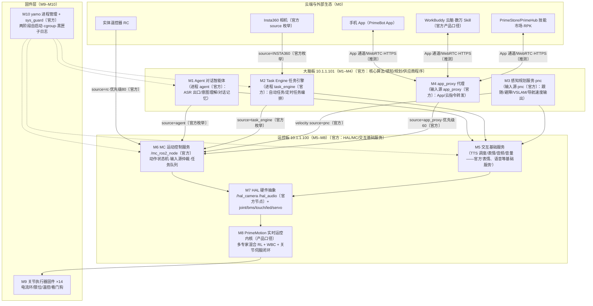
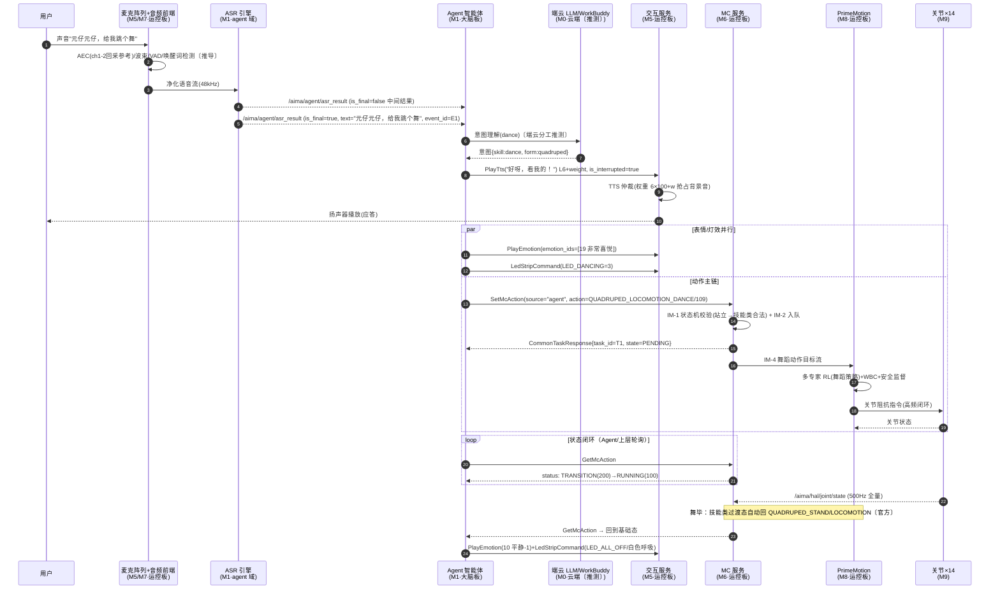
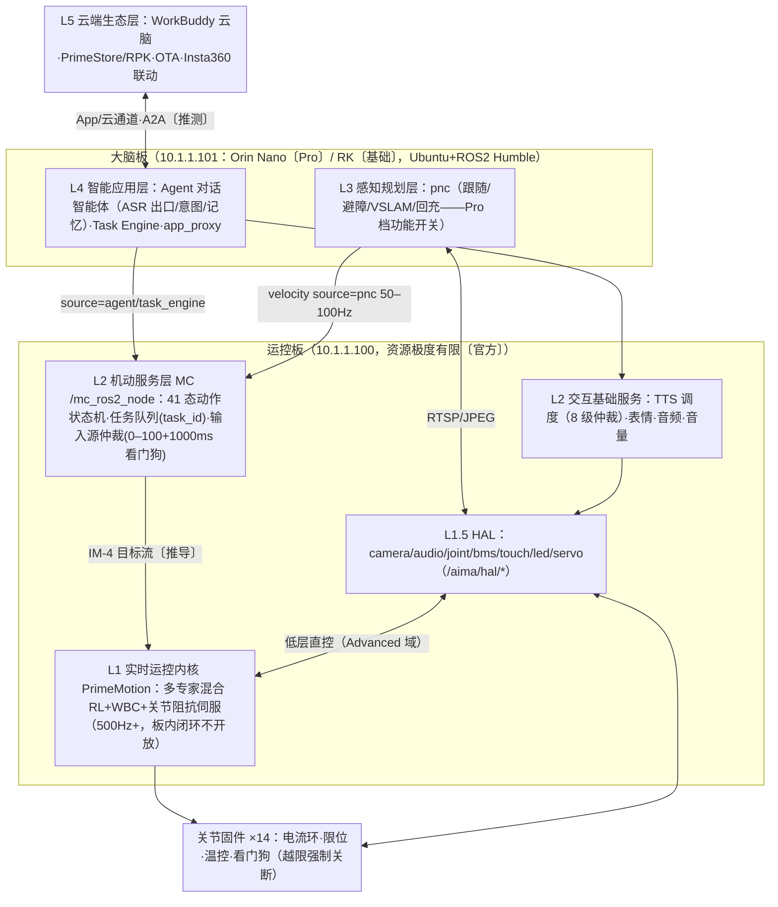

# 启元 T1 Pro 开发者文档与 SDK 深度分析：能力·接口·软件模块·端到端推导

| 文档信息 | |
|---|---|
| 版本 | v1.2 |
| 日期 | 2026-10-27 |
| v1.2 修订 | 第六/七/八章按内容相关度合并为第六章「我们的整体系统架构」：6.1 架构总图+一页纸速览；6.2 架构特征扩充至 10 条并加前五章互引；6.3 八大技术抓手（新增证据索引/壁垒所在/对我们的借鉴三列）；6.4 量化竞争力与短板（短板补"我们的应对设计"）；新增 6.5 我们的架构决策清单（采纳/改造/规避） |
| v1.1 修订 | 新增第五章「系统部署视图」：板卡清单与硬件架构（大脑板/运控板 SoC·核数·算力）、板内嵌入式控制单元、机外设备、各板进程部署与软件模块映射（yamo 进程表×板卡归属判定）、部署视角关键机制补充（网络带宽测算/FastDDS 与内核参数/存储目录与 yamo 接入/五层权限与安全/时间同步与可观测性/升级与多机/档位矩阵/部署选型与工具链/故障排查速查）；原第五/六/七章顺延为第六/七/八章 |
| 分析对象 | 启元 T1 / T1 Pro（官方 SDK 不区分型号，单一 T1 SDK 覆盖两档硬件；T1 Pro 差异在产品功能层，见 §1.6） |
| 主要信源 | 官方 SDK 仓库 atomgit.com/primebot/**t1-sdk**（2026-10-24 克隆）：《接口说明.md》14064 行、《PrimeBot_SDK快速入门与集成指南.md》1178 行、aimdk_msgs 消息源码（62 个 .msg/.srv）、examples（18 个场景例程 × C++/Python 双语言）；辅以 primebot.com 产品页与官方发布会口径（已经 [quadruped-software-architecture.md](quadruped-software-architecture.md) v1.2 逐条核验） |
| 证据标注 | 〔官方〕= SDK/官方文档明文；〔推导〕= 由官方证据链严格推出（证据随文标注）；〔推测〕= 基于技术体系的合理推断，无直接官方证据 |
| 关联文档 | [quadruped-software-architecture.md](quadruped-software-architecture.md)（业界调研与目标架构，v1.2）；[embodied-ai-analysis.md](embodied-ai-analysis.md)（公司与产品级分析） |

---

## 一、T1 Pro 提供的能力全景

### 1.1 能力分类总表

| 能力域 | 能力项 | 规模/规格 | 证据 |
|---|---|---|---|
| **运动-高层** | 运动模式（Action）状态机 | **41 个** McAction 枚举（急停 2 / 四足段 21 / 双足段 12 / 变形 4 / 上肢 1 / 起始 1），按合法拓扑切换 | 〔官方〕 |
| | 全身动作（Motion，神经网络驱动） | **20 个** MIMIC 动作（基于 .onnx 推理模型；四足跳舞×2、律动×2、说话×5、情感×N、双足滑冰 30s 等） | 〔官方〕 |
| | 预设动作（PresetMotion，关键帧轨迹） | **69 个**预设动画（挥手/比心/拍照/拥抱/思考/转圈/破冰舞蹈/全身跳舞…），另支持自定义 .csv 轨迹（120fps 固定采样率） | 〔官方〕 |
| | 连续速度控制 | 平移/侧移/转向/机身高度，50–100Hz 指令流 | 〔官方〕 |
| | 自定义上肢控制 | 双足形态上肢 6 关节 100Hz 连续目标流 | 〔官方〕 |
| **运动-低层** | 全身关节直控 | 14 关节（位置/速度/力矩 + stiffness/damping 阻抗），500–1000Hz，Ruckig 在线限幅，单帧步进 ≤0.2rad | 〔官方〕 |
| | 关节状态反馈 | 500Hz 全量上报（位置/速度/力矩/线圈温度/电机温度/电压） | 〔官方〕 |
| **交互-语音出** | TTS 语音合成 | 流式合成，**8 级优先级（L1–L10）+ 0–99 子权重**（最终权重=主级×100+子权），抢占/排队双模式仲裁 | 〔官方〕 |
| | 音频文件播放 | 本地文件 + PulseAudio media.role 四档（Alert/Notification/Communication/Music，自动 duck 压低音乐） | 〔官方〕 |
| | TCP 音频直连 | 播放 6001 端口（48kHz/mono/S16LE）、录音 4713 端口（**8 声道 48kHz**：ch1–2 回采 + ch3–8 麦克，ch5–6 主拾音） | 〔官方〕 |
| **交互-语音入** | 语音识别（ASR） | /aima/agent/asr_result 话题：中间/最终结果、置信度、event_id 上下文关联、语言标签 | 〔官方〕 |
| | 音量/静音管理 | 查询/设置音量（0–100，持久化）、物理功放级静音 | 〔官方〕 |
| **交互-视觉出** | 屏幕表情 | **23 种**内置表情（平静/喜悦/害怕/难过/聆听/思考/说话态…）+ mp4 视频播放（优先级+循环次数） | 〔官方〕 |
| **交互-灯效** | 灯带/颈灯 | **23 种**灯效模式（含变形指示、充电、低电量、故障）+ 自定义 RGB/周期（呼吸/闪烁） | 〔官方〕 |
| **交互-触觉** | 触摸感知 | 背部/胸部传感器，单击~六击 + 左右滑动共 10 种事件 | 〔官方〕 |
| **感知-视觉** | 头部双目相机 | head_stereo_left/right：单帧 JPEG 抓拍（~1fps）+ RTSP 连续流（rtsp://10.1.1.100:2554/live_*） | 〔官方〕 |
| | 变形舵机 | 位置 0–90°（0=四足位、90=双足位），速度 100–1000 步/s | 〔官方〕 |
| **硬件状态** | 电源管理 | BMS 全量数据：电压/电流/功率/温度/SOC/循环次数 + **29 个状态位**（充放电/过压/欠流/MOSFET/无线充电…） | 〔官方〕 |
| **系统** | 主动关机 | task engine 层 ShutdownTask 服务 | 〔官方〕 |
| | 进程自启动 | yamo 进程管理：开机自启动接入、两阶段启动（1500ms/8000ms）、cgroup 分组 | 〔官方〕 |

### 1.2 运动能力细节（SDK 全量口径）

**动作状态机（41 态）的拓扑要点**〔官方〕：

- 入口为 `PASSIVE_DEFAULT`（零力矩急停），可直达四足趴下/坐下/站立/恢复、双足恢复、阻尼急停；
- `DAMPING_DEFAULT`（阻尼急停）⇄ `PASSIVE_DEFAULT` 可互切；**任何状态可直达双急停**；
- 四足链：站立 → 基础运动（行走/奔跑/越障）→ 技能类（舞蹈/握手/骄傲/愉快/伸展/跳跃/后空翻/仿生）→ 变形（→双足）；
- 双足链：`BIPED_LOCOMOTION_WBC`（全身控制）为核心枢纽，⇄ 上肢自定义/动画模式，→ 基础运动（跑/越障/原地转/太空步）→ 技能 → 变形（→四足）；
- **技能/变形/恢复类为过渡态，执行完自动回基础态**（MIMIC 类经 SetMcMotion 自动从 `QUADRUPED_LOCOMOTION_DEFAULT`/`BIPED_LOCOMOTION_WBC` 切入并切回）；
- 非法拓扑切换被底层拦截；两次指令间隔 ≥500ms（否则 -10001）。

**关节清单（14 自由度 + 主动轮）**〔官方〕：

| 部位 | 关节 | 限位 (rad) | 峰值力矩 |
|---|---|---|---|
| 前左/前右腿（双足形态=手臂） | HIP_ROLL / HIP_PITCH / KNEE ×2 | roll ±0.47、pitch −1.22~4.36、knee ±2.62 | 60 N·m |
| 后左/后右腿 | HIP_ROLL / HIP_PITCH / KNEE ×2 | roll ±1.57、pitch 0~π、knee −2.62~−0.17 | 60 N·m |
| 后左/后右足端 | **FOOT（=主动轮，连续旋转）** ×2 | ±10.0（软件限位，注意线缆缠绕极限） | 60 N·m |

**自定义动作资产管线**〔官方〕：`.csv` 轨迹（固定 10 列：双臂肩 pitch/roll/yaw + 肘 ×2 + 腰 roll/yaw；120fps）→ 三种来源：App"手把手教学"示教录制（存 `/robot/userdata/sd/custom_motions/`）、"灵创"工具、Blender 导出 → SetMcPresetMotion(ani_path) 加载强驱。

### 1.3 产品级能力（官网口径，SDK 之外的面）

| 类别 | 能力 | T1 基础版 | T1 Pro |
|---|---|---|---|
| 基础 | 主动避障、身份识别（人脸+声纹）、前向跟随、语音交互/长期记忆、图形化编程、拖拽示教、多专家 RL 柔顺运控 | ✓ | ✓ |
| Pro 独占 | 360° 多传感融合避障、VSLAM 建图与自动回充、轨迹运镜/环绕/多机位拍摄、侧后向跟随、自动场景变形、语音召唤、跟随载物、后空翻（OTA）、USB 输出、蓝牙音箱、**深度二次开发** | ✗ | ✓ |
| 云端生态 | 腾讯云 WorkBuddy 云端大脑（数万 Skill）、PrimeStore 技能商店 / PrimeHub（skillhub.primebot.com）、PrimeFLOW 外观平台、RPK 技能包分发 | 共有 | 共有 |

〔官方产品页+发布会口径，经 v1.2 文档核验〕

### 1.4 开发体系能力（开发者视角的"元能力"）

| 项 | 内容 |
|---|---|
| 开发范式 | **ROS 2 Humble 原生**：SDK 即 aimdk_msgs 消息包 + 例程，无私有协议栈；`ros2 topic/service` 可直接调试 |
| 部署位置 | 开发 PC（10.1.1.99）/ 运控板 / 大脑板 三处等价部署，FastDDS 局域网透明互联 |
| 权限体系 | **五层**：运行模式（Standard/Develop）→ 开发方式（API 暂未支持 / ROS2）→ 开发层级（Basic 无损增强 / Advanced 深度接管）→ 领域设置 → 原子功能开关（当前仅 `domains.mc.low_level_dev` 低层运控） |
| 工具链 | Docker ×2（x86 交叉编译 ARM / x86 原生）、colcon、Ruckig 源码包（C++/Python nanobind）、OpenCV 4.13 源码包 |
| 运维通道 | SSH 密钥认证（两板密钥不同、售后发放）、/robot/software/ 模块部署、/robot/persist/{log,bag} 日志与数据包、yamo em doctor 状态检查 |
| 仿真 | 官方 t1-urdf（STL + MuJoCo XML + RViz/Gazebo launch）；技能链路 --dry-run/--sim（MockPrimeBot） |

---

## 二、T1 Pro 开发接口全景（官方 SDK 面）

### 2.1 接口总表（30 项）

| # | 模块 | 接口名称 | 类型 | 消息类型 | QoS / 频率 | 方向 |
|---|---|---|---|---|---|---|
| 1 | 运控高层 | `/aimdk_5Fmsgs/srv/GetMcAction` | Service | GetMcAction | Reliable | Robot→Outer |
| 2 | 运控高层 | `/aimdk_5Fmsgs/srv/SetMcAction` | Service | SetMcAction | Reliable | Outer→Robot |
| 3 | 运控高层 | `/aimdk_5Fmsgs/srv/SetMcMotion` | Service | SetMcMotion | Reliable | Outer→Robot |
| 4 | 运控高层 | `/aimdk_5Fmsgs/srv/SetMcPresetMotion` | Service | SetMcPresetMotion | Reliable | Outer→Robot |
| 5 | 运控高层 | `/aima/mc/locomotion/velocity` | Topic | McLocomotionVelocity | Reliable/Volatile/D10，50–100Hz | Outer→Robot |
| 6 | 运控高层 | `/aimdk_5Fmsgs/srv/SetMcInputSource` | Service | SetMcInputSource | Reliable | Outer→Robot |
| 7 | 运控高层 | `/aimdk_5Fmsgs/srv/GetCurrentInputSource` | Service | GetCurrentInputSource | Reliable | Robot→Outer |
| 8 | 运控高层 | `/aima/mc/custom/joint/command` | Topic | McCustomJointCommand | BestEffort/D10，100Hz | Outer→Robot |
| 9 | 运控低层 | `/aima/hal/joint/command` | Topic | JointCommandArray | BestEffort/D10，500–1000Hz | Outer→Robot |
| 10 | 运控低层 | `/aima/hal/joint/state` | Topic | JointStateArray | BestEffort/D10，500Hz | Robot→Outer |
| 11 | 交互 | `/aimdk_5Fmsgs/srv/PlayTts` | Service | PlayTts | Reliable | Outer→Robot |
| 12 | 交互 | `/aimdk_5Fmsgs/srv/GetVolume` / `SetVolume` | Service | Get/SetVolume | Reliable | 双向 |
| 13 | 交互 | `/aimdk_5Fmsgs/srv/GetMute` / `SetMute` | Service | Get/SetMute | Reliable | 双向 |
| 14 | 交互 | `/aimdk_5Fmsgs/srv/PlayAudioFile` | Service | PlayAudioFile | Reliable | Outer→Robot |
| 15 | 交互 | TCP `6001`（PulseAudio simple-protocol） | TCP 流 | 48kHz mono S16LE | 流式 100ms 分块 | Outer→Robot |
| 16 | 交互 | TCP `4713`（PulseAudio native-protocol） | TCP 流 | 48kHz **8ch** S16LE | 流式 | Robot→Outer |
| 17 | 交互 | `/aima/hal/audio/audio_device_list` | Topic | AudioDeviceInfoList | BestEffort，1Hz | Robot→Outer |
| 18 | 交互 | `/aima/agent/asr_result` | Topic | AsrResult | BestEffort/D10，事件驱动 | Robot→Outer |
| 19 | 交互 | `/aimdk_5Fmsgs/srv/PlayEmotion` | Service | PlayEmotion | Reliable | Outer→Robot |
| 20 | 系统 | `/aimdk_5Fmsgs/srv/ShutdownTask` | Service | ShutdownTask | Reliable | Outer→Robot |
| 21 | HAL | `/aima/hal/touch/state` | Topic | TouchState | Reliable/D1，触发式 | Robot→Outer |
| 22 | HAL | `/aima/hal/camera/CaptureJpegImage` | Service | CaptureJpegImage | Reliable，~1fps | Robot→Outer |
| 23 | HAL | `rtsp://<IP>:2554/live_<camera_id>` | RTSP | 视频流 | 连续流 | Robot→Outer |
| 24 | HAL | `/aimdk_5Fmsgs/srv/SetServo` | Service | SetServo | Reliable | Outer→Robot |
| 25 | HAL | `/aima/hal/bms/state` | Topic | Bms | BestEffort，1Hz | Robot→Outer |
| 26 | HAL | `/aimdk_5Fmsgs/srv/LedStripCommand` | Service | LedStripCommand | Reliable | Outer→Robot |
| 27 | HAL | `/aimdk_5Fmsgs/srv/SetNeckLight` | Service | SetNeckLight | Reliable | Outer→Robot |
| 28 | HAL | `/aima/hal/neck_light/state` | Topic | NeckLightState | Reliable/D1，触发式 | Robot→Outer |

> 注：服务名统一带 `/aimdk_5Fmsgs/srv/` 前缀（`aimdk_msgs` 的 ROS 命名空间转义）；话题统一 `/aima/` 前缀，按 `hal / mc / agent` 三级分域。

### 2.2 接口逐项定义（入参/出参）

#### 2.2.1 运动控制模块

**① GetMcAction 查询运动模式**〔官方〕
- 功能：查询当前运动/形态动作（Action）生命周期阶段。
- 入参：`request: CommonRequest`（含 `header: RequestHeader{stamp}`）。
- 出参：`header: ResponseHeader{stamp, code}`；`info: McActionInfo{current_action: McAction{value}, source: string, action_desc: string, status: McActionStatus{value: IDLE=0/RUNNING=100/TRANSITION=200}, switch_ready: bool}`。
- 要点：物理切换秒级耗时，须轮询至 `RUNNING` 再发后续指令；`value=0` 时以 `action_desc` 字符串兜底解析（内部保护动作可能不在公开枚举表）。

**② SetMcAction 设置运动模式**〔官方〕
- 功能：按状态机合法路径切换运动模式。
- 入参：`header: RequestHeader`；`source: string`（触发源，语义见 McTaskSource：sdk_rpc/agent/task_engine/app/cloud/rc…，**为空返回 -10002**）；`command: McActionCommand{action: McAction{value}, action_desc: string}`（双通道：数值优先、字符串按配置名回退）。
- 出参：`response: CommonTaskResponse{header{stamp,code}, task_id: uint64, state: CommonState{value, reason}}`。
- 业务码：`1` 成功；`-1001~-1007` 状态机类错误（无切换规则/目标未定义/姿态不具备/行为不支持/超时）；`-10001` 请求过频（<500ms）；`-10002` 触发源为空。

**③ SetMcMotion 设置全身动作（MIMIC）**〔官方〕
- 功能：播放神经网络（.onnx）推理的全身动作。
- 入参：`header`；`source`；`type: int32`（1=MIMIC_QY 自有模型 / 2=MIMIC_LC 灵创模型）；`motion: string`（内置动作名，如 QUAD_MIMIC_DANCE_TWO）；`model/resource: string`（外部路径，**当前版本服务端不解析**）；`interrupt: bool`；`operation: int32`（1=PRELOAD 预载 / 2=EXECUTION 执行）。
- 出参：`response: CommonTaskResponse`（非阻塞入队 + task_id）。
- 前置：先 SetMcAction 进入 `BIPED_STAND_DEFAULT`/`BIPED_LOCOMOTION_WBC` 等基础态并轮询确认 RUNNING。

**④ SetMcPresetMotion 预设动作控制**〔官方〕
- 功能：播放关键帧/预录关节轨迹（内置 69 个或外部 .csv）。
- 入参：`header`；`source`；`area: McControlArea{value: NONE=0/LEFT_HAND=1/RIGHT_HAND=2/HEAD=4/WAIST=8}`（位掩码，仅作上层标识，服务端不过滤）；`motion: McPresetMotion{value}`（69 枚举）；`interrupt: bool`（false 时若他动画播放中会被拦截，此时 `header.code=1` 而 state 仍为 RUNNING——须判 header.code）；`ani_path: string`（非空优先加载机上 .csv，120fps）。
- 出参：`response: CommonTaskResponse`。
- 前置：必须处于 `BIPED_LOCOMOTION_WBC`；**服务端不做稳态检查**，极端姿态下指令也会立即下发（安全时序由调用方负责）。

**⑤ /aima/mc/locomotion/velocity 走跑速度控制**〔官方〕
- 功能：水平平移 + 转向 + 机身高度的连续控制主干汇聚口（遥控器/App 摇杆/自主导航共用）。
- 入参（Payload）：`header: MessageHeader{stamp, frame_id, sequence, meas_stamp}`；`source: string`（**必须为已注册输入源**，严禁与内置 rc/pnc/interaction/vr/app_proxy/coreon_fusion 重名）；`forward_velocity / lateral_velocity: float64 (m/s)`；`angular_velocity: float64 (rad/s)`；`pitch_velocity: float64`（预留不生效）；`level: float64`（−1~1，WBC 下机身高度）。
- 出参：无（话题）。
- 仲裁：source 优先级抢占；单一信源 **1000ms** 断流自动脱锁顺延。

**⑥ SetMcInputSource 输入源管理**〔官方〕
- 功能：动态增删改/启停控制输入源并配置优先级。
- 入参：`request: CommonRequest`；`action: McInputAction{value: ADD=1001/MODIFY=1002/DELETE=1003/ENABLE=2001/DISABLE=2002}`；`input_source: McInputSource{name: string, priority: int32(0–100), timeout: int32(ms, 默认1000)}`（ADD/MODIFY 必填全三字段，DELETE/ENABLE/DISABLE 仅 name）。
- 出参：`response: CommonTaskResponse`。
- 仲裁三准则：高优先级绝对抢占 / 同级先入为主独占 / 超时脱锁按序顺延。
- ⚠️ 修改仅存 RAM，**重启丢失**（不回刷 YAML）。
- 优先级参考带：100–80 系统级（E-Stop/安全保护）＞79–60 高级（RC/App 手动）＞59–40 中级（语音/手势）＞39–20 低级（**SDK 二开**/PNC）＞19–0 备用。内置源实测值：`rc=80, pnc=80, interaction=80, vr=70, app_proxy=60`。

**⑦ GetCurrentInputSource 查询当前输入源**〔官方〕
- 入参：`request: CommonRequest`。出参：`response: CommonTaskResponse`；`input_source: McInputSource`（当前持有"指挥锁"的唯一控制源；name 频繁切换=控制权抖动；空串=开机未受控）。

**⑧ /aima/mc/custom/joint/command 自定义上肢关节**〔官方〕
- 功能：双足形态上肢 6 关节连续目标流。
- 入参（Payload）：`header: MessageHeader`；`joints: JointCommand[]{name, position, velocity, effort, stiffness, damping}`（仅上肢 6 关节，建议每帧全量填写，未填按 0 处理有关节突变风险）。
- 出参：无。前置：`BIPED_CUSTOM_UPPER` 态 + RUNNING 确认。

**⑨ /aima/hal/joint/command 低层关节控制**〔官方〕
- 功能：全身 14 关节电机伺服直控（**需 Advanced 模式 + domains.mc.low_level_dev + 关闭高层运控**）。
- 入参（Payload）：`header: MessageHeader`（stamp 必须机载时钟单调递增，乱序/重复即被总线驱动丢弃）；`joints: JointCommand[]{name(逻辑寻址唯一键，错拼静默丢弃), position(rad), velocity(rad/s), effort(N·m), stiffness(K_p), damping(K_d)}`。
- 出参：无。
- 安全约束：单帧位置增量 **≤0.2rad**；频率 500–1000Hz（<100Hz 触发硬件看门狗啸叫）；退出前必发全量 `stiffness:0, damping:5` 软关机帧。

**⑩ /aima/hal/joint/state 关节状态反馈**〔官方〕
- 出参（Payload）：`header`；`joints: JointState[]{name, position, velocity, effort, coil_temp(℃), motor_temp(℃), motor_vol(V)}`，500Hz 全量上报（二开模式下实际频率低于 1000Hz，勿以其为同步前提）。

#### 2.2.2 交互控制模块

**⑪ PlayTts 语音合成**〔官方〕
- 入参：`header: CommonRequest`；`tts_req: PlayTtsRequest{text(≤100字), priority_level: TtsPriorityLevel{value: L1=1背景/L2=2服务/L4=4任务/L6=6交互默认/L7=7系统/L8=8预警/L10=10生命安全}, priority_weight: uint32(0–99), domain: string(业务域隔离与审计), trace_id: string(全局追踪), is_interrupted: bool(抢占/排队)}`。
- 出参：`header: CommonResponse`；`tts_resp: PlayTtsResponse{text, priority_level, priority_weight, domain, trace_id, is_success, error_message, estimated_duration(流式合成固定返回0)}`。
- 仲裁：最终权重 = 主级×100 + 子权；新任务权重≥当前且抢占模式→立即掐断；权重<当前→请求丢弃（is_success=false）。无播报完成事件（需按 ~200ms/字估时）。

**⑫–⑬ Get/SetVolume、Get/SetMute**〔官方〕
- SetVolume 入参：`request` + `audio_volume: uint32(0–100，越界自动截断)`；出参回读实际值。持久化，冷启动恢复。
- SetMute 入参：`is_mute: bool`（true=物理功放关断，全局瞬时静默，不影响麦克风/ASR）；音量与静音两态独立。持久化。

**⑭ PlayAudioFile 音频文件播放**〔官方〕
- 入参：`request`；`file: AudioFile{pkg_name, file_name, file_path(绝对路径,建议≤1MB), info: AudioInfo{channels, sample_rate, size, sample_format, coding_format}(PCM必填/WAV自动解析), priority: uint32(1–10), priority_weight, media_role: string(Alert=100/Notification=80/Communication=60/Music=40,非Music自动duck压低音乐)}`。
- 出参：`response: CommonResponse`。

**⑮ TCP 6001 音频播放**〔官方〕：48kHz/mono/S16LE 流式；WAV 自动检测 RIFF 头、混音、重采样；100ms 分块 + 定时补偿。

**⑯ TCP 4713 音频录制**〔官方〕：8ch/48kHz/S16LE 原始流（ch1–2 回采=扬声器回声参考，ch3–8 六麦阵列，**ch5–6 为主拾音通道**）；不内置 VAD/ASR。

**⑰ /aima/hal/audio/audio_device_list**〔官方〕：`input_list/output_list: AudioDeviceInfo[]{id(动态分配勿作持久标识), device_addr(builtin_mic/builtin_speaker), device_type(builtin/bluetooth), device_name, is_sel}`，1Hz。

**⑱ /aima/agent/asr_result 语音识别结果**〔官方〕
- 出参（Payload）：`header`；`text: string`；`event_id: string`（对话上下文关联）；`is_final: bool`（false=中间结果）；`confidence: float32 [0,1]`；`language: string`。

**⑲ PlayEmotion 表情与视频**〔官方〕
- 入参：`header`；`type: string("emotion"/"file"，必填)`；`emotion_ids: int32[]`（23 内置表情）；`file_paths: string[]`（仅 mp4、绝对路径）；`priority: int32`（高打断低）；`loop_count: int32`（≤0 无限循环）。
- 出参：`header: CommonResponse`。

**⑳ ShutdownTask 主动关机**〔官方〕
- 入参：`header`；`token: TokenCommon{source(必填,空则拒), token}`。出参：`header`。
- ⚠️ 立即执行不判断当前状态（行走中直接断电），调用方须先引导至安全姿态。

#### 2.2.3 硬件抽象模块

**㉑ /aima/hal/touch/state**〔官方〕：`sensor_id(1=背部,2=胸部)`；`event_type(0–9：无/单击~六击/多击/左滑/右滑)`，触发式上报。

**㉒ CaptureJpegImage 单帧抓拍**〔官方〕：入参 `request + camera_id: string("head_stereo_left/right") + timeout_ms: uint32(0=默认1000ms)`；出参 `jpeg: JpegImage{camera_id, device, width, height, framerate, exposure, gain, image: sensor_msgs/CompressedImage}`；全链路 100–500ms，建议 ≤1fps。

**㉓ RTSP 视频流**〔官方〕：`rtsp://10.1.1.100:2554/live_head_stereo_{left,right}`；双足形态左目画面物理倒置，应用层须按形态（GetMcAction 查询）自行 180° 翻转。

**㉔ SetServo 变形舵机**〔官方〕：入参 `request + position: uint8(0–90°，0=四足位/90=双足位) + speed: uint16(100–1000 步/s，1步=0.225°)`。

**㉕ /aima/hal/bms/state**〔官方〕：版本信息 ×5 + `power_request` + `status: uint32`（29 位定义：充放电/过流/短路/过压/欠压/MOSFET 禁充禁放/温度/无线充电接入/关机触发…）+ 电压 mV/电流 mA(充电正)/功率 mW/温度/剩余容量 mAh/SOC%/循环次数/累计容量，1Hz。

**㉖ LedStripCommand 灯带**〔官方〕：入参 `request + led_strip_mode: uint8(0–20 预定义 + 254 呼吸自定义 + 255 闪烁自定义, 非法值静默忽略) + r/g/b: uint8 + period: uint16(ms, 0=常亮)`。

**㉗–㉘ SetNeckLight / neck_light/state 颈灯**〔官方〕：`enable: bool`（当前硬件仅支持开关，brightness 预留）。

### 2.3 接口横切设计模式（官方口径提炼）

1. **统一响应模型**：`ResponseHeader.code`（框架层 0/1）→ `CommonState.value`（业务层 11 态）→ `reason`（30 项故障原因枚举）→ `message`（诊断文本），四级判别。
2. **全链路 source 溯源**：运控类接口必填 source（McTaskSource 9 枚举），TTS 带 domain/trace_id——为审计与仲裁提供统一身份。
3. **异步任务化**：动作类接口返回 task_id 入队而非阻塞（PENDING→CREATED→RUNNING 状态机），长任务由调用方轮询。
4. **双仲裁器**：运动控制走输入源优先级仲裁（0–100 + 1000ms 看门狗）；语音播报走 TTS 权重仲裁（主级×100+子权）。
5. **安全护栏内嵌**：状态机合法路径 + 500ms 防抖 + 白名单/黑名单 + 单帧 0.2rad 限幅 + Ruckig 在线限幅 + 硬件看门狗 + 软关机帧约定。
6. **QoS 分级**：控制流 Reliable、传感流 Best Effort+Volatile+Depth10、事件流 Reliable+Depth1。

---

## 三、端到端软件模块推导

### 3.1 推导方法论

SDK 不是随意编排的接口清单，其**命名空间、节点名、进程名、source 枚举**本身就是系统模块边界的"化石记录"。推导证据链：

| 证据 | 来源 | 指向的模块 |
|---|---|---|
| 话题前缀 `/aima/hal/*`、`/aima/mc/*`、`/aima/agent/*` | 〔官方〕接口说明 | HAL / MC / Agent 三大服务域 |
| 节点名 `/hal_camera`、`/hal_audio`、`/mc_ros2_node` | 〔官方〕快速入门 §2.1.4 | HAL 下分相机/音频子节点，MC 单节点 |
| yamo 进程表：`sys_guard`、`mc`、`agent`、`task_engine`、`app_proxy`、`abox`、`node_control_worker`、`process_manager` | 〔官方〕快速入门 §4 | 板载常驻进程清单 |
| McTaskSource 枚举 APP/CLOUD/RC/SDK_RPC/**AGENT**/**TASK_ENGINE**/MC_INTERNAL/**INSTA360** | 〔官方〕McTaskSource.msg | 任务来源侧的模块全景（含云端与外部相机） |
| 内置输入源 `rc/pnc/interaction/vr/app_proxy/coreon_fusion` | 〔官方〕接口说明 §2.1.1.4 | 速度控制流的外部来源模块 |
| `ShutdownTask` srv 注释"task engine 层" | 〔官方〕 | Task Engine 为独立服务层 |
| "运控板负责 HAL、MC 及各类基础交互服务（表情、语音等）；大脑板负责核心 AI 算法、感知、规划及供应商程序" | 〔官方〕快速入门 §1 | 模块→物理板卡的部署映射 |
| ASR 结果挂在 `/aima/agent/` 域 | 〔官方〕 | ASR 归属 Agent 域（大脑板侧或其托管服务） |
| RTSP 端口在 10.1.1.100（运控板） | 〔官方〕接口说明 | 相机驱动与流媒体服务在运控板 |
| TCP 音频走运控板 PulseAudio | 〔官方〕 | 音频子系统在运控板 |

### 3.2 软件模块清单与部署映射



### 3.3 各模块接口清单（提供 × 调用）

> 说明：〔官方〕接口的完整入参/出参见第二章；本节对**推导出的内部接口**给出完整定义。内部接口名以 `IA-xx`（Internal Agent）、`IM-xx`（Internal MC）等编号，名称为本文拟名。

#### M0 云端与外部生态

| 提供（对外系统的接口） | 调用 |
|---|---|
| App 控制通道（遥控摇杆→app_proxy；开发者模式切换配置〔官方快速入门〕）；WorkBuddy Skill 调用（A2A，协议未公开〔推测：HTTPS/WS〕）；技能市场 RPK 分发下载；Insta360 联动触发（source=INSTA360〔官方〕）；RC 遥控指令流（source=rc，优先级 80〔官方〕） | — （外部系统） |

#### M1 Agent 对话智能体（大脑板，进程 agent〔官方〕）

**提供：**

| 接口 | 功能 | 入参 | 出参 | 证据 |
|---|---|---|---|---|
| `/aima/agent/asr_result`（Topic） | 发布 ASR 识别结果（中间+最终） | — | AsrResult{text, event_id, is_final, confidence, language} | 〔官方〕 |
| IA-1 意图理解（内部服务） | 文本→任务意图+槽位（如"跳舞"→ dance 技能 + 形态条件） | text, event_id, 上下文记忆 | 意图对象{skill, params, confidence} | 〔推导：asr_result 挂 agent 域 + McTaskSource.AGENT 枚举存在〕 |
| IA-2 对话应答生成（内部） | 生成口语应答文本（端云 LLM，WorkBuddy 接入〔官方产品报道〕） | 意图对象+对话历史 | 应答文本+动作计划 | 〔推导〕 |

**调用：**

| 被调接口 | 用途 |
|---|---|
| M5-PlayTts（source 侧 domain="agent"，L6 级） | 播报应答 |
| M5-PlayEmotion（270 说话态/18-19 喜悦等） | 表情联动 |
| M6-SetMcAction / SetMcMotion / SetMcPresetMotion（source="agent"） | 下发动作任务 |
| M6-GetMcAction | 查形态/状态决定动作选型（如跳舞动作按形态分流） |
| 云端 LLM/WorkBuddy API〔推测〕 | 复杂意图与 Skill 扩展 |

#### M2 Task Engine 任务引擎（大脑板，进程 task_engine〔官方〕）

**提供：**

| 接口 | 功能 | 入参 | 出参 | 证据 |
|---|---|---|---|---|
| `/aimdk_5Fmsgs/srv/ShutdownTask` | 主动关机（task engine 层实现） | TokenCommon{source≠空} | CommonResponse | 〔官方〕 |
| IT-1 任务编排（内部） | 定时/自动/复合任务（闹钟、清扫、拍摄脚本）拆解为动作序列 | 任务描述 | 动作序列+时序约束 | 〔推导：McTaskSource.TASK_ENGINE=6 存在 + TTS 优先级表"定时任务通知 SERVICE_L2""运控任务关键节点 MISSION_L4"暗示任务引擎为 TTS 的调用域〕 |

**调用：** M6 全部运控服务（source="task_engine"）；M5-PlayTts（L2/L4 级）；M1 的任务结果回传〔推导〕。

#### M3 感知规划服务 pnc（大脑板）

**提供：**

| 接口 | 功能 | 入参 | 出参 | 证据 |
|---|---|---|---|---|
| IP-1 速度指令输出 | 以 source="pnc"（优先级 80〔官方〕）发布 /aima/mc/locomotion/velocity | 感知目标（人/路径/充电桩） | McLocomotionVelocity 50–100Hz | 〔官方〕 |
| IP-2 跟随/避障/回充任务接口（内部） | App 下发的自主任务入口 | 任务目标 | 任务状态 | 〔推导：Pro 独占功能表 + pnc 输入源存在〕 |

**调用：** RTSP 视频流（hal 相机，运控板 2554）；CaptureJpegImage；M6-SetMcAction（进入行走模式）；M6-SetMcInputSource（注册 pnc 源）；M5-PlayTts（任务播报）。〔推导〕

#### M4 app_proxy 代理服务（大脑板）

**提供：** App/云 → 机器人全量 SDK 服务的代理转发（source="app_proxy"，优先级 60〔官方〕）；开发者模式配置下发（标准/开发、Basic/Advanced、领域开关〔官方快速入门〕）。
**调用：** M6/M5 全量服务；M10 配置接口。〔推导〕

#### M5 交互基础服务（运控板，"表情、语音等基础服务"〔官方〕）

**提供（全部〔官方〕，详见 §2.2）：** PlayTts、PlayEmotion、Get/SetVolume、Get/SetMute、PlayAudioFile、audio_device_list；TCP 6001/4713（PulseAudio 通道）；（ASR 结果由 Agent 域发布，音频采集硬件与通道由本模块的 hal_audio 提供）。

**内部推导接口：**

| 接口 | 功能 | 入参 | 出参 | 证据 |
|---|---|---|---|---|
| IS-1 TTS 合成引擎调用 | 文本→音频流（云端/本地流式合成——官方"无网络时无法播放未缓存新文本"→云端合成〔官方推导〕） | text, voice 配置 | 音频流 48kHz | 〔官方+推导〕 |
| IS-2 播报队列仲裁器 | 权重=主级×100+子权 排序/抢占/duck | PlayTtsRequest | 播放顺序决策 | 〔官方仲裁矩阵反推〕 |
| IS-3 音频前端（AEC/VAD/唤醒，归属 Agent 域或本模块〔推测〕） | 8ch 采集→回声消除（ch1-2 回采参考）→波束/降噪→VAD→唤醒词"元仔"〔官方昵称，唤醒引擎未文档化〕 | 8ch PCM 流 | 唤醒事件+净化语音流 | 〔推导：8ch 含 2 回采通道的官方硬件事实〕 |

**调用：** M7-hal_audio（PulseAudio 录放）；屏幕/灯效 HAL 驱动；云端 TTS/ASR 服务〔推导〕。

#### M6 MC 运动控制服务（运控板，节点 /mc_ros2_node〔官方〕）

**提供（全部〔官方〕，详见 §2.2）：** GetMcAction、SetMcAction、SetMcMotion、SetMcPresetMotion、SetMcInputSource、GetCurrentInputSource、/aima/mc/locomotion/velocity、/aima/mc/custom/joint/command。

**内部推导接口（服务端内部机制，官方行为证据反推）：**

| 接口 | 功能 | 入参 | 出参 | 证据 |
|---|---|---|---|---|
| IM-1 动作状态机 | 校验切换合法性/白名单/防抖，非法拦截 | 当前态+目标 action | 合法路径或拒绝码(-1001~-1006/-10001) | 〔官方错误码+状态机图〕 |
| IM-2 任务队列管理器 | 动作任务化生命周期 PENDING→CREATED→RUNNING | 指令 | task_id+状态流转 | 〔官方 CommonState 异步语义〕 |
| IM-3 输入源仲裁器 | 五档优先级锁+1000ms 看门狗脱锁+同级先入为主 | velocity 流(source) | 当前生效源+拦截决策 | 〔官方三准则〕 |
| IM-4 关节目标流下发（MC→PrimeMotion） | 将 Action/Motion/速度解算为目标关节流交实时内核 | 模式+参数+状态 | 执行状态回调 | 〔推导：SDK 不开放 MC-内核边界，行为由 GetMcAction 语义证实〕 |

**调用：** M7-/aima/hal/joint/command 形态（低层开发者模式下让位）；M8 PrimeMotion 内核；/aima/hal/bms/state（低电量拦截 REASON_LOW_BATTERY〔官方 reason 枚举〕）；M3 的障碍信号（REASON_OBSTACLE_*〔官方〕）。

#### M7 HAL 硬件抽象（运控板）

**提供（全部〔官方〕）：** /aima/hal/joint/command、joint/state、bms/state、touch/state、neck_light/state、audio_device_list；CaptureJpegImage；RTSP 流（2554）；SetServo；LedStripCommand；SetNeckLight；TCP 音频底层。

**调用：** M8 关节总线（高级开发模式下 hal/joint/command 直通内核）；各硬件驱动（相机 V4L2、音频 ALSA/PulseAudio、BMS 串口、LED、触摸、舵机——实现〔推测〕）。

#### M8 PrimeMotion 实时运控内核（运控板，产品口径"多专家混合 RL"）

**提供（对 M6/M7 内部）：** 关节阻抗伺服闭环通道（stiffness/damping 语义〔官方〕）；平衡/步态/全身控制执行；安全兜底（姿态超限、超时阻尼、跌倒保护、低电量自动变形〔产品口径〕）。
**调用：** M9 关节固件总线（CAN-FD/EtherCAT〔推测，未公开〕）。
**SDK 证据**：低层接口的 impedance 参数、0.2rad 步进限制、<100Hz 硬件看门狗、软关机帧——全部是"内核在闭环、SDK 只是喂目标"的间接官方证据。

#### M9 关节执行器固件 ×14

**提供：** 电流环（kHz 级）、限位/限速/温控、本地看门狗；越限强制关断（官方"超出软件限位触发底层固件拦截"）。
**调用：** 无（最底层）。

#### M10 yamo 进程管理 + sys_guard（双板）

**提供（〔官方〕快速入门 §4）：** 进程生命周期（yamo em doctor/start-app/stop-app）；两阶段自启动（stage1: sys_guard/mc… 1500ms → stage2: app_proxy…abox 8000ms）；cgroup 资源分组；日志规范（/robot/persist/log）。
**调用：** cgroup、systemd 类机制〔推测〕。

### 3.4 模块调用关系矩阵（行=调用方，列=被调方提供的能力）

| 调用方 ↓ \ 提供方 → | M1 Agent | M2 TaskEngine | M3 pnc | M5 交互 | M6 MC | M7 HAL | 云端 M0 |
|---|---|---|---|---|---|---|---|
| M0 App/云/RC/Insta | — | 触发任务 | 下发自主任务 | （经代理）音量/播报 | （app_proxy/rc 直连）速度/动作 | — | — |
| M1 Agent | — | 委派复合任务〔推导〕 | 感知查询〔推导〕 | **PlayTts/PlayEmotion** | **SetMcAction/Motion/PresetMotion(source=agent)** | GetMcAction 间接 | LLM/WorkBuddy〔推测〕 |
| M2 TaskEngine | 结果回传 | — | — | PlayTts(L2/L4) | **全量运控(source=task_engine)** | — | — |
| M3 pnc | — | — | — | PlayTts | **velocity(source=pnc)+SetMcAction+SetMcInputSource** | **RTSP/CaptureJpegImage** | 地图/云〔推测〕 |
| M5 交互 | ASR 结果→发布 | — | — | — | — | **hal_audio/屏幕/灯效驱动** | 云端 TTS/ASR〔推导〕 |
| M6 MC | — | — | 障碍信号〔推导〕 | 状态广播 | — | **joint 通道+bms 订阅** | — |
| M7 HAL | — | — | — | — | — | — | — |
| 开发者程序（SDK 用户） | 订阅 asr_result | ShutdownTask | — | 全部交互服务 | **全部 8 个运控接口(source=sdk_rpc，优先级带 39–20)** | 全部 HAL 话题/服务 | — |

---

## 四、演示 Case："元仔元仔，给我跳个舞"端到端剖析

### 4.1 场景设定

- 机器人处于**四足站立待机**（QUADRUPED_STAND_DEFAULT，用户刚回家未唤醒），电量充足，室内无障碍；
- 用户说出唤醒词+指令："**元仔元仔，给我跳个舞**"（"元仔"为 T1 官方昵称/唤醒名〔官方 B 站口径〕）；
- 期望行为：应答一句 → 播放喜悦表情 → 灯带律动 → 四足舞蹈 → 舞毕自动回到站立；
- 对照分支：若当前是**双足形态**，舞蹈走 SetMcPresetMotion 链路（4.3-G'）。

### 4.2 端到端时序图



### 4.3 分阶段分解（数据实例）

**A. 拾音与唤醒**（M7-hal_audio → M5 音频前端）
- 硬件：8ch 48kHz S16LE，ch1–2 回采（扬声器参考，AEC 用）、ch3–8 六麦，ch5–6 主拾音〔官方〕；
- 唤醒词"元仔"检测引擎未在 SDK 文档化〔推测：端侧唤醒，消费级产品标配〕；
- 数据流 D1：`8ch PCM (1.536 MB/s)` 板内 PulseAudio 通道。

**B. 语音识别**（ASR → /aima/agent/asr_result〔官方〕）
- 流式输出中间结果（is_final=false）+ 最终结果；
- 数据流 D2：`AsrResult{text:"元仔元仔，给我跳个舞", event_id:"E1", is_final:true, confidence:0.9x, language:"zh"}`。

**C. 意图理解与编排**（M1 Agent，McTaskSource.AGENT=5〔官方枚举〕）
- 唤醒段（"元仔元仔"）确立交互会话 → 指令段解析为 `{skill: dance}`；
- 形态感知：Agent 经 GetMcAction 得知 `current_action=QUADRUPED_STAND_DEFAULT` → 选四足舞蹈路径；
- 数据流 D3（内部）：意图对象 + 对话上下文（长期记忆〔产品口径〕）。

**D. 应答生成（并行支线 1）**（M5 PlayTts〔官方〕）
- 控制流 C6：TTS 仲裁——应答用 `INTERACTION_L6(6)` + weight，`is_interrupted=true` 抢占可能存在的背景播报（权重 6×100+w > 2×100）；
- 数据流 D8a：`PlayTtsRequest{text:"好呀，看我的！", priority_level:{value:6}, domain:"agent", trace_id:"tr-xxx"}` → 流式合成（~200ms/字〔官方建议值〕）→ 48kHz 音频流 → 功放。

**E. 表情与灯效（并行支线 2）**〔官方〕
- D8b：`PlayEmotion{type:"emotion", emotion_ids:[19], loop_count:1, priority:1}`；
- D8c：`LedStripCommand{led_strip_mode:3(LED_DANCING 律动)}`；
- 舞毕收尾：`PlayEmotion{emotion_ids:[10 平静]}` + 灯效复位。

**F. 动作决策与下发（主链）**
- 四足路径：`SetMcAction{header, source:"agent", command:{action:{value:109}}}`（QUADRUPED_LOCOMOTION_DANCE）；
- 备选：`SetMcMotion{source:"agent", type:1(MIMIC_QY), motion:"QUAD_MIMIC_DANCE_TWO", operation:2}`——MIMIC 类由系统自动从基础态切入/切回〔官方〕；
- 控制流 C2：source="agent" 的指令在输入源仲裁中的档位——若舞蹈同时有速度流则受仲裁约束；离散 Action 主要受状态机约束（C3）。

**G. 状态机校验与任务化**（M6 IM-1/IM-2）
- C3：`站立(101) → 技能类(109)` 属状态机合法路径（QBASE→QSKILL〔官方图〕）；白名单校验（REASON_NO_WHITELIST=7 拦截未授权动作）；500ms 防抖（-10001）；
- D5：`CommonTaskResponse{code:0, task_id:T1, state:{value:200 PENDING}}`；
- 失败分支举例：电量低 → `reason=5 REASON_LOW_BATTERY`；正在充电 → `reason=6`。

**G'. 双足形态对照路径**〔官方〕
- 前置：`SetMcAction(BIPED_LOCOMOTION_WBC=300)` 并轮询 GetMcAction 至 RUNNING；
- 下发：`SetMcPresetMotion{source:"agent", area:{value:11(左手|右手)}, motion:{value:2021 DANCE_MOVE 或 3061 FULL_BODY_DANCE_2}, interrupt:true}`；
- 服务端无稳态检查、area 不过滤——安全时序由 Agent 保证〔官方警示〕。

**H. 实时执行**（M6→M8→M9，板内闭环）
- IM-4：舞蹈目标流（离线编排/RL 策略输出〔产品口径多专家 RL〕）；
- M8：500Hz+ 阻抗闭环、Ruckig 限幅、姿态安全监督；
- D6（板内）：关节目标/力矩流；C5：安全监督（跌倒→QUADRUPED_RECOVERY 路径存在〔官方〕）。

**I. 状态回流与收尾**
- D7：`/aima/hal/joint/state` 500Hz 全量（上层监控/记忆，不进控制环）；
- C7：技能过渡态结束自动回 `QUADRUPED_STAND_DEFAULT`（或 LOCOMOTION_DEFAULT）〔官方虚线路径〕；
- Agent 轮询 GetMcAction 确认回位 → 对话记忆写入（"刚刚给主人跳了舞"〔产品口径长期记忆〕）。

### 4.4 数据流与控制流清单

| 编号 | 流 | 内容 | 生产者→消费者 | 经由接口 |
|---|---|---|---|---|
| D1 | 原始音频 | 8ch 48kHz PCM | 麦克阵列→音频前端 | 板内 PulseAudio〔官方通道〕 |
| D2 | ASR 文本 | AsrResult | ASR→Agent/上层 | /aima/agent/asr_result |
| D3 | 意图/任务 | 意图对象 | Agent→TaskEngine/MC | IA-1/IA-2〔推导〕 |
| D4 | 动作指令 | SetMcAction/Motion/Preset 请求 | Agent→MC | §2.2 各服务 |
| D5 | 任务回执 | task_id+state | MC→Agent | CommonTaskResponse |
| D6 | 关节目标流 | 位置/速度/力矩/阻抗 | MC→PrimeMotion→关节 | IM-4〔推导〕+板内总线 |
| D7 | 状态回流 | JointStateArray 500Hz | 关节→HAL→上层 | /aima/hal/joint/state + GetMcAction |
| D8 | 表达输出 | TTS 音频/表情/灯效 | 交互服务→功放/屏/灯 | PlayTts/PlayEmotion/LedStripCommand |

| 编号 | 控制流 | 机制 | 证据 |
|---|---|---|---|
| C1 | 唤醒门控 | 唤醒词开 ASR 会话（event_id 关联） | 〔推导+官方 event_id〕 |
| C2 | 输入源仲裁 | 五档优先级+1000ms 看门狗+先入为主 | 〔官方〕 |
| C3 | 状态机校验 | 合法拓扑+白/黑名单+500ms 防抖+形态匹配 | 〔官方错误码〕 |
| C4 | 任务生命周期 | task_id 异步：PENDING→CREATED→RUNNING | 〔官方 CommonState〕 |
| C5 | 安全监督 | 30 项 reason 拦截+急停直达+超时阻尼+限幅 | 〔官方〕 |
| C6 | TTS 优先级仲裁 | 权重=级×100+子权，抢占/排队矩阵 | 〔官方〕 |
| C7 | 自动回位 | 技能/变形/恢复态自动回基础态 | 〔官方状态机〕 |

### 4.5 时延预算（数量级估算）

| 阶段 | 估计 | 依据 |
|---|---|---|
| 唤醒确认 | <500ms | 〔推测〕消费级标配 |
| ASR 最终结果 | 300–800ms | 流式中间结果机制〔官方〕+〔推测〕 |
| 意图理解 | 200ms–1s | 端云 LLM 分工〔推测〕；简单指令可端侧命中 |
| TTS 首包 | ~200–500ms | 官方"流式合成、200ms/字"反推 |
| 动作指令受理 | <100ms（入队即回） | 官方非阻塞语义 |
| 姿态过渡（TRANSITION） | 数秒 | 官方明示"机械过渡可能长达数秒" |
| 舞蹈执行 | 10–30s | 动作库时长量级（滑冰 30s〔官方〕） |
| **端到端（说完→开始舞动）** | **≈1–3s** | 综合估算〔推测〕 |

### 4.6 异常分支（安全设计如何介入）

| 异常 | 系统行为 | 证据 |
|---|---|---|
| 电量 < 阈值 | SetMcAction 被拒 `reason=5 REASON_LOW_BATTERY`；产品级低电自动切四足防摔 | 〔官方 reason 枚举+产品口径〕 |
| 正在充电 | 拒绝 `reason=6 REASON_CHARGE` | 〔官方〕 |
| 双足指令发到四足形态 | 拒绝 `reason=19 REASON_FORM_MIS_MATCH` / `-1004 姿态不具备` | 〔官方〕 |
| 舞蹈中再次喊"停" | ASR→Agent 打断：新 SetMcAction 抢占（技能态可切出）或急停 `PASSIVE_DEFAULT`（任何态直达） | 〔官方状态机〕 |
| 语音链路掉线 | 舞蹈为已入队任务继续执行完并自动回位（任务不依赖持续指令流；速度流才有 1000ms 脱锁） | 〔官方语义〕 |
| 舞蹈中被抱起/倾倒 | 力控柔顺+倾倒保护（被拎起即停）；倒地后 `QUADRUPED_RECOVERY` 可恢复 | 〔产品口径+官方 Action〕 |
| 上层进程崩溃 | PrimeMotion 板内闭环继续保平衡；任务流断则安全停止 | 〔官方"内核闭环"证据链〕 |

### 4.7 本 Case 之外值得梳理的关键信息（回应"还有什么要梳理"）

1. **安全链全景**：SDK 只暴露了 reason 枚举与急停态；E-Stop 硬件通道、bms power_request（长按关机位）、看门狗分层（1000ms 软/100Hz 硬）如何串联成纵贯链，值得实机验证。
2. **形态感知的权威来源**：SetServo 的 0–90° 是变形舵机角度，GetMcAction 是逻辑形态；双目左目画面随形态倒置说明相机外参与形态强相关——形态应是一等系统状态（影响感知标定/动作合法性/状态估计）〔官方证据综合〕。
3. **QoS 与带宽治理**：运控板资源"极度有限"〔官方原话〕；高频大包（joint/state 500Hz、RTSP）与控制流共享 20M UDP 缓冲的隔离策略（SHM 默认关闭）值得压测。
4. **时间同步**：header.stamp 单调性由总线驱动强制〔官方〕，但跨板（大脑/运控）时钟源与 meas_stamp 语义未文档化——多传感融合与日志对账的前提。
5. **已知接口缺口清单**〔官方技能 README 自述+本文核验〕：无 SLAM/导航接口、无夹爪、无 ASR 开放输入接口（只读结果不能注入）、无力传感接口、无双目深度/ToF 数据接口（仅 RGB JPEG/RTSP）、TTS 无播报完成事件、SetMcInputSource 不持久化、SetMcMotion 外部 model/resource 字段未实现——这些缺口恰是 T1 Pro 后续版本与竞品对比的观察点。
6. **多机与隔离**：ROS_DOMAIN_ID 区分多台机器人〔官方〕，但 DDS 无认证（同网段即入网）——开发者模式下局域网安全模型值得评估（对照宇树 CVE 教训）。

---

## 五、系统部署视图：板卡、算力与进程分布

> 本章回答：T1 Pro 上除了运控板还有什么板？各板什么硬件架构、多少核/多少算力？各板上跑什么进程、这些进程承载哪些软件模块和服务？并从部署视角补充容易忽略的关键机制。
> 截至 2026-10 官方无拆机报告，硬件细节以 SDK 文档 + 官网口径为界，越界处逐条标注。

### 5.1 板卡清单与硬件架构

#### 5.1.1 计算主板：共两块（"双板架构"〔官方〕）

| 板卡 | 官方职责〔官方〕 | 硬件架构 | CPU 核 | AI 算力 | 内存 | OS/运行时 | IP | 证据 |
|---|---|---|---|---|---|---|---|---|
| **运控板**（"小脑板"，配置代号 soc0〔推导〕） | 底层硬件抽象（HAL）+ 运控算法（MC）+ 各类基础交互服务（表情、语音等） | ARM64 SoC，**具体型号官方未披露**；证据：需 ARM 交叉编译工具链部署（docker_x86_cross_arm / arm-native-toolchain 仓库）、板跑完整 Linux（有 cgroup/SSH/PulseAudio/systemd 类服务） | 未披露（官方仅定性"**资源极度有限**"，主要保障实时运动控制，不建议部署应用） | 未披露（无独立 NPU 口径） | 未披露 | **Ubuntu 22.04 + ROS 2 Humble**（板载可直接编译运行 SDK〔官方〕）+ yamo 进程管理 + cgroup 分组 | 10.1.1.100（出厂固定） | 〔官方〕职责/IP/OS；SoC 型号未公开 |
| **大脑板**（"大脑板"，配置代号 soc1〔推导〕） | 核心 AI 算法、感知、规划及部分复杂的**供应商程序** | **T1 Pro：NVIDIA Jetson Orin Nano 模组**（SDK 明示支持"Orin 与 RK 两平台"〔官方〕，Pro 搭 Orin Nano〔官方产品+媒体口径〕） | **6 核 Arm Cortex-A78AE** | **~40 TOPS（INT8，媒体口径）**；GPU 1024 CUDA 核 + 32 Tensor 核 | 8GB LPDDR5（68GB/s） | Linux（Ubuntu 22.04 + ROS 2 Humble）+ JetPack/CUDA/TensorRT 栈〔推导〕 | 10.1.1.101（出厂固定） | SoC/核数/算力=NVIDIA 公开规格；装态为推导 |
| （对照）T1 基础版大脑板 | 同上 | **RK 平台**（具体型号未公开；推断 RK3588 级） | 8 核（4×A76 + 4×A55）〔推断〕 | ~6 TOPS NPU〔推断〕 | LPDDR4/5 | 同一套软件栈（Docker 工具链含 orin/ 与 rk/ 两套 Dockerfile，**开发者代码不分叉**〔官方〕） | 10.1.1.101 | 〔官方"双平台"+推测〕 |

> 板卡代号证据链：SSH 密钥目录以 `<机器人SN>_soc0` 命名、"运控板和大脑板的密钥可能不同"〔官方〕→ 存在 soc0/soc1 两块 SoC；进程配置文件 `t1_v2d_soc0_config.yaml`（t1=机型，v2d=硬件/版本代号，含义未公开）的 apps 里含 `mc`〔官方〕→ 含 mc 的 soc0 判定为运控板〔推导〕。

#### 5.1.2 板内嵌入式控制单元（非独立"计算板"，但属部署视图）

| 单元 | 数量 | 架构/载体 | 跑什么 | 证据 |
|---|---|---|---|---|
| **关节执行器 MCU** | 14（含后足 2 主动轮关节） | 每关节独立驱动电路〔推导〕 | FOC 电流环（kHz 级〔推测，行业惯例〕）、限位/限速/温控、本地看门狗；越限**强制关断**、<100Hz 指令断流触发硬件看门狗 | 〔官方〕JointState 上报线圈温度/电机温度/电压、"底层固件拦截""硬件 Watchdog"表述 |
| **BMS 电池管理 MCU** | 1 | 电池包内 MCU，固件可升级（status bit21 新/老固件） | 29 位电池状态采集、充放电保护、长短按关机判定（power_request）、无线充电检测 | 〔官方〕Bms.msg |
| **音频芯片** | 1 | ALSA 声卡 `platform-aw89403_sound`（专用音频 DSP/功放，8 通道输入） | 6 麦 + 2 回采通道采集、扬声器输出（经运控板 PulseAudio） | 〔官方〕录音设备名 |
| **变形舵机控制器** | 1 | 舵机驱动（位置 0–90°，100–1000 步/s） | 四足⇄双足躯干抬升机构的独立伺服 | 〔官方〕SetServo |
| **灯带/颈灯/探照灯驱动** | 若干 | LED 驱动 | 23 种灯效渲染（含变形/充电/低电语义灯语） | 〔官方〕LedStripCommand |
| **触摸传感** | 2（背部/胸部） | 电容触摸 IC | 单击~六击/滑动事件识别 | 〔官方〕TouchState |
| **头部表情屏驱动** | 1 | 屏幕驱动板（归属板卡未文档化） | 23 种表情 + mp4 播放 | 〔官方〕PlayEmotion |

#### 5.1.3 机体外设备（部署拓扑的外围节点）

| 设备 | 接入方式 | 角色 | 证据 |
|---|---|---|---|
| 手机 App（PrimeBot App） | WiFi/BT〔推测〕→ app_proxy 通道 | 遥控/开发者模式配置/示教录制 | 〔官方〕输入源 app_proxy=60、开发者模式在 App 里切换 |
| 实体遥控器 RC | 独立链路 → source=rc（优先级 80） | 工业级遥控 | 〔官方〕 |
| VR 终端 | source=vr（优先级 70） | 远程操控 | 〔官方〕输入源表 |
| Insta360 相机 | source=INSTA360 | 拍摄联动触发 | 〔官方〕McTaskSource 枚举 |
| 回充桩（Pro） | 无线充电检测 bit26 | VSLAM 回充目标 | 〔官方〕Bms 位 + 产品口径 |
| 蓝牙音箱（Pro） | 蓝牙（audio_device_list 的 bluetooth 设备） | 外放输出 | 〔官方〕设备列表 |
| 开发者 PC | 网线直连（建议 10.1.1.99） | 第三块"算力节点"：SDK 程序可跑在 PC 而非板载 | 〔官方〕 |

**传感器接入分布**（部署视角易漏点）：头部双目相机接**运控板**（RTSP 流从 10.1.1.100:2554 出〔官方〕）；ToF×5 + 鱼眼×2 + IMU **未开放任何 SDK 接口**，接入位置未公开——Pro 档 360° 融合/VSLAM 需要它们，推断直连**大脑板**（Orin）〔推测〕；音频/触摸/BMS/关节接运控板〔官方接口归属〕。

### 5.2 各板进程部署与软件模块映射

#### 5.2.1 运控板（10.1.1.100）进程表

| 进程/服务 | 类型 | 承载模块（对应第三章） | 提供的接口/能力 | 证据 |
|---|---|---|---|---|
| `mc` | yamo 应用（第一阶段启动） | **M6 MC 运动控制服务**（ROS2 节点 `/mc_ros2_node`） | SetMcAction/GetMcAction/SetMcMotion/SetMcPresetMotion/SetMcInputSource/GetCurrentInputSource + /aima/mc/locomotion/velocity + /aima/mc/custom/joint/command；内部：41 态状态机、任务队列（task_id）、输入源仲裁器 | 〔官方〕节点名 + soc0 配置含 mc |
| `/hal_camera` | ROS2 节点 | **M7 HAL-视觉** | CaptureJpegImage、RTSP 流服务（2554） | 〔官方〕节点名 |
| `/hal_audio` | ROS2 节点 | **M7 HAL-音频 + M5 交互服务（语音部分）** | Get/SetVolume、Get/SetMute、PlayAudioFile、audio_device_list；TTS 调度入口 | 〔官方〕节点名 |
| 交互基础服务进程（表情/灯效/触摸/舵机/关机等 srv 提供方，进程名未逐一披露） | yamo 应用 | **M5 交互服务 + M7 HAL** | PlayTts/PlayEmotion/LedStripCommand/SetNeckLight/SetServo/ShutdownTask、/aima/hal/touch/state、/aima/hal/bms/state、joint/state 上报 | 〔官方〕"运控板负责基础交互服务" + 服务存在 |
| PulseAudio | 系统服务 | M7 音频底座 | TCP 6001（播放）/4713（8ch 录音）、unix socket、蓝牙音频切换 | 〔官方〕协议与端口 |
| RTSP 流媒体 | 系统服务 | M7 | 2554 端口双目流 | 〔官方〕 |
| `process_manager`（yamo）+ `sys_guard` + `node_control_worker` + cgroup worker | yamo 应用（sys_guard/mc 第一阶段；其余第二阶段） | **M10 系统管理底座** | 进程监管（yamo em doctor/start/stop-app）、两阶段自启动、cgroup 分组 | 〔官方〕配置文件与命令 |
| SSH（密钥认证，run 用户） | 系统服务 | — | 板卡运维通道 | 〔官方〕 |
| **PrimeMotion 实时内核** | **载体未公开**（运控板 Linux 实时域，或板内独立 MCU〔推测〕） | **M8** | 多专家混合 RL + WBC + 关节伺服闭环、安全兜底 | 〔产品口径 + SDK 间接证据〕 |

#### 5.2.2 大脑板（10.1.1.101）进程表

| 进程/服务 | 类型 | 承载模块 | 提供的接口/能力 | 证据 |
|---|---|---|---|---|
| `agent` | yamo 应用 | **M1 Agent 对话智能体** | /aima/agent/asr_result 发布、意图理解、对话编排、云端 LLM/WorkBuddy 调用 | 进程名〔官方 yamo 示例〕；**板卡归属为推导，见 5.2.3** |
| `task_engine` | yamo 应用 | **M2 Task Engine** | ShutdownTask（task engine 层〔官方 srv 注释〕）、自动/定时任务编排 | 同上 |
| 感知规划服务（输入源 `pnc`，进程名未披露） | yamo 应用 | **M3 感知规划** | /aima/mc/locomotion/velocity（source=pnc）、跟随/避障/VSLAM/回充（Pro 档功能） | 输入源名〔官方〕；进程/板卡〔推导：属"核心算法"〕 |
| 供应商程序（`abox` 等） | yamo 应用（第二阶段） | 外部合作方软件 | 未公开（Insta360 联动、云通道等〔推测〕） | app 名〔官方 soc0 配置；职责未明〕 |
| `app_proxy` | yamo 应用（第二阶段） | **M4 App 代理** | 手机 App/云指令→SDK 服务转发（source=app_proxy=60） | 输入源〔官方〕；**归属存疑，见 5.2.3** |
| AI 推理运行时 | 系统栈 | 模型层 | ASR/TTS 本地缓存、NPU 推理（Pro 档重感知功能） | 〔推导〕 |

#### 5.2.3 归属判定依据与不确定性（重要）

官方两处示例存在张力，**进程→板卡的逐一映射无法完全确证**：

1. 《快速入门》§1 总述：运控板=HAL/MC/交互基础服务；大脑板=核心算法/感知/规划/供应商程序〔官方〕；
2. 但 soc0（含 mc，判为运控板）的配置示例 stage2 里出现 `app_proxy`、`abox`；`yamo em doctor` 示例输出中 `agent`、`task_engine`、`mc` 同板并列〔官方示例〕——若示例为真实分布，则 agent/task_engine/app_proxy/abox **在运控板**上（"交互型 agent 贴音频硬件、感知认知在大脑板、LLM 在云"的分工也自洽〔推导〕）；
3. **实机验证方法**（拿到机器后 5 分钟可做）：分板 SSH（10.1.1.100 / 10.1.1.101，各自密钥）→ 各跑 `yamo em doctor` + `ros2 node list`，即得权威进程分布。

#### 5.2.4 开机时序与进程监管〔官方〕

- **两阶段自启动**：stage1（`sys_guard`、`mc` 等）启动后延时 **1500ms** → stage2（`app_proxy`、`abox`、用户模块等）启动后延时 **8000ms**——先保命（运控/守护）再上业务（智能/交互）；
- 进程由 process_manager（yamo）统一拉起监管，配 cgroup 资源分组；`yamo em stop-app/start-app <name>` 手动控制；
- 用户模块接入方式：部署到 `/robot/software/<module>/` + 修改对应板 `t1_xxx_socX_config.yaml` 的 apps 段 + stage2 列表（见《快速入门》§4）。

### 5.3 部署视角的关键补充内容

#### 5.3.1 网络拓扑与带宽预算

**（1）IP 规划与接入**〔官方〕

| 节点 | IP | 说明 |
|---|---|---|
| 运控板 | 10.1.1.100（出厂固定） | RTSP(2554)/SSH/TCP 音频(6001/4713) 均在此板 |
| 大脑板 | 10.1.1.101（出厂固定） | SSH 密钥与运控板不同 |
| 开发 PC | **10.1.1.99（官方建议）** | 配置方法：Settings→Network→有线网卡→IPv4=Manual，地址 10.1.1.99 / 掩码 255.255.255.0 / 网关留空；验证：`ping 10.1.1.100`、`ping 10.1.1.101` |

- 接入前提：**必须先在 App 切换开发者模式并重新上下电**，否则"外部设备无法发现机器人节点，网口也无法连接"〔官方原话〕；
- 机器人连 WiFi 后服务同样可用（`hostname -I` 查无线 IP，RTSP 换该 IP 即可），但**高频开发场景官方推荐网线直连**；
- 多网卡主机（有线+WiFi 并存）会绑错网卡导致发现失败，官方建议**临时禁用无关网卡**〔官方〕。

**（2）通信配置三件套**〔官方 §6.7〕

- **FastDDS profile**（SDK 自动加载，无需手配）：`source install/setup.bash` 后经 ament 环境钩子自动设 `RMW_IMPLEMENTATION=rmw_fastrtps_cpp` 与 `FASTRTPS/FASTDDS_DEFAULT_PROFILES_FILE=<sdk>/share/aimdk_msgs/config/fastdds_profiles.xml`；profile 要点：UDPv4 传输、关闭 builtin transports、收发缓冲各 **20M**（20971520）：

```xml
<transport_id>aimdk_udp_transport</transport_id>
<type>UDPv4</type>
<sendBufferSize>20971520</sendBufferSize>
<receiveBufferSize>20971520</receiveBufferSize>
```

- **内核参数**（SDK 不会自动改，须手动）：必须满足 `net.core.rmem_max ≥ receiveBufferSize` 且 `wmem_max ≥ sendBufferSize`，官方建议统一 24M——临时：`sudo sysctl -w net.core.rmem_max=25165824`（wmem 同）；持久化：写入 `/etc/sysctl.d/99-primebot-sdk.conf` 后 `sudo sysctl --system`；不配置的典型症状：**高频 topic 丢帧、时通时不通、pub/sub 帧率不足**；
- **网卡白名单 interfaceWhiteList**（可选）：profile 中默认注释；多网卡丢帧/超时时取消注释并填**本机通信网卡 IP**（如 10.1.1.99，注意不是机器人 IP）+ 127.0.0.1，改后重新 `colcon build` + `source`；
- **防火墙**：DDS 发现走组播端口，而**数据走随机大端口（数万起）**，部分系统默认防火墙会拦——官方处置：`sudo ufw disable`〔官方〕；
- **SHM 传输**：profile 已含 `aimdk_shm_transport` 描述符但**默认只启用 UDP**；同机多进程（如程序直接部署在运控板上）可按需启用 SHM 并调 `segment_size`〔官方〕。

**（3）带宽与负载测算**〔估算〕

| 数据流 | 频率/规格 | 单帧/码率估算 | 折合带宽 |
|---|---|---|---|
| /aima/hal/joint/state | 500Hz × 14 关节 | 每关节 name≈22B + 3×float64=24B + 2×int16 + 1×uint8 ≈ 51B → 全帧 ≈ 0.75–1.2KB（含 CDR 对齐） | **≈3–6 Mbps** |
| /aima/mc/locomotion/velocity | 50–100Hz | ≈250B | ≈0.1–0.2 Mbps |
| TCP 4713 录音 | 8ch × 48kHz × S16LE | 768KB/s | ≈6.1 Mbps（持续录音时） |
| TCP 6001 播放 | mono 48kHz × S16LE | 96KB/s | ≈0.8 Mbps |
| RTSP 双目流 | 每目一路 | 1080p30 H.264 量级〔估算〕 | 单目 2–8 Mbps |
| BMS/touch/ASR/指令 | 1Hz/事件级 | <1KB | 可忽略 |

结论：全部叠加 ≈ 15–25Mbps，千兆网大幅富余；**真实瓶颈不在带宽，在运控板 CPU（"资源极度有限"）与 20M UDP 缓冲的搭配**——所以官方把内核调优写成必做步骤。板间（运控板⇄大脑板）物理带宽官方未披露（媒体称 2.5Gbps，**非官方口径**）。

#### 5.3.2 存储目录规范与板载模块接入〔官方〕

**（1）目录规范全表**

| 路径 | 用途 | 特性与约束 |
|---|---|---|
| `/robot/software/<module>/` | 板载模块部署**唯一合法位置** | 启动脚本必须在此（绝对路径，不支持 `~`/相对路径），否则 yamo 不接管；例：`/robot/software/my_module/bin/start_my_module` |
| `/robot/software/process_manager/bin/cfg/` | yamo 进程配置 | `t1_xxx_socX_config.yaml` 按板区分；**改前必备份**，只增不删（不动已有 apps 条目） |
| `/robot/persist/log/` | 模块/系统日志 | 重启保留；**有定期清理机制**；自定义模块日志建议写到此处的项目子目录；`/tmp` 下的日志重启即丢且空间小 |
| `/robot/persist/bag/` | ROS2 bag 数据包 | 数据回流/复盘用 |
| `/home/user/*` | 资源文件（音视频、模型权重、配置） | ⚠️ **OTA 后非持久化分区可能丢数据**，须自备份；官方建议建项目名/公司名子目录避免与系统资源冲突 |
| `/opt` | 长期运行的第三方组件 | 推荐位置 |
| `/robot/userdata/sd/custom_motions/` | App"手把手教学"录制的自定义动作 | 文件名格式 `<用户输入名称>_<时间戳>_<编号>.csv`（120fps、固定 10 列） |
| 禁区 | `/etc` 等系统目录 | 官方明示勿随意写入，防服务异常 |

**（2）yamo 自启动接入四步**〔官方 §4，字段级〕

1. 脚本部署至 `/robot/software/<module>/bin/`，`chmod +x`；脚本要求：处理 SIGTERM/SIGINT（优雅退出）、日志路径从环境变量 `LOG_PATH` 读（由配置注入）；
2. 改对应板的 `t1_xxx_socX_config.yaml`，在 `apps:` 段追加，字段：`path`（必填，绝对路径）、`sudo`（必填，false=普通用户/true=root）、`stderr`（建议，错误日志路径）、`env`（选填，模块专属环境变量如 `LOG_PATH: /robot/persist/log/my_module`）；
3. 把模块名加进 `startup_stages` **第二阶段** apps 列表末尾（第一阶段 `sys_guard`、`mc` 等不动，两阶段间隔分别为 1500ms/8000ms）；
4. 验证：先手动跑脚本 → 重启后 `yamo em doctor` 应显示模块 Running；日常管理 `yamo em start-app/stop-app <name>`。

**（3）日志导出标准流程**〔官方 §6.8〕：SSH 登录板卡 → `tar -czf /robot/persist/log/robot_logs_$(date +%Y%m%d_%H%M%S).tar.gz /robot/persist/log/`（bag 同理，**不要打包到 /tmp**）→ `scp -i ./<SN>_soc0/id_ed25519 run@<板IP>:/robot/persist/log/robot_logs_*.tar.gz ./` → 随问题附上：软件版本 + SDK 版本 + `yamo em doctor` 快照 + `ros2 node/topic list` + 复现步骤。

#### 5.3.3 安全与访问模型（部署安全清单）

**（1）开发者模式开启流程**〔官方 §2.1.1，逐步〕

App 连接机器人 → 设置 → 「开发者功能」→ 首次弹出《二次开发功能启用须知》（**开启后不再享受维保服务**）→ 运行模式由「标准模式」切「开发者模式」→ 选择开发层级（基础/高级）→ 保存配置 → **重新上下电生效**；退出开发模式走同样流程切回标准模式。注意：标准模式下"外部设备无法发现机器人节点，网口也无法连接"〔官方原话〕——这是产品级网络封闭，不是普通的防火墙。

**（2）五层权限闸门**〔官方 §5，表格化〕

| 层级 | 维度 | 选项与现状 |
|---|---|---|
| 一 | 运行模式 | `Standard`：全闭环，仅运行官方认证组件，**不接受外部控制指令**；`Develop`：开启外部接入通道，允许注入自定义控制逻辑与算法模型 |
| 二 | 开发方式 | `API`（RESTful/gRPC，跨语言轻量集成）：**暂未支持**；`ROS2`（DDS，高频强时效）：当前默认全局支持（需重启生效） |
| 三 | 开发层级 | `Basic` 基础开发：**无损能力增强**——原厂业务与安全策略保持完整，外部指令并发注入；`Advanced` 高级开发：**深度逻辑接管**——允许关闭特定官方模块，获取核心资源（传感器裸流、底层运控）独占权 |
| 四 | 领域设置 | 可选接管：运动控制 / 语音交互 / 作业规划 / 传感器数据（范畴官方持续拓展中） |
| 五 | 原子功能开关 | **当前仅开放一项**：`domains.mc.low_level_dev` 低层运控开发 = ①授权全身关节直接指令下发；②**本体高层运动控制功能需手动关闭** |

**（3）SSH 访问模型**〔官方 §2.1.5〕：仅密钥认证（禁密码）；私钥由售后**邮件发放**，目录以 `<机器人SN>_soc0` 命名（每台机器不同）；**运控板与大脑板密钥不同**；登录 `ssh -i ./<SN>_soc0/id_ed25519 run@<板IP>`；密钥目录需 `sudo chown -R $USER:$USER` + `chmod 600`。

**（4）低层关节直控的安全操作序列**（Advanced 域部署必读，综合官方多处警示）：

App 切「高级开发 + 低层运控域」→ 重启 → **确认高层运控已关闭**（否则高低层指令冲突会"引发剧烈物理震颤"〔官方〕）→ 机器人放平或悬空 → 500–1000Hz 指令流（Ruckig 限幅、单帧步进 ≤0.2rad、stamp 严格单调）→ **退出前必发全量软关机帧 `stiffness:0, damping:5`**，严禁直接断流（<100Hz 触发硬件看门狗啸叫）。

**（5）残余风险评估**〔官方事实 + 本文分析〕

- **DDS 层无认证无加密**：开发者模式下，同网段任意主机接入即可订阅/发布全部话题与服务（含 `/aima/hal/joint/command` 关节直控）。`ROS_DOMAIN_ID` 只是**隔离**不是**安全**（ID 可枚举）。部署纪律：10.1.1.0/24 必须物理可信——开发用网线直连、勿桥接到不可信局域网/公网（对照宇树 Go2 DDS 无认证 RCE 前科 CVE-2026-27509/27510）；
- **恢复出厂**：官方明示**不建议自行用三方工具强刷固件**（有丢失核心授权/硬件闭锁风险），系统损坏应停手联系售后〔官方 §6.6〕。

#### 5.3.4 时间同步与可观测性

**（1）时间约束**〔官方〕

- `MessageHeader{stamp, frame_id, sequence, meas_stamp}`：`stamp` **必须源于机载系统时钟且严格单调递增**——底层总线驱动会**自动丢弃任何乱序或重复时间戳的数据包**（关节指令流尤其致命：丢帧 → 频率跌破 100Hz → 硬件看门狗）；
- 跨板/外部部署的节点必须与机器人对时后取机器人系统时钟，不能用本机未同步时钟；官方未文档化对时机制（NTP/chrony/PTP 均未提及）——**部署前需实机验证**〔缺口〕；`meas_stamp`（测量时间戳）语义亦未文档化〔缺口〕。

**（2）可观测性命令集**〔官方散见 §2/§4/§6，汇总〕

| 目的 | 命令 | 正常预期 |
|---|---|---|
| 链路连通 | `ping 10.1.1.100` / `ping 10.1.1.101` | ttl=64 亚毫秒级 |
| 节点发现 | `ros2 node list` | 出现 `/hal_camera`、`/hal_audio`、`/mc_ros2_node` 等（无需编译 SDK 即可查） |
| 话题拓扑 | `ros2 topic list`（加 `-t` 带类型） | `/aima/hal/..`、`/aima/mc/..` 系列 |
| 服务拓扑 | `ros2 service list` | `/aimdk_5Fmsgs/srv/..`、`/hal_audio/..` 系列 |
| 数据验证 | `timeout 5 ros2 topic echo /aima/hal/bms/state --once` | 输出电压/电流/SOC 报文 |
| 进程健康 | `yamo em doctor` | 各 app `Running`（表格含 PID/启动时间/EM 状态） |
| 资源水位 | `top -o %CPU` / `free -h` / `df -h` / `top -b -n 1 \| grep mc` | 见下方阈值 |

**资源异常阈值**〔官方 §6.9〕：CPU 长期 >90%、可用内存 <200MB、磁盘剩余 <10% ——任一命中即可能导致运行异常。

**（3）三个高频"假故障"**〔官方明示的坑〕

1. **新建 Client 首次请求丢失**：ROS2 Client 即使 `wait_for_service` 成功，底层匹配仍需毫秒级（跨芯片场景明显）——对策：**节点初始化时一次性建 Client 全局复用**；必须动态创建时，就绪后额外等 ~200ms 或首调重试；
2. **事件型话题无数据**：`/aima/hal/touch/state` 等仅状态变化时上报——监听无输出不代表故障，物理触发一次即可验证；
3. **TTS 无播报完成事件**：官方未开放播报结束通知，需按 **~200ms/字**估时（如"好呀看我的"5 字 ≈1s 后再接动作）。

#### 5.3.5 升级、版本与多机

- **整机系统 OTA：官方口径"当前暂不支持"**（SDK 快速入门 §2.1.6 注，2026-10 时点）〔官方〕——意味着部署变更（系统层）主要靠售后渠道；**数据自管理是硬要求**：OTA 一旦开放，`/home/user` 等非持久化分区有丢数据风险，核心资源须例行备份到 `/robot/persist/` 或外部；
- **固件/资产版本碎片化证据**（部署兼容性检查点）：BMS 固件有新/老版本之分（status bit21）〔官方〕；动作库持续增补且新旧并存（`DANCE_MOVE=2021` 与 `DANCE_MOVE_UPDATED=2044`、"蛇形舞动 2"与"蛇形舞动 2 导演剪辑 2043"）〔官方枚举〕——跨版本部署的二开程序应**以枚举名而非裸数值**下发动作，并对 `REASON_NOT_SUPPORTED(26) 当前机型不支持` 做容错；
- **版本信息采集**：SSH 登录板卡可查软件版本〔官方〕；向官方反馈问题须附机器人软件版本 + SDK 版本 + 日志包 + 模块状态快照；
- **多机部署**：同一局域网多台机器人须**逐台配置不同 `ROS_DOMAIN_ID`**（出厂默认 0）〔官方〕；注意 Domain 只做流量隔离，不构成访问控制（见 5.3.3）。

#### 5.3.6 档位矩阵：同一套部署跨两档硬件

| 维度 | T1 基础版 | T1 Pro | 证据 |
|---|---|---|---|
| 大脑板 SoC | RK 平台（~6 TOPS 级〔推断〕） | Orin Nano（6 核 A78AE + ~40 TOPS + 8GB） | 〔官方双平台+媒体〕 |
| 运控板 | **相同**（官网速览运动参数逐项一致：四足 3m/s、轮足 2.5m/s、30° 坡、15cm 越障；整机仅差 0.5kg，集中在头部算力模组） | 同左 | 〔官方参数+推断同硬件〕 |
| 软件栈/SDK | **完全同一套**：单一 t1-sdk 不分型号；Docker 工具链含 orin/ 与 rk/ 两套 Dockerfile，**开发者代码不分叉** | 同左 | 〔官方〕 |
| 仿真/模型 | 共用官方 t1-urdf（STL+MuJoCo XML+RViz/Gazebo launch） | 同左 | 〔官方〕 |
| RPK 技能包 | manifest 的 target.models 同列 T1 与 T1-Pro，技能跨档通用 | 同左 | 〔官方技能仓库〕 |
| 感知功能 | 前向跟随/ToF 避障等轻感知 | 360° 多传感融合、VSLAM 建图回充、运镜拍摄、侧后向跟随、自动场景变形**独占** | 〔官方星号脚注〕 |
| 二开深度 | 图形化编程/零代码编排 | 深度二次开发（官网"二次开发\*"带 Pro 星号） | 〔官方产品页〕 |

部署含义：二开代码写一次可跑三处（PC/运控板/大脑板）×两档机型；但**依赖 Pro 档算力的功能（重感知类）在基础版上不可用**，程序应对 `REASON_NOT_SUPPORTED(26)` 做机型容错。

#### 5.3.7 用户代码部署位置选型与工具链（三选一）

| 部署位置 | 适合放什么 | 工具链/编译 | 硬约束 |
|---|---|---|---|
| 开发 PC（10.1.1.99，x86） | 开发调试、GPU 大算力、可视化、离线分析 | 本机 Ubuntu 22.04 + ROS2 Humble，或 Docker `docker_x86_native_x86`；`colcon build --cmake-args -DCMAKE_BUILD_TYPE=Release` → `source install/setup.bash` → `python3 examples/python/demo.py` / `ros2 run aimdk_examples_cpp demo` | 依赖网络；断网指令流有看门狗兜底 |
| 运控板（ARM，资源受限） | 贴运动硬件的**低延迟轻逻辑**（自定义关节控制、状态桥接） | x86 上用 `docker_x86_cross_arm` 交叉编译出 ARM 产物再部署，或板载直接编译 | **"运控板资源极度有限，主要保障实时运动控制，不建议部署应用或存储大数据"**〔官方原话〕；接管低层须 Advanced+低层域 |
| 大脑板（Pro=Orin，ARM） | AI 推理、视觉处理、常驻服务、供应商程序位 | 同 ARM 工具链（orin Dockerfile） | ARM64 环境；与官方核心算法共享算力 |

**两种代码集成模式**〔官方 §3，要点〕：

- **SDK 内开发**（小工程推荐）：Python 直接在 `examples/python/` 加脚本即跑；C++ 在 `examples/cpp/src/` 加 `.cpp` 并向 `CMakeLists.txt` 顶部 `EXAMPLE_TARGETS` 列表追加目标名（foreach 自动建目标）；需要 OpenCV/Ruckig 时按 `get_video_stream`/`joint_control` 样例追加条件块；
- **第三方独立集成**（已有工程推荐）：Python 用环境叠加——SDK 放 `deps/` 合并 `colcon build`，`run.sh` 依次 `source /opt/ros/humble/setup.bash` → `source ./deps/install/setup.bash` → 激活 venv → 拉起业务；C++ 用 `FetchContent` 封装 `GetPrimebotSDK.cmake` 拉 `aimdk_msgs`/`ruckig_for_primebot`，**显式链接 `aimdk_msgs__rosidl_typesupport_cpp` 与 `..._fastrtps_cpp`**，并设 `CMAKE_INSTALL_RPATH_USE_LINK_PATH TRUE` 解决 `.so` 查找；
- 编译红线〔官方〕：**路径不得含中文/空格**（CMake 解析必挂）；Ruckig Python 模块需 `pip install nanobind`；OpenCV 4.13 为源码交付（`aimdk_opencv` 包），无预编译 `.so`。

#### 5.3.8 部署故障排查速查〔官方 FAQ §6 全量提炼〕

| # | 现象 | 根因（按概率排序） | 处置 |
|---|---|---|---|
| 1 | `ros2 node list` 空 / 仅 `/rosout` | ①网线/IP 不通（先 `ping` 两块板）②`ROS_DOMAIN_ID` 不一致（机器人默认 0，PC 有杂散值）③未切开发者模式或未重启生效 ④多网卡绑错（同时连 WiFi+有线） | 修链路；`echo $ROS_DOMAIN_ID` 对齐；重开开发者模式；**禁用无关网卡** |
| 2 | 节点可见但 `topic echo` 超时 / 时通时不通 / 帧率不足 / `Service not available` | ①防火墙拦**随机大端口 UDP**（发现用组播能过、数据过不了）②内核缓冲 < FastDDS profile（20M）③未 `source` SDK 环境（报 `Cannot determine type`，无法反序列化）④事件型话题本就无数据 | `sudo ufw disable`；sysctl 调 24M；重新 source；物理触发一次 |
| 3 | `colcon build` 失败 | ①**路径含中文**（官方重点警示，CMake 解析必挂）②缺 `python3-colcon-common-extensions`/`rosidl` 生成器 ③编译前未 `source /opt/ros/humble/setup.bash` ④g++ 过低（Ubuntu 22.04 自带即满足） | 全英文无空格路径；补装依赖；先 source 再 build |
| 4 | `colcon: command not found` | pip `--user` 安装后 `~/.local/bin` 不在 PATH | PATH 补 `~/.local/bin` 或改用 apt 安装 |
| 5 | 首次服务调用"发了没反应" | ROS2 Client 匹配滞后（跨芯片常见） | Client 全局复用；动态创建后延时 200ms 或首调重试（见 5.3.4） |
| 6 | 关节控制中电机啸叫/异常 | 指令频率跌破 100Hz 触发硬件看门狗 | 保证 500–1000Hz 稳定发布；退出前发 `stiffness:0, damping:5` 软关机帧 |
| 7 | 系统损坏/服务拉不起来 | 误删系统文件、错误装载三方库 | **勿自行三方强刷**（核心授权丢失/硬件闭锁风险）→ 停手联系售后 |

#### 5.3.9 部署视图总图

```mermaid
flowchart TB
    subgraph EXT["机外设备"]
        APP["手机 App"] --- RC["遥控器 RC (源=rc,80)"]
        VR["VR (源=vr,70)"] --- INSTA["Insta360 (源=INSTA360)"]
        PC["开发 PC 10.1.1.99（SDK 程序）"]
        DOCK["回充桩/蓝牙音箱"]
    end

    subgraph SOC1["大脑板 10.1.1.101｜T1 Pro: Orin Nano 6核A78AE+40TOPS｜T1: RK平台"]
        AG["agent（M1 对话智能体·归属待证）"]
        TE["task_engine（M2·归属待证）"]
        PNC["感知规划 pnc（M3·Pro 档功能）"]
        VEN["供应商程序 abox 等"]
    end

    subgraph SOC0["运控板 10.1.1.100｜ARM SoC（型号未披露·资源极度有限）"]
        MC["mc /mc_ros2_node（M6：状态机·仲裁·任务队列）"]
        HALC["hal_camera（M7：JPEG/RTSP 2554）"]
        HALA["hal_audio（M7/M5：音量·播放·8ch 录音）"]
        INTX["交互基础服务（M5：TTS 调度·表情·灯效·触摸·舵机·BMS）"]
        YAMO["yamo+sys_guard（M10：两阶段启动·cgroup）"]
        PA["PulseAudio（6001/4713）"]
        PM8["PrimeMotion 实时内核（M8·载体未公开）"]
    end

    subgraph MCU["板内嵌入式单元"]
        JM["关节 MCU ×14（FOC·限位·看门狗）"]
        BMSM["BMS MCU（29 位状态）"]
        AUD["aw89403 声卡（6麦+2回采）"]
        SRV["变形舵机/灯驱动/触摸IC/屏驱动"]
    end

    APP & VR -.->|"WiFi/BT"| SOC1
    RC -.-> SOC0
    PC & INSTA -.->|"LAN FastDDS"| SOC0
    SOC1 <==|"板间以太网 FastDDS（带宽未披露）"| SOC0
    MC --> PM8 --> JM
    INTX --> SRV
    HALA --- PA --- AUD
    HALA & INTX & MC --- BMSM
```

#### 5.3.10 仍缺失/待实机验证清单

1. 运控板 SoC 型号、核数、实时内核载体（Linux RT 还是板内 MCU）——需拆机或 SSH 后 `cat /proc/cpuinfo`/`lspci`；
2. 板间链路物理带宽与实际有效吞吐；
3. agent/task_engine/app_proxy/abox 的权威板卡归属（5.2.3 的分板 `yamo em doctor` 验证法）；
4. 跨板时钟同步机制（PTP/chrony）；
5. ToF×5/鱼眼×2/IMU 的接入板卡与数据通路（判断 Pro 档感知是否可被二开复用）；
6. 大脑板是否预装 TensorRT/CUDA 推理栈及供应商程序清单。

---

## 六、我们的整体系统架构

本章以前五章的证据为输入——能力全景（§1）、接口详解（§2）、软件模块推导（§3）、演示 Case 数据流/控制流（§4）、系统部署视图（§5）——给出**我们的整体系统架构**：6.1 总图与一页纸速览、6.2 架构特征、6.3 支撑架构的关键技术抓手、6.4 该架构换来的竞争力与暴露的短板、6.5 落到"我们"的架构决策清单（采纳/改造/规避）。原独立的"关键技术抓手""关键竞争力与短板"两章并入本章——抓手是架构的**支撑机制**，竞争力是架构的**商业结果**，本就是同一架构的两个剖面，与总图、特征合为一章更连贯。

> 总图以 T1 Pro 实测架构为蓝本（前五章全部证据的来源）；"我们的"差异化决策集中在 6.5，与 [quadruped-software-architecture.md](quadruped-software-architecture.md) 的目标架构互为印证。

### 6.1 架构总图与一页纸速览



**一句话概括**：大脑板管"想"（Agent/感知/规划），运控板管"动"（MC 状态机+交互基础服务+实时内核），一块 FastDDS 局域网总线把两侧和开发者 PC 平等缝在一起；安全与实时闭环下沉在运控板与关节固件，开放面全部收敛为 ROS2 Topic/Service。

**架构一页纸速览**（每个视角都可回溯到前五章的具体证据）：

| 视角 | 结论 | 证据出处 |
|---|---|---|
| 域划分 | 云端 L5 → 大脑板 L3–L4 → 运控板 L1–L2 → 关节固件 L0，四层四级 | §5.1、§3.2 |
| 通信总线 | 局域网 FastDDS 一总线到底；30 项接口全部为标准 ROS2 Topic/Service，零私有协议 | §2.1 |
| 运动行为 | 41 态动作状态机是单一事实源；叠加 20 Motion + 69 PresetMotion 三级动作资产 | §1.2、§2.2.1 |
| 控制权 | 输入源 0–100 五档优先级 + 1000ms 看门狗 + 同级先入为主 | §2.2.1⑥ |
| 表达通道 | TTS 8 级权重仲裁 + 23 表情 + 23 灯效 + 10 种触摸事件，全通道有优先级治理 | §1.3、§2.2.2 |
| 安全 | 30 项 reason 前置拦截 → 状态机拓扑约束 → Ruckig/0.2rad 限幅 → 硬件看门狗/限位关断 → 双急停任何态直达 | §2.3、§4.6 |
| 开放治理 | 五层权限闸门，低层运控为 Advanced 独占域（开启即失去维保） | §5.3.3 |
| 部署 | 三节点等价部署（PC/运控板/大脑板）+ 同栈跨 Orin/RK 双档 + yamo 两阶段启动 | §5.2、§5.3.6–5.3.7 |
| 端到端闭环 | 语音"跳个舞"→起舞 ≈1–3s；动作任务 task_id 异步全生命周期可追踪 | §4.4–4.5 |

### 6.2 架构特征分析（10 条，SDK 证据支撑）

1. **双板双域，职责官方明文**：运控板=HAL+MC+基础交互（重实时轻算力，"资源极度有限"），大脑板=核心算法+感知+规划+供应商程序（重算力）——"小脑/大脑"物理分离，RT/NRT 边界只传抽象目标流（§5.1）。
2. **频率金字塔可从接口频率反推**：关节 500–1000Hz（低层）→ 速度 50–100Hz → 上肢 100Hz → Action/Motion 事件级 → ASR/对话事件级——每层向上抽象一级（力矩→速度→技能→意图），层间带宽逐级递减一个量级（§2.1 接口频率列、§5.3.1 带宽测算）。
3. **状态机中心化**：41 态动作状态机是全系统运动行为的单一事实源（语音、App、导航、SDK 全部经它校验），形态（四足/双足/变形）是状态机的一等公民——形态合法性（REASON_FORM_MIS_MATCH）深入每条指令，甚至影响相机画面的物理朝向（§1.2、§2.2.3㉓）。
4. **双仲裁器并行**：运动输入源仲裁（物理控制权，0–100 优先级+看门狗）+ TTS 权重仲裁（发声通道，主级×100+子权抢占矩阵）——两类稀缺物理资源各配独立仲裁，且都支持"高优先级抢占/低优先级静默"（§2.2.1⑥、§2.2.2⑪）。
5. **分级开放治理**：五层权限（Standard/Develop → API/ROS2 → Basic/Advanced → 领域 → 原子开关）+ Advanced 独占低层域——"卖安全"与"卖能力"的商业分层直接编码进系统（§5.3.3）。
6. **安全纵贯**：30 项 reason 前置拦截（服务层）→ 状态机拓扑约束+500ms 防抖（MC 层）→ Ruckig/单帧 0.2rad 步进限幅（指令层）→ 硬件看门狗/限位强制关断（固件层）→ 双急停任何状态直达——上层崩溃的最坏结果是"安全趴下"而非失控（§2.3、§4.6）。
7. **三级动作资产体系**：Action（内置状态机模式）→ Motion（onnx 神经网络资产）→ PresetMotion（120fps csv 关键帧，可 App 手把手示教录制）——动作即数据、可 UGC、可上架，配合技能市场形成分发闭环（§1.2、§3.3）。
8. **端云分工可插拔**：TTS 云端流式合成（离线仅缓存可播）、LLM/WorkBuddy 云脑、RPK 技能包——云端是能力放大器而非必需品，断网时基础运动/交互能力保留（§1.6、§5.3.1）。
9. **三节点部署等价性**：SDK 程序在开发 PC/运控板/大脑板三处等价运行，板卡只是部署位置选择（性能/时延权衡）——DDS 的位置透明性被当作产品能力使用，而非仅仅传输机制（§5.3.7）。
10. **同栈双档交付**：单一 t1-sdk 不分型号，Orin/RK 双 Dockerfile 编译同一套代码，产品差异收敛为"NPU 算力决定的功能开关"一个旋钮——量产验证的"一架构多档位"路线（§5.3.6）。

---

### 6.3 关键技术抓手（八大抓手）

| # | 抓手 | 内涵与机制 | 前五章证据 | 壁垒所在 | 对我们的借鉴 |
|---|---|---|---|---|---|
| 1 | **双形态统一动作状态机** | 单一状态机编排四足 21 态+双足 12 态+变形 4 态；技能态自动回位、变形/恢复为过渡态；形态合法性深入每条指令；两次指令 ≥500ms 防抖 | §1.2、§2.2.1①②、§4.3-G | 状态机拓扑+变形动作序列与本体强耦合的工程积累，难以跨本体复用 | 形态作为一等系统状态，贯穿指令合法性、感知标定（相机随形态倒置）、状态估计三处 |
| 2 | **RL 动作资产管线** | MIMIC onnx 推理动作 20 个 + 120fps csv 关键帧 69 内置 + 灵创/Blender 工具链 + App 手把手示教——"动作即数据" | §1.2、§2.2.1③④ | 动作资产的**生产工艺**（工具链+示教+导演剪辑迭代）与资产库规模，而非推理本身 | 三级资产分层（模式/神经网络/关键帧），资产格式标准化后生态可滚雪球 |
| 3 | **双仲裁体系** | 输入源五档优先级+1000ms 看门狗+同级先入为主；TTS 主级×100+子权抢占矩阵 | §2.2.1⑤⑥、§2.2.2⑪ | 多控制源并存的产品级治理经验（消费场景遥控/语音/App/导航并发是常态） | 每类稀缺物理资源（运动权/发声权）独立仲裁器，机制显式化为公开契约 |
| 4 | **多专家混合 RL 运控内核** | 基础运动/柔顺/安全专家混合（遇外力顺势、被拎起即停）；SDK 只开放目标流不开放伺服 | §2.2.1⑨、§5.2.1 | 力控柔顺的训练数据与 Sim2Real（背靠智元系真机数据积累） | "内核闭环不开放、上层只喂目标流"的安全模型；力控安全是体验底座 |
| 5 | **纯视觉+ToF 形态自适应感知** | 无激光雷达路线；相机外参与形态绑定；Pro 档以 NPU 算力解锁 360° 融合/VSLAM/运镜 | §2.2.3㉒㉓、§5.3.6 | 纯视觉路线的成本/可靠性平衡与数据积累 | 感知能力档位化（算力开关），而非架构分叉 |
| 6 | **端云一体技能生态** | WorkBuddy 数万 Skill + PrimeStore/RPK 分发 + source=INSTA360 第三方硬件联动枚举 | §1.6、§3.3 M0 | 双边网络效应（技能作者×技能用户），后发者难以速成 | 技能作为一等分发单元（manifest 权限/安全参数）；第三方硬件以 source 枚举进一等公民 |
| 7 | **统一工程契约** | 四级响应判别（header.code→state.value→reason→message）；source 全链路溯源（9 枚举）；task_id 异步生命周期；QoS 分级（控制 Reliable/传感 BestEffort） | §2.3 | 全栈接口契约的一致性纪律（SDK 即架构文档） | 契约先行：接口模型在架构阶段定义，模块实现只是填充 |
| 8 | **部署等价与档位化交付** | 三节点等价部署；同栈跨 Orin/RK 双 Dockerfile；yamo 两阶段启动（先保命后业务） | §5.2、§5.3.6–5.3.7 | 跨 SoC 的裁剪与适配工程量 | 部署等价性当产品能力设计；功能开关而非代码分叉做档位 |

**最深的两条护城河**：抓手 1+2（双形态状态机 × 动作资产管线）是产品体验的直接来源且与本体强耦合——竞品可以买到同样的 SoC 与开源 RL 管线，但复刻不了 130 项调校过的动作资产与形态切换序列；抓手 4（力控柔顺内核）则是"敢让消费者抱起来"的安全底气，靠数据与迭代时间堆出来。

### 6.4 关键竞争力与短板（量化）

**竞争力**（按差异化强度排序，附量化证据）：

| # | 竞争力 | 量化证据 | 出处 |
|---|---|---|---|
| 1 | **交互完成度** | 30 项接口中交互类 12 项；23 表情 + 23 灯效 + 8 级 TTS 仲裁 + 10 种触摸事件；发声通道全优先级治理——同价位交互栈最完整 | §1.3、§2.2.2 |
| 2 | **双形态独占** | 41 态中变形 4 态 + 四足 21 + 双足 12；变形舵机独立接口（0–90°）；19999/29999 元价位无直接竞品（Go2 纯四足、1X NEO 未交付国内） | §1.2、§2.2.3㉔ |
| 3 | **动作资产深度** | 41 Action + 20 Motion + 69 PresetMotion = **130 项内置动作资产** × 3 种生成管线，全量 API 开放调用 | §1.2 |
| 4 | **工程治理成熟度** | 4 级响应判别、9 种 source 溯源、30 项 reason 枚举、QoS 分级、看门狗分层——首版 SDK 即达到的契约纪律 | §2.3 |
| 5 | **智元系生态杠杆** | 数据（AgiBot World 500h+ 真机）→模型（GO-1 同源）→云脑（WorkBuddy 数万 Skill）→市场（PrimeStore）闭环 | §1.6 |

**短板与风险**（每条附"我们的应对设计"，详细展开见 6.5）：

| # | 短板 | 表现 | 我们的应对设计 |
|---|---|---|---|
| 1 | **感知接口开放度低** | 开发者仅 RGB JPEG（~1fps）/RTSP；深度/点云/ToF/IMU 全无接口，自建视觉伺服成本高（官方技能 README 自认缺口） | 开放 best-effort 只读传感流接口，纳入权限域管控 |
| 2 | **交互接口半开放** | ASR 只读不可注入、TTS 无完成事件（官方建议按 200ms/字估时）、唤醒引擎黑盒——做不了精细对话编排 | 统一"完成事件"协议（动作/播报/任务三类任务齐备） |
| 3 | **配置态管理粗糙** | 输入源修改仅存 RAM 重启丢失、SetMcMotion 的 model/resource 字段声明未实现、多处接口 Beta(0.1) | 配置双写（RAM+持久化）；接口版本化治理 |
| 4 | **网络信任模型** | 开发者模式=局域网裸 DDS 无认证，同网段任意主机可发关节指令（对照宇树 Go2 CVE-2026-27509/27510 前科） | DDS 认证/加密或独立安全网段（见 6.5 改造项） |
| 5 | **生态早期** | 技能市场/社区规模远小于宇树 Go2 全球科研社区；SDK 迭代节奏待观察 | 客观事实而非设计缺陷——作为观察窗口，不构成架构教训 |

### 6.5 我们的架构决策清单（采纳 / 改造 / 规避）

以前五章证据为输入，对我们自研架构的决策（与 [quadruped-software-architecture.md](quadruped-software-architecture.md) 第四章目标架构互为印证）：

| 决策 | T1 Pro 的设计 | 我们的 做法 / 理由 |
|---|---|---|
| **采纳** | 双板双域拓扑，RT/NRT 边界只传抽象目标流 | 采纳（与目标架构"双域五层"一致；T1 Pro 量产验证可行性） |
| 采纳 | DDS 一总线 + 30 接口全标准 ROS2，零私有协议 | 采纳（生态友好性的根源；开发者用 ros2 CLI 即可调试） |
| 采纳 | 动作状态机中心化 + 形态一等公民 + 合法路径 + 自动回位 | 采纳（多形态产品的运动行为单一事实源） |
| 采纳 | 输入源五档优先级 + 1000ms 看门狗 + 先入为主 | 采纳（并补持久化，见改造项） |
| 采纳 | TTS 权重仲裁（主级×100+子权+抢占矩阵） | 采纳思想（表达通道统一仲裁器化） |
| 采纳 | 三级动作资产（状态机模式/onnx/csv+示教） | 采纳（动作即数据；示教录制是消费级刚需） |
| 采纳 | 五层权限 + 低层运控 Advanced 独占域 | 采纳（分级开放治理，"卖安全"与"卖能力"解耦） |
| 采纳 | source 溯源 + task_id 异步 + 四级响应判别 | 采纳（统一契约先行） |
| 采纳 | yamo 两阶段启动（先 sys_guard/mc 后业务，1500/8000ms） | 采纳（启动时序=安全时序） |
| **改造** | DDS 无认证无加密 | 改造：启用 DDS auth/加密或独立安全网段——开放控制总线的攻击面必须配套治理（宇树 CVE 教训） |
| 改造 | Service + task_id + 调用方轮询实现异步 | 改造：统一为标准 ROS2 Action 或补完成事件 topic——T1 Pro 的 TTS 无完成事件 forcing 200ms/字估算，属接口债 |
| 改造 | 输入源修改不持久化（重启回 YAML 预设） | 改造：配置双写（运行态+持久层），配置变更带回执 |
| 改造 | 感知无只读流接口（深度/IMU/ToF 全封闭） | 改造：开放 best-effort 只读传感流（权限域管控），降低二开视觉成本 |
| 改造 | ASR 只读、唤醒引擎黑盒 | 改造：提供 ASR 文本注入与唤醒事件接口，支持第三方对话编排 |
| 改造 | 板载自启动靠手工改 YAML | 改造：CLI 工具化（register/enable/log 一条命令） |
| **规避/待验证** | 交互服务（音频/表情/TTS 调度）集中在"资源极度有限"的运控板 | 视我们运控板形态决策：若运控板 MCU 化，交互服务上移大脑板 |
| 规避/待验证 | 实时内核与 Linux 服务同板（载体官方未公开） | 明确独立 RT 域（MCU/实时核），上层崩溃内核保命——不留"半开放"模糊地带 |
| 规避 | 服务名从类型串转义生成（aimdk_5Fmsgs） | 规避：服务命名直读化，别让命名考古成为开发者第一道门槛 |

**收束**：T1 Pro 用量产产品验证了目标架构的五大共性（双域拓扑/频率金字塔/仲裁租约/技能化/安全纵贯，详见调研文档第三章）；6.5 的改造项（DDS 认证、统一完成事件、配置持久化、传感只读开放、ASR 注入）即我们相对 T1 Pro 的增量价值点——不是推翻蓝本，而是把它欠的接口债还上。

---

## 附录：信源清单

- 官方 SDK 仓库：atomgit.com/primebot/t1-sdk（含《接口说明.md》《PrimeBot_SDK快速入门与集成指南.md》aimdk_msgs/examples，2026-10-24 克隆核验）
- 官方消息定义：aimdk_msgs 62 个 .msg/.srv（hal/mc/interaction/agent/config/common 六子模块）
- 官方开源组织：atomgit.com/primebot（t1-sdk、q1-sdk、q1-dev-guide、t1-urdf、arm-native-toolchain、x86-cross-arm-toolchain、carry-clothes 等技能仓库）
- 官方产品/口径：primebot.com/t1.html、dev.primebot.com、skillhub.primebot.com；官方 B 站"我是启元T1，大家也可以叫我'元仔'"（唤醒名口径）
- WorkBuddy 接入报道（雷锋网/知乎 2026-09）：启元机器人接入 WorkBuddy，调用上万种 Skill
- 经核验的既有调研：本仓库 quadruped-software-architecture.md v1.2（含官网星号脚注、发布会口径、URDF 主动轮结论）
