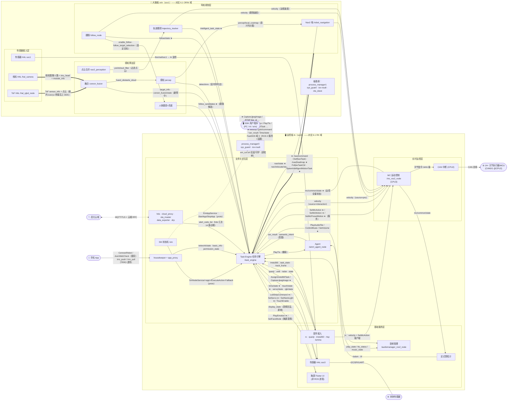

# 启元 T1 Pro 双板实机分析（orin 大脑板 / rk 主控板）

> **采集方式**：全程通过 `ssh t1pro_orin` / `ssh t1pro_rk` 只读探测（`ip`/`ps`/`lscpu`/`taskset`/`systemctl cat`/`cat`/`ros2 node|topic|service list`），未对板卡做任何写入、重启或服务操作。
> **采集时间**：2026-10-29（机器人完整开机运行态，双板 uptime ≈ 46 min，业务栈全部在线）。
> **结论口径**：接口字段全部来自板载 `/robot/software/interface/aimdk_msgs` 与 `/robot/software/algorithm/aimdk_msgs` 的 `.msg`/`.srv` 原始定义；官方语义以 SDK《接口说明.md》交叉核对；无法实证的归属均标注「推断」或「未确证」。

---

## 1. 两块板如何连接 + 连接测试结果

### 1.1 网络拓扑（实测）

三台设备同处 `10.1.1.0/24` 一个二层网段，**PC 是直连机器人内部以太网，不经过 rk 路由转发**：

```
                        ┌──────────── 互联网 / 云端 (aiem-gw.primebot.cn)
                        │ wifi 上联
┌──────────────────┐    │    ┌──────────────────────────────────┐
│ 开发者 PC         │    │    │  rk3576 主控板（soc0）            │
│ enp0s31f6:       │    │    │  hostname: localhost              │
│  10.1.1.99/24 ───┼────┴────┤ eth0:    10.1.1.100/24           │
│ (有线直插机器人   │  有线    │ wlan0:   192.168.10.113 (DHCP)   │
│  内部网口)        │  同网段  │ p2p0:    192.168.88.88 (自建热点) │
└──────────────────┘  直连   │ USB网卡: 192.168.43.100 (RNDIS)   │
                              └───────────────┬──────────────────┘
                                              │ eth0 ↔ 内部以太网 10.1.1.0/24
                              ┌───────────────┴──────────────────┐
                              │ Jetson Orin 大脑板（soc1）         │
                              │ hostname: jetson                  │
                              │ unused0: 10.1.1.101/24（唯一网口） │
                              └──────────────────────────────────┘
```

要点：

- **rk（10.1.1.100）是对外网关**：WiFi、p2p0 热点（hostapd + dnsmasq，给手机 App 连的 192.168.88.x）、USB RNDIS 网卡都在 rk 上；orin 只有一张内网口 `unused0`。
- **orin 出网必须经 rk**（orin 无 WiFi/上联网口），双板间业务流量走 10.1.1.0/24。
- 两块板都运行 `tetherd --bind <本机IP>`（tetherd.service），负责维护这张内部以太网。
- 两板时钟由 `ptp4l`（PTP，`/etc/linuxptp/ptp4l.conf`）+ rk 侧 `chrony` 同步。

### 1.2 SSH 访问配置（本机 `~/.ssh/config`）

| 别名 | HostName | 用户 | 端口 | 密钥 | sudo |
|---|---|---|---|---|---|
| `t1pro_rk` | 10.1.1.100 | `run` | 22 | `~/.ssh/t1pro_rk` | **免密 sudo** |
| `t1pro_orin` | 10.1.1.101 | `run` | 22 | `~/.ssh/t1pro_orin` | **免密 sudo** |

### 1.3 连接测试结果

| 测试项 | `ssh t1pro_orin` | `ssh t1pro_rk` |
|---|---|---|
| 连通性 | ✅ 通 | ✅ 通 |
| hostname | `jetson` | `localhost` |
| 内核 | `5.15.148-tegra #1 SMP PREEMPT` | `6.1.141-rk3576 #1 SMP` |
| 架构 | aarch64 | aarch64 |
| 系统 | Ubuntu 22.04.5 LTS (jammy) | Ubuntu 22.04.5 LTS (jammy) |
| 开机时长（采集时） | 9→46 min | 10→48 min |
| 负载（采集时） | 8.43 / 7.47 / 4.11（完整任务运行中） | 15.96 / 16.35 / 9.69（完整任务运行中） |
| 登录用户 | `run`（uid 1000） | `run`（uid 1000） |
| 设备树型号 | `NVIDIA Jetson Orin Nano Engineering Reference Developer Kit Super` | `primebot rockchip rk3576 t2-3` |

> 板上**没有 docker**：`/opt/docker/` 只是环境脚本目录（`env.sh`/`entrypoint.sh`，source ROS 2 Humble + `/opt/env.d/`），整机为裸机部署。

---

## 2. 硬件信息：查询命令与两板实测

### 2.1 三条命令对照表

| 查询项 | 命令 | t1pro_orin 实测 | t1pro_rk 实测 |
|---|---|---|---|
| **CPU 核数** | `nproc` | `6`（真实 6 核） | `6`（⚠️ 实际 8 核，见下） |
| | `lscpu` | `CPU(s): 6`，`Model name: Cortex-A78AE`，每簇 3 核 ×2 | `CPU(s): 8`：**CPU0-3 = Cortex-A53（L2 簇 0，最高 2016 MHz）+ CPU4-7 = Cortex-A72（L2 簇 1，最高 2208 MHz）** |
| **Ubuntu 版本** | `cat /etc/os-release \| grep PRETTY` | `PRETTY_NAME="Ubuntu 22.04.5 LTS"` | `PRETTY_NAME="Ubuntu 22.04.5 LTS"` |
| **GPU 型号** | orin：`nvidia-smi --query-gpu=name,driver_version --format=csv`；rk：无 nvidia-smi，用 `ls /dev/dri/` + dmesg/设备树佐证 | `Orin (nvgpu)`，driver `540.4.0`（Jetson Orin Nano Super 集成 Ampere GPU；`/proc/device-tree/model` = Orin Nano 开发套件 Super） | SoC 集成 **ARM Mali-G52 MC3**（rk3576 Datasheet 口径）；实机证据：`/dev/dri/card0、card1、renderD128、renderD129` + 内核 `kbase_*` 线程（Mali kbase 驱动）；`/sys/kernel/debug/mali/version` 未挂载，GPU 型号字符串无法从 sysfs 直接读出 |

### 2.2 ⚠️ rk 的 `nproc` 陷阱与隔离核（重点）

rk 内核启动参数做了 CPU 隔离（`/sys/devices/system/cpu/isolated` = **`2-3`**）：

- **被隔离的是 CPU2、CPU3，属 Cortex-A53 小核簇**（CPU0-3 = A53@2.0GHz，CPU4-7 = A72@2.2GHz）。
- 普通用户进程（含 sshd 登录 shell）的默认亲和性被设为 **`0,1,4-7`**（`taskset -pc 1` 实测 = `0,1,4-7`），所以 `nproc` 只看到 **6** 个 CPU——`lscpu` 才显示真实的 8。
- 整机几乎所有用户态进程都带 `0,1,4-7` 亲和性（systemd 全局默认），即**调度器层面与隔离核绝缘**。

**隔离核上到底跑了什么（实测）：**

| 隔离核 | 占用者（实测证据） | 作用 |
|---|---|---|
| **CPU2** | 中断亲和性 `2`：`irq14 rk_timer`、`irq38/39 arm-pmu`、**`irq83 can0`（累计 ~600 万次）、`irq84 can1`（~450 万次）**（`/proc/irq/*/smp_affinity_list`） | **CAN 总线中断专用核**：机器人 14 关节执行器/主控 MCU 挂在 can0/can1 上，硬中断全部收在 CPU2，不被任何进程抢占 |
| **CPU3** | 进程亲和性 `3`：**`./mc_app_main --cfg_file_path=./cfg/mc_T1.yaml`**（pid 2669，comm `mc_main`，36 个线程全部钉在 CPU3，调度策略 SCHED_OTHER） | **运动控制主程序独占核**：PrimeMotion 实时运控内核用户态部分，独享一个核避免被普通负载干扰 |

> 结论：rk 用「1 核收 CAN 中断 + 1 核跑运动控制」的隔离方案替代了 PREEMPT_RT，其余 6 核（2×A53 + 4×A72）跑全部业务栈。

---

## 3. 双板进程全景：进程清单、功能与部署方式

### 3.1 部署机制（两板一致，实测自 systemd 单元与进程树）

```
systemd
 ├─ em.service（EM App，Requires=system_entry.service，After=iox-roudi/camera-start/sync_time）
 │    └─ /robot/software/process_manager/bin/start_process_manager.sh
 │         └─ ./process_manager --cfg_file_path=./cfg/process_manager_config.yaml
 │              └─ 按 yaml 逐个拉起每个应用的 em_run.sh：
 │                   sudo -u #1000|0 -g … -E --preserve-env=PYTHONPATH EM_APP_NAME
 │                     FASTRTPS_DEFAULT_PROFILES_FILE LOG_PATH ROBOT_FEATURE_ROS2_CHANNEL_QOS
 │                     ROS_LOG_DIR  /robot/software/<app>/bin/em_run.sh
 │                        └─ 各应用二进制 ./xxx --cfg_file_path=./cfg/xxx.yaml
 ├─ iox-roudi.service → /robot/software/entry/run_roudi.sh
 │    └─ /opt/iceoryx/bin/iox-roudi -c /robot/software/entry/cfg/roudi_config.toml -m on   （板内零拷贝 IPC 总线）
 ├─ tetherd.service → /usr/bin/tetherd --bind 10.1.1.100|101
 └─（rk 独有）hostapd/dnsmasq（p2p0 热点）、mosquitto（conduit_router TLS MQTT）、fce863r-bt.service（蓝牙）
```

- 应用根目录 `/robot/software/<app>/`，统一 `bin/em_run.sh + cfg/*.yaml` 布局；**多数应用以用户 `run`(uid 1000) 运行，少数以 root（`sudo -u #0`：data_exporter、ota_master/ota_slave、sys_guard、hds）**。
- 环境注入：`EM_APP_NAME`（应用名）、`FASTRTPS_DEFAULT_PROFILES_FILE=/robot/software/entry/cfg/standard/ros_dds_configuration.xml`（FastDDS 配置）、`ROS_LOG_DIR/LOG_PATH=/robot/persist/log/<app>`、`ROBOT_FEATURE_ROS2_CHANNEL_QOS`。
- ROS 2 Humble 裸机安装于 `/opt/ros/humble`；aimdk 消息定义包安装于 `/robot/software/interface/aimdk_msgs`。
- 进程守护：em.service `Restart=always` + process_manager 按配置重启子应用；健康诊断由 hds + sys_guard 负责。

### 3.2 rk（主控板 soc0，10.1.1.100）进程表

| 进程（二进制） | 运行用户 | 功能 | 备注 |
|---|---|---|---|
| `process_manager` | root | 进程管理器：按 `process_manager_config.yaml` 拉起/守护全部 em 应用 | 对应 ROS 节点 `/process_manager0` |
| `sys_guard` | root | 系统守护/场景看护（温控、资源、活动场景） | `/sys_guard_node_soc0` |
| **`mc_app_main`** | run | **运动控制主程序（实时运控内核）** | **钉在隔离核 CPU3**，36 线程，`/mc_ros2_node` |
| `aim_sm_app`（qy3576_t1_v2d1_2X.yaml） | run | 状态机 SM：整机有限状态机与场景调度 | `/sm` |
| `aima-agent-app`（agent.yaml） | run | Agent 对话智能体（LLM/语音交互/任务编排入口），RSS ~1.1GB | `/aimrt_agent_node`；子进程 ping `aiem-gw.primebot.cn` 探测云端 |
| `task_engine` | run | 任务引擎：长任务编排/仲裁执行（跟随、建图、运镜…） | `/task_engine` |
| `aimrt_main`（exposure_config.yaml） | run | 相机曝光控制 | 图上未见独立 ROS 节点（iceoryx 通道为主） |
| `aimrt_main`（t1_v2d0_config.yaml） | run | 设备管理器 device_manager | `/device_manager_node`（cwd=/robot/software/device_manager/bin 实证） |
| `aimrt_main`（audio_manager.yaml） | run | 音频管理（麦克风阵列/播放/音乐） | `/audiomanager_ros2_node` |
| `aimrt_main`（hal_sensor_t1_v2d0_cfg.yaml） | run | 传感器 HAL（BMS/触摸/灯/舵机/颈部灯，soc0 侧） | `/hal_sensor_soc0` |
| `aima-hal_camera-app-main`（rk 配置） | run | 相机 HAL（rk 侧摄像头供电/管理） | 图上未见 ROS 节点（iceoryx 为主） |
| `aima-hds-app`（hds_master.yaml） | root | 健康诊断服务 HDS（故障码汇总/告警） | `/hds` |
| `flutter-pi --release -r 180 display_ui` | root | 胸屏 Flutter UI 渲染 | 非 ROS 进程 |
| `aima-legged_odom-app` | run | 足式里程计（odom/tf/躯干位姿） | `/legged_odom_node` |
| `aima-rc-app`（rc_T1.yaml） | run | 遥控器 rc 接入（体感遥控/摇杆） | `/rc` |
| `aima-dp-app`（drp） | run | 数据记录（rosbag 录包，bag 存 /robot/persist/bag/） | `/record_ros2_node_3765`（节点名含 pid） |
| `aima-cloud_proxy-app` | root | 云端代理（上行状态/资源/日志） | `/cloud_proxy` |
| `aima_ota_master_app` | root | OTA 主控（升级编排/心跳） | `/ota_master` |
| `aimrt_main`（insta360.yaml） | run | Insta360 云台相机接入 | `/insta360_ros2_node` + `/insta360_gimbal_tts` |
| `aimrt_main`（quanji.yaml，connx） | run | 「圈圈」UWB 随行设备接入（UWB/IMU/雷达/音频） | `/quanji_uwb_ros2_node` |
| `picture_service`（resource_manager 目录） | run | 拍照与资源管理（图片/自定义动作资源） | `/picture_service`（SM 注册名 `resource_manager`） |
| `scene_engine` | run | 场景引擎（场景 tick/切换） | 图上未见独立 ROS 节点 |
| `python3 housekeeper` | run | 管家服务：WiFi/蓝牙/4G/设备信息/权限管理 | `/housekeeper0`（另 `/HK_ros2_rpc_node` 推断亦属管家/云属性桥） |
| `python3 local_app_proxy.app_proxy` | run | 手机 App 代理（App 连接/鉴权/指令转发） | `/app_proxy` + `/app_proxy_client` |
| `ros2 run rtsp_server` ×2 | run | RTSP 视频流服务（App 看相机画面） | `/rtsp_video_server` |
| `lumina_server` | run | 灯效服务器（氛围灯/表情灯语联动） | `/lumina_server` |
| `aima-data_exporter-app` | root | 数据导出（云端异步任务/文件分片上传） | `/data_exporter`（soc0 实例） |
| `abox server / abox log`（--project t1） | run | 日志服务（采集/上传） | 非 ROS 进程 |
| `mosquitto`（conduit_router_tls.conf） | root | MQTT over TLS（设备侧消息管道） | 非 ROS 进程 |
| `hostapd` + `dnsmasq` | root/nobody | p2p0 热点（192.168.88.0/24）及 DHCP | 非 ROS 进程 |
| `iox-roudi` | run | iceoryx 零拷贝 IPC 守护 | 两板各一 |
| `secret_store` | root | 密钥/凭据存储 | 非 ROS 进程 |

### 3.3 orin（大脑板 soc1，10.1.1.101）进程表

| 进程（二进制） | 运行用户 | 功能 | 备注 |
|---|---|---|---|
| `process_manager` | root | 同 rk（soc1 实例） | `/process_manager1` |
| `sys_guard` | root | 系统守护（soc1 侧） | `/sys_guard_node_soc1` |
| `aimrt_main`（hal_sensor_orin_t1_cfg.yaml） | run | 传感器 HAL（ADU 电源板/温度，soc1 侧） | `/hal_sensor_soc1` |
| `aimrt_main`（t1_v2d1_config.yaml，hal_rgbd） | run | RGBD/ToF 相机 HAL（头部 5 目 ToF：main/front/rear/left/right） | `/hal_rgbd_node` + `/hal_rgbd_node_0`（cwd=hal_rgbd/bin 实证） |
| `aima-hal_camera-app-main`（orin 配置） | run | 相机 HAL（orin 侧：双目/鱼眼/中央彩色相机 + 头部 IMU） | `/hal_camera` + `/hal_camera_1` |
| `aimrt_main`（aimrt_person_track_config_T.yaml） | run | 人体跟踪感知（跟随候选目标检测） | `/aimrt_person_track_node` + `/aimrt_person_track_srv` |
| `aimrt_main`（aimrt_brightness_status_config_T.yaml） | run | 亮度检测（跟随过暗门控） | `/aimrt_brightness_status_node` + `/aimrt_brightness_status_srv` |
| `coreon_fusion` | run | 多传感器融合（5×ToF+相机+IMU+UWB → 融合点云/目标/避障状态） | `/coreon_fusion_ros2_node` |
| `percep`（algorithm/perception） | run | 感知算法主程序（语义分割/环境识别/楼梯检测/局部代价图） | `/perception` |
| `ros2 launch nav2_bringup start_real_navigation.launch.py` | run | **Nav2 导航栈**：bt_navigator、controller_server、planner_server、behavior_server、smoother_server、map_server、robot_navigation、双层 costmap、lifecycle_manager_navigation、nav2_container、4×static_transform_publisher | 导航全链条 |
| `ros2 launch follow follow.launch.py` | run | 跟随控制（语义跟随规划） | `/follow_node` |
| `ros2 launch path_follow_node trajectory_tracker.launch.py` | run | 轨迹跟踪（环绕运镜等智能运动） | `/trajectory_tracker` |
| `aimrt_main`（nav2_perception：pointcloud_combiner + perception_node） | run | 点云合并（前/后 ToF）+ 感知生命周期节点 | `/pointcloud_combiner_node`、`/perception_node`、`/lifecycle_manager_t1_perception` |
| `aima-data_exporter-app` | root | 数据导出（soc1 实例） | `/data_exporter`（soc1 实例） |
| `aima_ota_slave_app`（ota_slave_soc1.yaml） | root | OTA 从控（soc1 升级执行） | `/ota_slave` |
| `iox-roudi` | run | iceoryx Roudi | |
| `tetherd` | root | 内部网维护 | |

### 3.4 隔离核专享进程（rk）小结

见 §2.2 表：**CPU2 = CAN0/CAN1 硬中断 + rk_timer/arm-pmu；CPU3 = `mc_app_main` 运动控制独占（36 线程全钉 CPU3）**。除隔离核外，rk 其余进程亲和性一律 `0,1,4-7`；orin 无隔离核。


---

## 4. 进程 → ROS 2 Node → Topic / Service 挂载总表

### 4.0 图与采集说明

- 两板**同属一个 ROS 2 域**：`ROS_DOMAIN_ID=0`（默认未覆盖）、`RMW=rmw_fastrtps_cpp`、`ROS_LOCALHOST_ONLY=0`，FastDDS 统一加载 `/robot/software/entry/cfg/standard/ros_dds_configuration.xml`，经 10.1.1.0/24 组播互通——**从任一板能看到双板全部 69 个节点**（含隐藏辅助节点）。
- 板上 ros2 CLI 用法：`source /opt/docker/env.sh` 后直接 `ros2 node list`（orin 侧已存在用户级 ros2-daemon，pid 3066，`--ros-domain-id 0 --rmw-implementation rmw_fastrtps_cpp`）。
- ⚠️ 实测现象：在 rk 上执行 `ros2 node list`（无 daemon/`--no-daemon`）只能看到约 16 个节点（绝大多数是 orin 侧节点），rk 本机节点反而不可见——推断 rk 业务进程的 FastDDS 配置限制了本机发现或绑定特定网卡；**全量图以 orin 侧采集为准**。
- 节点归属判定依据：板上 `ps` 进程参数链（em_run.sh 目录 ↔ 二进制 ↔ 配置）+ 命名约定 `soc0=rk、soc1=orin`（如 `hal_sensor_soc0/soc1`、`sys_guard_node_soc0/soc1`、`process_manager0/1`、`ota_slave_soc1.yaml`）+ 双实例同名节点（`/data_exporter` 出现两次 = 双板各一）。个别无法实证的标注「推断/未确证」。
- 下表 `P/S/V/C` = 发布话题数 / 订阅话题数 / 业务服务端数 / 业务客户端数（已剔除 `describe_parameters` 等 6 项参数标准服务与 `/rosout`、`/parameter_events`）。

### 4.1 rk（主控板 soc0）进程与节点

| 进程 | ROS 2 节点 | P | S | V | C |
|---|---|---|---|---|---|
| process_manager | `/process_manager0` | 0 | 0 | 0 | 0 |
| sys_guard | `/sys_guard_node_soc0` | 3 | 1 | 2 | 0 |
| **mc_app_main（CPU3 独占）** | `/mc_ros2_node` | 4 | 2 | 13 | 0 |
| aim_sm_app | `/sm` | 3 | 2 | 4 | 28 |
| aima-agent-app | `/aimrt_agent_node` | 15 | 8 | 18 | 24 |
| （管家/云属性桥，推断） | `/HK_ros2_rpc_node` | 0 | 0 | 1 | 1 |
| task_engine | `/task_engine` | 12 | 39 | 30 | 51 |
| （任务触发链路，推断 task_engine 侧） | `/task_trigger_ros2_node` | 0 | 3 | 0 | 1 |
| aimrt_main（t1_v2d0，device_manager） | `/device_manager_node` | 1 | 0 | 0 | 1 |
| aimrt_main（audio_manager） | `/audiomanager_ros2_node` | 9 | 1 | 15 | 1 |
| aimrt_main（hal_sensor soc0） | `/hal_sensor_soc0` | 6 | 2 | 9 | 0 |
| aima-hds-app | `/hds` | 2 | 3 | 3 | 1 |
| housekeeper | `/housekeeper0` | 6 | 0 | 23 | 2 |
| local_app_proxy | `/app_proxy`、`/app_proxy_client` | 3 / 0 | 29 / 0 | 3 / 0 | 0 / 2 |
| aima-rc-app | `/rc` | 3 | 0 | 2 | 6 |
| aima-dp-app（drp 录包） | `/record_ros2_node_3765` | 1 | 4 | 2 | 0 |
| cloud_proxy | `/cloud_proxy` | 3 | 7 | 0 | 1 |
| ota_master | `/ota_master` | 3 | 5 | 2 | 10 |
| aimrt_main（insta360） | `/insta360_ros2_node`、`/insta360_gimbal_tts` | 6 / 0 | 2 / 0 | 3 / 0 | 1 / 2 |
| aimrt_main（quanji） | `/quanji_uwb_ros2_node` | 5 | 0 | 1 | 0 |
| picture_service | `/picture_service` | 3 | 1 | 10 | 3 |
| rtsp_server（×2 进程） | `/rtsp_video_server` | 0 | 0 | 0 | 1 |
| lumina_server | `/lumina_server` | 1 | 9 | 0 | 13 |
| legged_odom | `/legged_odom_node` | 8 | 1 | 2 | 0 |
| data_exporter（soc0 实例） | `/data_exporter` ① | 1 | 0 | 12 | 10 |
| 无 ROS 节点：aimrt_main(exposure)、hal_camera(rk)、scene_engine、flutter-pi、abox、mosquitto 等 | — | | | | |

**① `/data_exporter` 在图中出现两次（重名双实例），soc0/soc1 各一个。**

### 4.2 orin（大脑板 soc1）进程与节点

| 进程 | ROS 2 节点 | P | S | V | C |
|---|---|---|---|---|---|
| process_manager | `/process_manager1` | 0 | 0 | 0 | 0 |
| sys_guard | `/sys_guard_node_soc1` | 3 | 1 | 2 | 0 |
| aimrt_main（hal_sensor orin） | `/hal_sensor_soc1` | 3 | 0 | 1 | 0 |
| aimrt_main（hal_rgbd） | `/hal_rgbd_node`、`/hal_rgbd_node_0` | 8 / 1 | 11 / 6 | 3 / 0 | 1 / 0 |
| aima-hal_camera-app-main（orin） | `/hal_camera`、`/hal_camera_1` | 5 / 3 | 2 / 2 | 4 / 3 | 1 / 1 |
| aimrt_main（person_track） | `/aimrt_person_track_node`、`/aimrt_person_track_srv` | 6 / 0 | 4 / 0 | 0 / 1 | 0 / 1 |
| aimrt_main（brightness） | `/aimrt_brightness_status_node`、`/aimrt_brightness_status_srv` | 1 / 0 | 1 / 0 | 0 / 1 | 0 / 0 |
| coreon_fusion | `/coreon_fusion_ros2_node` | 7 | 27 | 7 | 1 |
| percep | `/perception` | 10 | 5 | 1 | 0 |
| nav2_bringup launch | `/bt_navigator`、`/bt_navigator_navigate_to_pose_rclcpp_node`、`/controller_server`、`/planner_server`、`/behavior_server`、`/smoother_server`、`/map_server`、`/robot_navigation`、`/global_costmap/global_costmap`、`/local_costmap/local_costmap`、`/lifecycle_manager_navigation`、`/nav2_container`、`/map_to_odom_tf_publisher`、`/camera_to_base_tf_publisher`、`/front_tof_to_combined_tf_publisher`、`/rear_tof_to_combined_tf_publisher` | 见 4.4 | | | |
| follow launch | `/follow_node` | 9 | 1 | 1 | 0 |
| trajectory_tracker launch | `/trajectory_tracker` | 5 | 2 | 1 | 0 |
| nav2_perception | `/pointcloud_combiner_node`、`/perception_node`、`/lifecycle_manager_t1_perception` | 见 4.4 | | | |
| data_exporter（soc1 实例） | `/data_exporter` ① | 1 | 0 | 12 | 10 |
| aima_ota_slave_app | `/ota_slave` | 2 | 0 | 2 | 0 |
| （进程未确证，订阅 trro 专用通道） | `/trro_recv_dedicated` | 0 | 1 | 0 | 0 |

### 4.3 各节点完整接口挂载（rk 侧业务节点）

> 格式：`发布` / `订阅` / `服务端` / `客户端`。参数类标准服务与 `/rosout`、`/parameter_events` 省略。带 ★ 的为 SDK 官方对外接口。

**`/mc_ros2_node`（mc_app_main，rk·CPU3）**
- 发布：`/aima/mc/common/state`（运控全量状态）★、`/aima/hds/diagnostic_list`、`/aimrte/sm/node_state/pb_…SmNodeStateChannel`、`/robot/trace/events`
- 订阅：`/aima/mc/locomotion/velocity`（速度指令）★、`/aima/mc/custom/joint/command`（上肢自定义关节指令）★
- 服务端：`SetMcAction`★、`GetMcAction`★、`SetMcMotion`★、`GetMcMotions`、`SetMcPresetMotion`★、`GetMcPresetMotionState`、`SetMcInputSource`★、`GetCurrentInputSource`★、`SetRobotRuntimeModel`、`GetRobotRuntimeModel`、`McMotionRecord`、`SmNodeService/mc/ExecuteAction|Fallback`
- 客户端：—

**`/sm`（aim_sm_app，rk）**
- 发布：`/aima/sm/system_state`（整机状态机当前状态）、`/aimrte/sm/node_state/…`、`/robot/trace/events`
- 订阅：`/aima/hal/bms/state`、`/aimrte/sm/node_state/…`
- 服务端：`GetSystemState`、`MigrateSystemState`、`SmNodeService/sm/ExecuteAction|Fallback`
- 客户端：`EmAppService/GetAllAppInfos|GetAppInfo|GetDevSettings|SetDevSettings|StartApp|StartApps|StopApp|StopApps`（process_manager 的 proto RPC 桥）、各应用 `SmNodeService/<app>/ExecuteAction|Fallback`（audio_manager、coreon_fusion、hal_camera、hal_rgbd、hds、mc、task_engine）、`SetJointPower`、`GetJointPowerState`、`SetPowerDown`、`SetPowerDownOrin`、`SetHalTofStream`、`SetHalCameraStream`

**`/aimrt_agent_node`（aima-agent-app，rk）**
- 发布：`/aima/agent/asr_result`（ASR 结果）★、`/aima/agent/face_info`（人脸）、`/aima/agent/greeting_state`、`/aima/agent/interaction_state`、`/aima/agent/biologic_state`、`/aima/agent/business_agent_control_state`、`/aima/agent/semantic_intent`、`/aima/agent_show_text`、`/agent/process_audio_output`、`/agent/task_operation`、`/interaction/tts_status`、`/aima/app_proxy/trro_pull_message`、`/aima/hal/audio/play_state`、`/aimrte/sm/node_state/…`、`/robot/trace/events`
- 订阅：`/aima/app_proxy/trro_push_message`、`/aima/hal/audio/music_state`、`/aima/hal/bms/state`、`/aima/hal/network/state`、`/aima/interaction/state`、`/aima/robot/permission_state`、`/aima/sm/system_state`、`/interaction/tts_status`
- 服务端：`PlayTts`★、`GetTtsDuration`、`GetAudioStatus`、`PlayMediaFile`、`GetAndPlayNlgText`、`SetTtsParameters`、`StopTtsTraceId`、`StartVoiceInteraction`、`StartBiologicalEntry`、`BusinessAgentControl`、`GetAgentPropertiesRequest`、`SetAgentPropertiesRequest`、`SetAgentSuppression`、`GetMicSourceRequest`、`SetMicSourceRequest`、`TaskStatus`、`SmNodeService/agent/ExecuteAction|Fallback`
- 客户端：`AmRequest`、`AmCancel`、`ControlTask`、`ControlMusic`、`PlayAnimation`、`PlayEmotion`、`PlayEmotionByStr`、`PlayCustomMotion`、`PlayMove`、`PlayMoveWithWalkMode`、`PlayPhoto`、`FollowTaskCtrl`、`NaviTaskCtrl`、`SearchMusic`、`GetMusicList`、`GetAndPlayNlgText`、`PlayTts`、`PlayMediaFile`、`SetMode`、`SetNeckLight`、`CtrlPermission`、`ShutdownTask`、`TouchEnable`

**`/task_engine`（task_engine，rk）— 全图最重的业务枢纽（P12/S39/V30/C51）**
- 发布：`/aima/interaction/state`（交互长任务状态）★、`/aima/task_engine/task_status`、`/aima/task_engine/agent_flow/task_info`、`/aima/extreme_action/status`、`/aima/map/localization/state`、`/aima/map/charge_point/set_state`、`/aima/map/charge_point/navi_sit_state`、`/aima/mc/locomotion/velocity`、`/aima/core/locomotion/velocity`、`/aima/resource/update`、`/aimrte/sm/node_state/…`、`/robot/trace/events`
- 订阅（39 路）：agent 侧（biologic/interaction_state/semantic_intent/agent_show_text）、算法状态（navi/state、navi/relocate/state、follow/state、charge_point/recognition_state、charge_point/sit_state）、HAL（bms/touch/servo/rgb/network/audio×3）、系统（sm/system_state、permission_state、hds/alert_code_list、net_port_state）、交互（display_state、tts_status、interaction task_status）、感知（follow_candidates、follow_brightness_dark、percep/detect/env）、里程计（odom、odom/status）、圈圈（quanji/state、quanji/radar）、insta360/task_state、app/info、map/build_state、map/state、slam_state、fall_guard/danger_regions、intelligent_task_state
- 服务端：`PlayMove`、`PlayMoveWithWalkMode`、`PlayAnimation`、`PlayEmotion`、`PlayCustomMotion`、`PlayDefaultEmoji`、`SetFaceMode`、`RecordMotion`、`FollowTaskCtrl`、`NaviTaskCtrl`、`MapCommandTask`、`MapLocalizationTask`、`SetChargePointTask`、`ControlTask`、`AmRequest`、`AmCancel`、`AgentFlowTaskCtrl`、`GetMotionList`、`GetTaskInfo`、`InteractWithId`、`FaceGreet`、`SetMode`、`SetAppConfig`、`ShutdownTask`、`TaskInjection`、`TouchEnable`、`TransformTask`、`ControlPowerSave`、`SmNodeService/task_engine/ExecuteAction|Fallback`
- 客户端（51 路）：mc 侧（SetMcAction/Motion/PresetMotion、GetMc*、McMotionRecord）、导航（/navi/command|loadmap|relocate、NaviTaskCtrl）、建图（MapCommand、MMStartLocalization、MMStopLocalization、GetMapList、GetMapData、GetCurrentMap、GetNaviPoints、SetNaviPoint）、跟随（SetFollowPerceptionTask、SetFollowTaskBiped）、专座（setchargepoint、setchargepointsit、chargepointsit/enable）、感知（/perception/enable、set_brightness_enable）、资源（GetResourcePath、GetCustomMotionList、DeleteResource、RenameResource）、交互（PlayTts、PlayAudioFile、StopAudioPlay、GetAndPlayNlgText、StopTtsTraceId、SetVolume、GetVolume、SetNeckLight、LedStripCommand）、Insta360（AssignInsta360Task、ControlInsta360、PlayPhoto、CaptureJpegImage）、系统（SetPowerDown、SetPowerDownOrin、SetServo、ObstacleCheck、SetAvoidance、GetWifiState、MigrateSystemState、StartBiologicalEntry、StartVoiceInteraction、SpawnIntelligentMotionTask）

**`/audiomanager_ros2_node`（audio_manager，rk）**
- 发布：`/aima/hal/audio/audio_device_list`（音频设备列表）★、`play_state`、`volume`、`mute`、`mic_source`、`music_state`、`event_probe`、`diagnostic_list`、`sm/node_state`
- 订阅：`/aima/sm/system_state`
- 服务端：`GetVolume`★、`SetVolume`★、`GetMute`★、`SetMute`★、`PlayAudioFile`★、`StopAudioPlay`、`ControlMusic`、`SearchMusic`、`GetMusicList`、`GetMicSourceRequest`、`SetMicSourceRequest`、`GetSpkSinkRequest`、`SetSpkSinkRequest`、`SmNodeService/audio_manager/…`
- 客户端：`PlayEmotion`

**`/hal_sensor_soc0`（hal_sensor，rk）**
- 发布：`/aima/hal/bms/state`（电源管理数据）★、`touch/state`（头部触摸）★、`neck_light/state`、`rgb/state`、`servo/state`、`diagnostic_list`
- 订阅：`/aima/hal/thermal/soc1`、`/aima/sm/system_state`
- 服务端：`SetServo`★、`SetNeckLight`★、`GetNeckLightState`、`LedStripCommand`★、`GetBatteryInfo`、`SetJointPower`、`GetJointPowerState`、`SetExt12vPower`、`SetPowerDown`
- 客户端：—

**`/housekeeper0`（housekeeper，rk）— 网络/设备管理全家桶（V23）**
- 发布：`/aima/hal/network/state`、`/aima/net/net_port_state`、`/aima/robot/basic_info`、`/aima/robot/permission_state`、`/robot/scan/bluetooth`、`diagnostic_list`
- 服务端：`GetWifiState`、`CtrlWifi`、`GetWifiHotspotState`、`CtrlWifiHotspot`、`SetHotspotInfo`、`CtrlScanBluetooth`、`ConnectBluetooth`、`DisConnectBluetooth`、`ReBroadcastBluetoothService`、`SetBleAlias`、`SetBluetoothName`、`CtrlModem`、`GetModemInfo`、`GetLbsLocation`、`GetNetworkState`、`CtrlPermission`、`GetRobotInfo`、`GetRobotState`、`GetWholeRobotInfo`、`SetRobotName`、`SetSN`、`SetBoardSN`、`SetDevSecret`
- 客户端：`GetRobotInfo`、`JsonWebCheck`

**`/app_proxy` + `/app_proxy_client`（local_app_proxy，rk）**
- `/app_proxy` 发布：`/aima/app_proxy/trro_push_message`、`/aima/mc/locomotion/velocity`、`/aima/mc/body_pose`；订阅 29 路（App 所需的全部状态镜像）；服务端：`ConnectRobot`、`DisconnectRobot`、`JsonWebCheck`（App 接入鉴权三件套）
- `/app_proxy_client` 客户端：`GetCurrentMap`、`SetAppConfig`

**`/rc`（aima-rc-app，rk）**：发布 `mc/locomotion/velocity`、`mc/body_pose`、sm/node_state；服务端 `SmNodeService/rc/…`；客户端 `SetMcAction`、`GetMcAction`、`SetMcMotion`、`SetMcPresetMotion`、`GetMcPresetMotionState`、`ControlTask`

**`/ota_master`（rk）**：发布 OTA 心跳 proto 通道、sm/node_state、trace；订阅 bms(×2)、network、mc/common/state、sm/system_state；服务端 `SmNodeService/ota_master/…`；客户端 `AmRequest`、`ControlPowerSave`、`GetBatteryInfo`、`GetSystemState`、`LedStripCommand`、`MigrateSystemState`、`PlayAnimation`、`PlayTts`、`SetMcAction`、`SetPowerDown`

**`/lumina_server`（rk）**：订阅 asr_result、face_info、play_state、bms、network、touch、interaction/state、tts_status、bluetooth 共 9 路做灯语联动；发布 trace/events；客户端 13 路（PlayTts、PlayEmotion、PlayAnimation、PlayMove、PlayLight、PlayAudioFile、PlayCustomMotion、SetMode、Get/SetVolume、StopAudioPlay、AmCancel、TouchEnable）

**`/picture_service`（rk，resource_manager）**：服务端 `GetPictureList`、`GetPicture`、`DeletePicture`、`GetResourcePath`、`GetCustomMotionList`、`DeleteResource`、`RenameResource`、`PlayPhoto`、`SmNodeService/resource_manager/…`；客户端 `CaptureJpegImage`、`ControlInsta360`、`PlayTts`；发布 `resource/update`、sm/node_state、trace

**`/insta360_ros2_node` + `/insta360_gimbal_tts`（rk）**：发布 `insta360/state`、`task_state`、`track_frame`、`cmd`、`robot_control`、`mc/locomotion/velocity`；服务端 `AssignInsta360Task`、`ControlInsta360`、`GetInsta360WiFiInfo`；gimbal_tts 客户端 `PlayTts`、`SetMcAction`

**`/quanji_uwb_ros2_node`（rk）**：发布 `quanji/uwb`、`imu`、`radar`、`audio_frame`、`state`；服务端 `ControlQuanji`

**`/legged_odom_node`（rk）**：发布 `/odom`、`/odom_torso`、`/odom/status`、`/odom/trajectory`、`/tf`、`torso_imu_orientation`、`upper_body_joint_states`、sm/node_state；订阅 `mc/common/state`；服务端 `SmNodeService/aima-legged_odom-app/…`

**`/cloud_proxy`（rk）**：发布 `resource/update`、diagnostic、sm/node_state；订阅 7 路（network、alert、interaction、mc 状态、task_status、trace）；客户端 `ControlTask`

**`/record_ros2_node_3765`（drp 录包，rk）**：订阅 `mc/common/state`、`mc/locomotion/velocity`、`mc/body_pose`、`bms/state` 落 rosbag；服务端 `SmNodeService/drp/…`

**`/data_exporter`（soc0 实例，root）**：服务端 `soc0/async/Create|CancelAsyncTask`、`soc0/sync/CreateSyncTask|GetTaskStatus`、`soc0/cloud/platform/*`（GetJWT、GetUploadPath、CombineFileSlices、UnbindProject）、`soc0/cloud/result/Upload*`；客户端跨板调用 soc1 同名服务

**`/device_manager_node`（rk）**：发布 diagnostic；客户端 `GetJointPowerState`

**`/sys_guard_node_soc0`（rk）**：发布 `sys_guard/active_scene`、diagnostic、sm/node_state；订阅 sm/system_state；服务端 `SmNodeService/sys_guard/…`

### 4.4 各节点完整接口挂载（orin 侧节点）

**`/coreon_fusion_ros2_node`（coreon_fusion）— 感知融合枢纽（S27）**
- 发布：`/aima/coreon_fusion/state`（融合/避障状态）★、`/perception/percep_fusion/point_cloud`、`/perception/target_info`、`mc/locomotion/velocity`、diagnostic、sm/node_state、trace
- 订阅（27 路）：5 路 ToF sensor_info、5 路 pmd_royale 点云、metoak 相机 3 路、orin 相机图像 5 路（bgr_centra、fisheye×2、stereo×2）、torso IMU/odom×2、filtered_point_cloud、occlusion_status、fall_guard/edge_xs、interaction/state、mc/locomotion/velocity
- 服务端：`ObstacleCheck`、`SetAvoidance`、`GetSceneList`、`GetSceneState`、`SceneCommand`、`SmNodeService/coreon_fusion/…`
- 客户端：`GetAndPlayNlgText`

**`/perception`（percep）**：发布 `/percep/local_costmap`（语义局部代价图）、`percep/cloud`、`fused_obstacle_cloud`、`tof/{main,front,rear}/point_cloud`、`detect/env`（室内外）、`detect/grip`、`stair_detection`、`stereo_right/seg_mask`；订阅 `mc/common/state`、`odom`、`follow_brightness_dark`、`follow_camera_lift_angle`、`target_info`；服务端 `/perception/enable`（SetBool）

**`/hal_rgbd_node` + `/hal_rgbd_node_0`（hal_rgbd）**：发布 5 路 `ofilm/tof/*/sensor_info`（RgbdInfo：曝光/温度）、`ofilm/tof/inter_board`、diagnostic、sm/node_state；订阅 10 路 `ofilm/tof/*/raw_record|rrf_record`（录制开关）；服务端 `SetHalTofStream`、`SmNodeService/hal_rgbd/…`

**`/hal_camera` + `/hal_camera_1`（hal_camera orin）**：`/hal_camera` 发布 `hal/camera/module_info`、`hal/imu/imu_head`、`soc_sync/ready`；服务端 `CaptureJpegImage`★、`HALCameraCommand`；`/hal_camera_1` 服务端 `SetHalCameraStream`；两者共同订阅 `permission_state`（相机权限门控）、`mc/common/state`

**`/aimrt_person_track_node` + `_srv`（person_track）**：发布 `perception/follow_candidates`（跟随候选）★、`perception/target_info`（Detection2DArray）、`follow_camera_lift_angle`、3 路调试（debug_cloud/image/markers）；订阅 `mc/common/state`、`odom`、`enable_follow`、`follow_target_selection`；服务端 `/perception/set_follow_perception_task`；客户端 `SetServo`（相机抬升）

**`/aimrt_brightness_status_node` + `_srv`**：发布 `perception/follow_brightness_dark`（亮度门控）；订阅 `hal/camera/head_stereo_left`；服务端 `/perception/set_brightness_enable`

**Nav2 栈（`ros2 launch nav2_bringup start_real_navigation.launch.py`）**：
- `/robot_navigation`（对外导航封装）：发布 `aima/algo/navi/state`★、`navi/relocate/state`★、`mc/locomotion/velocity`；服务端 `/navi/command`（SetNaviTask）★、`/navi/relocate`（SetNaviRelocate）★；客户端 lifecycle_manager/manage_nodes
- `/map_server`：发布 `grid_map_origin`、`keepout_zones`；服务端 `/navi/loadmap`（LoadNaviMap）★、`load_map`、`map`、生命周期组；客户端 `/navi/command`
- `/bt_navigator`（订阅 goal_pose/odom/tf）、`/controller_server`（发布 cmd_vel 汇聚点 `mc/locomotion/velocity`、local_plan、cost_cloud 等）、`/planner_server`（发布 plan、goal_blocked_by_obstacle）、`/behavior_server`（恢复行为：look_ahead、ray_scan）、`/smoother_server`（plan_smoothed）、双层 costmap（`global_costmap/global_costmap`、`local_costmap/local_costmap`，各带 clear_around/except/entirely + get_costmap 服务）、`/lifecycle_manager_navigation`（bond 看护 + manage_nodes/is_active）、`/nav2_container`（组件容器，当前未加载组件）
- 4×static_transform_publisher：`map_to_odom_tf_publisher`、`camera_to_base_tf_publisher`、`front_tof_to_combined_tf_publisher`、`rear_tof_to_combined_tf_publisher`（发布 `/tf_static`）

**`/follow_node`（follow）**：发布 `aima/algo/follow/state`★、`mc/locomotion/velocity`、`enable_follow`、`follow_target_selection`、语义调试 4 路；订阅 `follow_node/command`；服务端 `SetFollowTaskBiped`

**`/trajectory_tracker`（path_follow_node）**：发布 `aima/motion/intelligent_task_state`（环绕运镜状态）★、`global_trajectory_path`、`trajectory_tracker/status`、`enable_follow`、`mc/locomotion/velocity`；订阅 `perception/target_info`、`pointcloud_filter`；服务端 `SpawnIntelligentMotionTask`★

**`/pointcloud_combiner_node` + `/perception_node` + `/lifecycle_manager_t1_perception`（nav2_perception）**：合并前/后 ToF 点云 → `percep/tof/combined/point_cloud`；`perception_node` 发布 `pointcloud_filter`、订阅 `hal/joint/state`（关节状态，二开低层反馈）与合并点云，受 lifecycle 管理

**`/hal_sensor_soc1`（orin）**：发布 `hal/adu/state`（ADU 电源板状态）、`hal/thermal/soc1`（orin CPU 温度）、diagnostic；服务端 `SetPowerDownOrin`（orin 侧关机）

**`/ota_slave`（orin）**：发布 sm/node_state、trace；服务端 `SmNodeService/ota_slave/…`

**`/sys_guard_node_soc1`（orin）**：同 soc0 结构（active_scene、diagnostic、sm/node_state）

**`/trro_recv_dedicated`（归属未确证，orin 侧可见）**：订阅 `aima/app_proxy/trro_pull_message`（App 通道专用接收器）

**`/HK_ros2_rpc_node`（推断 rk 管家/云属性桥）**：服务端 `aimomp.protocol.DevicePropertyService/SetProperty`；客户端 `aimomp.protocol.CloudPropertyService/ReportProperty`（proto RPC 包装）

**辅助节点**：`/launch_ros_1692`（launch 进程自身）、8×`/transform_listener_impl_*`（各进程内 tf2 监听辅助节点）、`/bt_navigator_navigate_to_pose_rclcpp_node`（bt_navigator 内部桥）——非业务节点。


---

## 5. ROS 2 接口全貌（node/topic/service 实测清单 + 接口明细表）

### 5.0 图概况与统计

| 统计项 | 数值 | 说明 |
|---|---|---|
| `ros2 node list` | **69** | 双板合计（含 8 个 transform_listener 辅助、1 个 launch_ros、1 个空容器等非业务节点） |
| `ros2 topic list` | **198** | 双向（有发有订）86；仅发布 65；**仅订阅 47（= 二次开发入口或发布者离线）** |
| `ros2 service list` | **480** | aimdk 业务服务 **147** + proto 包装 RPC **58** + 参数标准服务 210（35 节点×6）+ 生命周期服务 ~44 + nav2 地图/代价图/管理 ~16 + 其他 |
| 域/中间件 | domain 0 / `rmw_fastrtps_cpp` | FastDDS 配置：`/robot/software/entry/cfg/standard/ros_dds_configuration.xml` |

**接口表约定**：
- 话题（Topic）无入参出参之分，表中「入参」= 发布方需填写的**负载字段**（.msg 定义）、「出参」= 订阅方读到的同构负载 + 主要消费方；
- 服务（Service）「入参」= Request 字段、「出参」= Response 字段；
- ★ = SDK 官方对外接口（《接口说明.md》30 项面）；未标★为内部接口，**非 SDK 承诺面，跨版本可能变动，慎依赖**；
- 所有 aimdk 服务共用统一响应模型（`CommonResponse`/`CommonTaskResponse` + `CommonState` 状态码与 reason 枚举），详见 §5.4，表中不逐条重复。

### 5.1 Topic 接口全表（198 项，按模块分组）

#### 5.1.1 运动控制与底盘

| 接口 | 类型 | 中文名 · 简介 | 入参（发布方填写） | 出参（订阅方读取） | 注意事项 |
|---|---|---|---|---|---|
| `/aima/mc/locomotion/velocity` ★ | McLocomotionVelocity | **走跑控制指令**（全图中枢话题：11 发布者/6 订阅者） | `source` 输入源名(rc/vr/app_proxy/interaction/pnc)；`forward_velocity` 前进 m/s（+前−后）；`lateral_velocity` 侧移 m/s（+左−右）；`angular_velocity` 角速度（+左旋）；`pitch_velocity` 弯腰角速度；`level` 档位 | 同负载；mc 网关按输入源优先级仲裁后送运控 | ★官方；**需先经 `SetMcInputSource` 抢占输入源**；多源并发时高优先级者生效（timeout 默认 1000ms，超时自动回落）；建议 10Hz+ 持续发布 |
| `/aima/core/locomotion/velocity` | McLocomotionVelocity | task_engine→运控的内部速度通道 | 同上 | 同负载（mc 侧订阅） | 内部通道，与上条并行，二开勿用 |
| `/aima/mc/common/state` ★ | McCommonState | **运控全量状态**（输入源/Action/形态/FSM/姿态/提起/牵手） | `header`；`input_source`（name/priority/timeout）；`action_info`（current_action/source/status/switch_ready）；`runtime_model`（腰/左右手状态）；`motion_status`（player_state/control_area/motion/进度）；`fsm_state`；`form_state`（四足/双足）；`posture`（roll/pitch/yaw）；`is_moving`；`is_fallen`；`lift_state`（提起检测概率/阈值）；`task_info`（task_id）；`held_state`（牵手状态） | 同负载；全图 10 个订阅者（task_engine/follow/rc/感知/ota…） | 权威状态源：判断可下发动作前先看 `action_info.switch_ready`；`McActionStatus` 的 100=RUNNING（≠CommonState 语义） |
| `/aima/mc/body_pose` | McBodyPose | 躯干姿态控制（站立高度/弯腰/侧弯/转头） | `header`；`source`；`stand_height` 站高；`bend_forward` 前弯；`bend_sideways` 侧弯；`twist_waist` 转腰；`raise_head` 抬头；`turn_head` 转头 | 同负载；rc 与 app_proxy 发布、drp 记录 | 姿态叠加量，量纲见官方运控文档；二开走 rc 同款通道需输入源授权 |
| `/aima/mc/custom/joint/command` ★ | McCustomJointCommand | **自定义上肢关节控制指令**（二开低层入口，当前仅订阅） | `header`；`joints[]`：JointCommand（关节名/位置/速度/力矩等，详见 SDK 低层接口章） | mc 网关消费 | ★官方；仅 `BIPED_CUSTOM_UPPER`(1014) 等动作模式下生效；频率与安全限位见 SDK §2.1.2 |
| `/aima/hal/joint/state` ★ | JointStateArray | **关节状态反馈数组**（当前仅订阅、发布者离线） | `header`；`joints[]`：JointState（`name`；`position`；`velocity`；`effort`；`coil_temp` 线圈温度；`motor_temp`；`motor_vol`） | perception_node、nav2 链路订阅 | ★官方；当前由运控侧按需发布（图上暂无发布者，订阅端就绪）；高频大数组，注意 QoS |
| `/cmd_vel` | geometry_msgs/Twist | Nav2 标准速度话题（仅订阅，当前 nav2 未使用该通路） | `linear.x/y/z`；`angular.x/y/z` | 双层 costmap 订阅 | T1 实际速度走 `mc/locomotion/velocity`；`/cmd_vel` 为 nav2 兼容保留 |
| `/upper_body_joint_states` | sensor_msgs/JointState | 上肢关节状态（legged_odom 发布，rviz/调试用） | 标准 JointState（name/position/velocity/effort） | 调试/RViz | 调试用途 |
| `/odom/status` | std_msgs/UInt8 | 里程计状态码 | `data` 状态码 | task_engine 订阅 | 内部 |
| `/odom/trajectory` | nav_msgs/Path | 里程计轨迹（建图回显） | `header`；`poses[]` PoseStamped | 调试/RViz | 调试用途 |
| `/aima/motion/intelligent_task_state` ★ | IntelligentMotionTaskState | **环绕运镜任务状态** | `task_id`；`action_type`（1 后退2.5m/2 半径2m环绕/3 直线后退6m）；`task_running`；`task_finished`；`task_failed` | 同负载；task_engine 订阅 | ★官方（SpawnIntelligentMotionTask 的状态回传） |
| `/aima/extreme_action/status` | ExtremeActionStatus | 极限动作（空翻等）授权与限位状态 | `schema_version`…`permission_level`；`speed_limit_mps`；`recent_30d_count/limit`；`lifetime_count/limit`；`cloud_sync_status` | app_proxy 订阅（App 展示） | 内部；含云端配额同步语义 |

#### 5.1.2 交互与 Agent（语音/音频/表情/人脸/任务）

| 接口 | 类型 | 中文名 · 简介 | 入参（发布方填写） | 出参（订阅方读取） | 注意事项 |
|---|---|---|---|---|---|
| `/aima/agent/asr_result` ★ | AsrResult | **语音识别结果** | `header`；`text` 识别文本；`event_id`；`is_final` 是否终稿；`confidence` 置信度；`language` | 同负载；task_engine/lumina 订阅 | ★官方；流式语义：`is_final=false` 为中间结果 |
| `/interaction/tts_status` ★ | TtsStatus | **TTS 播报状态** | `text`；`priority` 优先级；`trace_id`；`tts_status` 状态机（播放中/完成/失败）；`domain`；`error_message` | 同负载；Agent/task_engine/lumina 等 4 订阅 | ★官方；打断/完成判定以 `trace_id` 对齐 |
| `/aima/agent/face_info` | FaceInfoArray | 人脸信息数组（识别到的人脸+face_id） | `header`；`list[]` FaceInfo | 同负载；Agent/agent 侧 3 订阅 | 内部（Agent 由相机/识别链路生成） |
| `/aima/agent/greeting_state` | GreetingState | 迎宾问候触发状态 | `header`；`state`（1=触发）；`face_id`；`name` | app_proxy 订阅 | 内部 |
| `/aima/agent/interaction_state` | AgentConversationState | Agent 会话主/子状态 | `main_state`；`sub_state`；`event_id`；`trace_id` | task_engine 订阅 | 内部 |
| `/aima/agent/biologic_state` | BiologicalEntryState | 生物录入（声纹/人脸注册）进度 | `header`；`stage`（0-6：空闲→人脸→姓名→声纹→上传）；`state`（0-7 含异常）；`reason` | task_engine/app_proxy 订阅 | 内部 |
| `/aima/agent/business_agent_control_state` | BusinessAgentControlState | 业务 Agent 控制状态透传 | `header`；`agent_name`；`payload_json` | app_proxy 订阅 | 与 `BusinessAgentControl` 服务配对 |
| `/aima/agent/semantic_intent` | SemanticIntent | 语义意图（LLM 结构化输出） | `header`；`type` 意图类型；`value` | task_engine 订阅 | 内部 |
| `/aima/agent_show_text` | AgentShowText | Agent 上屏文本（流式） | `msg_type`（1开始/2结束/3内容/4单条）；`session_id`；`language`；`text` | task_engine/app_proxy 订阅 | 内部；App 气泡渲染数据源 |
| `/agent/process_audio_output` | ProcessedAudioOutput | 处理后音频流（回声消除后） | `header`；`stream_id`；`audio_vad_state`；`audio_data[]` PCM | 外部音频消费（当前仅发布） | 高带宽；音频调试用 |
| `/agent/task_operation` | TaskOperation | Agent 任务操作事件（CRUD） | `header`；`msg_type`；`operator_type`（1建/2读/3改/4删/5完成）；`agentflow_id`；`msg_content` | task_trigger 订阅 | 内部 |
| `/aima/interaction/state` ★ | InteractionState | **交互长任务状态**（当前 interaction/task_state + 形态/模式） | `header`；`interaction_id`；`mp_state` 上肢动作状态；`form_state`；`action_info`；`mode`（0室内/1户外/2超能）；`mode_speed`；`task_state`（长任务类型枚举 1-12：跟随/建图/定位/运镜…） | 同负载；全图 6 订阅 | ★官方；`mode` 与 `SetMode` 服务联动 |
| `/aima/interaction/task_status` | AmStatus | 任务模块函数级状态 | `function_name`；`function_status`（0未知/1运行/2停止）；`json_data` | app_proxy 订阅 | 内部 |
| `/aima/display_state` | DisplaySate | 胸屏当前表情 ID | `header`；`emoticon_id` | task_engine 订阅 | 内部（屏侧回显） |
| `/aima/hal/audio/audio_device_list` ★ | AudioDeviceInfoList | **音频设备列表** | `input_list[]`/`output_list[]`：AudioDeviceInfo | task_engine 订阅 | ★官方（查询输入/输出设备） |
| `/aima/hal/audio/play_state` | PlayStateChange | 播放状态变化 | `pkg_name` 来源包名；`state` PlayStateType | Agent/task_engine 等 2 订阅 | 与 `PlayAudioFile`/音乐播放联动 |
| `/aima/hal/audio/music_state` | MusicState | 音乐播放全量状态（歌曲/进度/音质/VIP） | `control_command_id`；`playback_state`(0-5)；`song_name`；`artist[]`；`total_duration/current_time`；`vip_song/trail`；`qualities[]`；`playback_index`… | Agent/task_engine 订阅 | 内部；与 `ControlMusic`/`SearchMusic` 配对 |
| `/aima/hal/audio/volume` | VolumeChange | 音量变化通知 | `type` VolumeType；`audio_volume` | 2 订阅 | 与 `SetVolume` 联动 |
| `/aima/hal/audio/mute` | MuteChange | 静音变化通知 | `mute` bool | task_engine 订阅 | 与 `SetMute` 联动 |
| `/aima/hal/audio/mic_source` | MicSourceChange | 麦克风源切换通知 | `mic_source`；`pid`；`vid` | 外部（仅发布） | 与 `SetMicSourceRequest` 联动 |
| `/aima/hal/audio/event_probe` | EventProbeInfoArray | 音频事件探针（埋点） | `list[]` EventProbeInfo | 外部（仅发布） | 诊断用途 |
| `/aima/robot/permission_state` | PermissionState | 隐私权限状态（麦克风/相机/定位） | `microphone`；`camera`；`location`；`updated_timestamp` | 全图 5 订阅（hal_camera/rgbd 等门控） | 内部；权限关闭时相机节点停流 |
| `/robot/scan/bluetooth` | BluetoothInfoArray | 蓝牙扫描结果 | `header`；`list[]` BluetoothScannedInfo | lumina/app_proxy 订阅 | 与 `CtrlScanBluetooth` 配对 |

#### 5.1.3 跟随链路

| 接口 | 类型 | 中文名 · 简介 | 入参（发布方填写） | 出参（订阅方读取） | 注意事项 |
|---|---|---|---|---|---|
| `/aima/algo/follow/state` ★ | FollowState | **跟随任务状态** | `state`（0空闲/1未发现目标/2跟随中/3丢失/4跟错/5太远/6太近/7受阻） | 同负载；task_engine 订阅 | ★官方 |
| `/perception/follow_candidates` ★ | PerceptionFollow | **跟随候选目标列表**（归一化框） | `header`；`perception_list[]`（`id`；`x,y` 左上角归一化坐标；`w,h` 归一化宽高） | task_engine/app_proxy 订阅（follow_node 经 `follow_target_selection` 接收选定目标） | ★官方；坐标是**图像归一化比例**非米制 |
| `/perception/follow_brightness_dark` | BrightnessStatus | 跟随亮度门控（过暗禁跟随） | `allow_follow`；`brightness` 灰度均值 0-255 | perception/task_engine 订阅 | 由 `set_brightness_enable` 服务开关 |
| `/perception/follow_camera_lift_angle` | std_msgs/UInt8 | 相机抬升角度档位 | `data` 角度档 | perception/person_track 链路 | 内部 |
| `/follow_node/enable_follow` | std_msgs/Int8 | 跟随使能（person_track↔follow 联动） | `data` | person_track 订阅 | 内部 |
| `/follow_node/follow_target_selection` | std_msgs/String | 跟随目标选择 | `data` 目标 id | person_track 订阅 | 内部 |
| `/follow_node/command` | std_msgs/Int8 | 跟随控制命令（仅订阅，外部可发） | `data` 命令码 | follow_node 订阅 | 简易控制入口（非 SDK 承诺） |
| `/follow/viz/*`、`/follow/diag/semantic_costmap`、`/follow/transform_event` | Marker/OccupancyGrid/String 等 | 跟随可视化/诊断 4 路 | 标准可视化消息 | RViz（仅发布） | 调试用 |

#### 5.1.4 导航 · 建图 · 定位

| 接口 | 类型 | 中文名 · 简介 | 入参（发布方填写） | 出参（订阅方读取） | 注意事项 |
|---|---|---|---|---|---|
| `/aima/algo/navi/state` ★ | NaviState | **导航任务状态** | `state`（0空闲/1初始化/2导航中/3暂停/4到达/5失败/6取消/7低功耗/8初始化失败）；`goal` 当前目标 PoseStamped；`description` | 同负载；map_server/task_engine 订阅 | ★官方 |
| `/aima/algo/navi/relocate/state` ★ | NaviRelocateState | **导航重定位状态** | `state`（0空闲/1初始化/2移动/3暂停/4取消/10失败/11初始化失败）；`description` | task_engine 订阅 | ★官方 |
| `/navi/command`（服务 `/navi/command` ★ 同名） | — | 见 §5.2 服务表 | — | — | — |
| `/odom` ★相关 | nav_msgs/Odometry | **轮式/足式里程计**（legged_odom 发布） | `header`；`pose`（含 covariance）；`twist` | 全图 7 订阅（bt_navigator/controller/costmap/follow/感知） | 标准消息；坐标系 odom |
| `/odom_torso` | nav_msgs/Odometry | 躯干（上半身）里程计 | 同上 | coreon_fusion 订阅 | 内部 |
| `/torso_imu_orientation` | nav_msgs/Odometry | 躯干 IMU 航向（以里程计形式表达） | 同上 | coreon_fusion 订阅 | 内部 |
| `/aima/hal/imu/torso/state` | sensor_msgs/Imu | 躯干 IMU 原始数据（仅订阅、发布者离线） | 标准 Imu（角速度/线加速度/姿态） | coreon_fusion 订阅 | 内部 HAL 通道 |
| `/aima/hal/imu/imu_head` | sensor_msgs/Imu | 头部 IMU（hal_camera 发布） | 标准 Imu | 外部（仅发布） | 内部 |
| `/tf`、`/tf_static` | tf2_msgs/TFMessage | 坐标变换树（map→odom 静态、base_link→相机/ToF 静态、odom→base_link 动态） | TFMessage（transforms[]） | 全图 9 订阅 | 4 个静态发布器 + legged_odom 动态发布 |
| `/goal_pose` | geometry_msgs/PoseStamped | 导航目标点（仅订阅；nav2 标准入口） | `header`；`pose` | bt_navigator 订阅 | T1 业务侧走 `/navi/command` 服务 |
| `/grid_map_origin` | nav_msgs/OccupancyGrid | 当前地图原点/元信息（map_server 发布） | 标准 OccupancyGrid | robot_navigation、costmap 订阅 | 内部 |
| `/plan`、`/plan_smoothed`、`/local_plan`、`/global_trajectory_path`、`/received_global_plan`、`/transformed_global_plan` | nav_msgs/Path | 全局/局部/平滑/跟踪路径 6 路 | `header`；`poses[]` | RViz/下游控制 | nav2 标准可视化链路 |
| `/global_costmap/costmap[_raw|_updates]`、`/local_costmap/costmap[_raw|_updates]` | OccupancyGrid / nav2_msgs/Costmap / OccupancyGridUpdate | 全局/局部代价图（原始+增量） | 标准代价图消息 | behavior_server、coreon_fusion、RViz | nav2 标准 |
| `/percep/local_costmap` | PercepCostmap | **感知语义代价图**（occupancy+语义类别+可通行代价） | `header`；`width/height/resolution/origin`；`robot_form`；`occupancy[]`(-1未知/0-59自由/60-100占)；`semantic_class[]`；`semantic_source[]`(1图像语义/2几何/3融合)；`traversability_cost[]` | nav2 规划链路 | 内部；以 odom 锚定的滚动图 |
| `/goal_blocked_by_obstacle` | std_msgs/Bool | 目标点被障碍封堵 | `data` | behavior_server 订阅 | 内部 |
| `/speed_limit` | nav2_msgs/SpeedLimit | 速度限制（仅订阅） | `percentage`/`max_speed` | controller_server 订阅 | nav2 标准 |
| `/keepout_zones` | nav_msgs/Path | 禁行区（map_server） | `poses[]` | RViz | 内部 |
| `/aima/map/state` | MapState | 当前地图切换 | `header`；`current_map` | task_engine 等订阅 | 内部 |
| `/aima/map/build_state` | MapBuildState | 建图任务状态（阶段/进度/轨迹/PNG） | `stage`(0未知/1建图/2保存/3取消)；`state`(0-3)；`mapping_type`(1手动/2自动探索)；`task_id`；`map_info`；`png_data[]`；`trajectory[]` | task_engine/app_proxy 订阅 | 内部；与 `MapCommand` 服务配对 |
| `/aima/map/localization/state` | MapLocalizationTaskState | 定位任务状态 | `task_id`；`map_id`；`state`(0-4)；`message` | app_proxy 订阅 | 内部 |
| `/aima/map/charge_point/set_state` | ChargePointTaskState | 专座（充电点）搜索任务状态 | `task_id`；`map_id`；`state`(0-4)；`message` | app_proxy 订阅 | 与 `SetChargePointTask` 配对 |
| `/aima/map/charge_point/navi_sit_state` | ChargePointSitTaskState | 对座/入座任务状态 | 同上结构 | app_proxy 订阅 | 与 `SetChargePointSit` 配对 |
| `/aima/algo/charge_point/recognition_state` | ChargePointRecognitionState | 专座识别算法状态（仅订阅） | `state`(0-5)；`has_result`；`charge_pose`；`charge_front_pose` | task_engine 订阅 | 算法→引擎回报通道 |
| `/aima/algo/charge_point/sit_state` | ChargePointSitState | 对座算法状态（仅订阅） | `state`(0-12 含占用/路径阻塞/对座失败)；`ready_to_sit` | task_engine 订阅 | 算法→引擎回报通道 |
| `/slam_state` | SlamState | SLAM 状态（仅订阅） | `header`；`state_msg` | task_engine 订阅 | 内部 |
| `/aima/sm/system_state` | SmSystemState | **整机状态机当前状态**（如 startup_check/idle/…） | `header`；`cur_state`；`cur_status`；`next_state` | 全图 8 订阅 | 系统级门控：多数服务在非就绪态返回 NOT_READY |
| `/aima/hds/alert_code_list` | AlertCodeArray | 告警码列表（HDS 汇总） | `header`；`list[]` AlertCode | task_engine/hds/cloud/app 订阅 | 与 `GetAlertCodeJsonFile` 配对 |
| `/aima/hds/diagnostic_list` | DiagnosticInfoArray | 诊断信息（14 个模块上报） | `header`；`diagnostics[]` Diagnostic | hds 汇总 | 内部健康总线 |
| `/diagnostics` | diagnostic_msgs/DiagnosticArray | ROS 标准诊断（lifecycle_manager×2） | 标准 | ROS 生态工具 | nav2 侧 |

#### 5.1.5 感知算法输出（orin）

| 接口 | 类型 | 中文名 · 简介 | 入参（发布方填写） | 出参（订阅方读取） | 注意事项 |
|---|---|---|---|---|---|
| `/aima/coreon_fusion/state` | CoreonFusionState | 融合感知/避障状态 | `header`；`is_avoidance` 是否避障中；`source` 触发源；`obstacle_info` 障碍信息 | task_engine/app_proxy 订阅 | 内部；跟随/导航避障联动信号 |
| `/perception/target_info` | vision_msgs/Detection2DArray | **检测目标数组**（person_track 与 coreon_fusion 双发布） | 标准 2D 检测（id/bbox/score/hypothesis） | trajectory_tracker、coreon_fusion 订阅 | 同名双发布者，消费方需按时间戳甄别 |
| `/percep/local_costmap` | PercepCostmap | 语义代价图（见 5.1.4） | 见 5.1.4 | nav2 链路 | — |
| `/percep/cloud` | sensor_msgs/PointCloud2 | 主感知点云 | 标准点云 | RViz（仅发布） | 调试/录包 |
| `/percep/fused_obstacle_cloud` | PointCloud2 | 融合障碍点云 | 标准点云 | 仅发布 | — |
| `/percep/tof/main\|front\|rear/point_cloud` | PointCloud2 | ToF 点云（percep 转发 main/front/rear） | 标准点云 | pointcloud_combiner 订阅 front/rear | — |
| `/percep/tof/combined/point_cloud` | PointCloud2 | 前+后 ToF 合并点云 | 标准点云 | perception_node 订阅 | — |
| `/percep/detect/env` | std_msgs/Int32 | 环境判定（0 室内 / 1 室外 / 2 判定中） | `data` | task_engine 订阅 | 与室内/超能模式联动 |
| `/percep/detect/grip` | std_msgs/UInt8 | 抓取检测 | `data` | 仅发布 | — |
| `/percep/stair_detection` | std_msgs/Int32 | 楼梯检测 | `data` | 仅发布 | — |
| `/percep/stereo_right/seg_mask` | sensor_msgs/Image | 右目语义分割掩码 | 标准 Image | 仅发布 | 高带宽调试流 |
| `/perception/percep_fusion/point_cloud` | PointCloud2 | 融合点云（coreon_fusion 输出） | 标准点云 | RViz（仅发布） | — |
| `/pointcloud_filter` | PointCloud2 | 过滤后点云（perception_node 输出） | 标准点云 | trajectory_tracker 订阅 | 运镜避障输入 |
| `/filtered_point_cloud` | PointCloud2 | 过滤点云（仅订阅） | 标准点云 | coreon_fusion 订阅 | 内部 |

#### 5.1.6 传感器原始数据流（HAL → 算法）

| 接口 | 类型 | 中文名 · 简介 | 入参（发布方填写） | 出参（订阅方读取） | 注意事项 |
|---|---|---|---|---|---|
| `/aima/hal/camera/bgr_centra` | sensor_msgs/Image | 中央彩色相机图像（BGR） | 标准 Image | coreon_fusion 订阅 | 大带宽；iceoryx 板内优先，跨板走 DDS |
| `/aima/hal/camera/head_stereo_left` | Image | 头部左目立体相机图像 | 标准 Image | 亮度检测订阅 | — |
| `/aima/hal/camera/head_stereo_left_orin` / `_right_orin` | Image | 头部双目（orin 处理流）左右目 | 标准 Image | coreon_fusion 订阅 | — |
| `/aima/hal/camera/head_fisheye_left_orin` / `_right_orin` | Image | 头部左右鱼眼（orin 流） | 标准 Image | coreon_fusion 订阅 | — |
| `/ofilm/tof/{main,front,rear,left,right}/sensor_info` | RgbdInfo | 5 路 ToF 模组信息 | `header`；`exposure` 曝光；`temperature` 温度 | coreon_fusion/融合链路订阅 | 与 `SetHalTofStream` 供电/出流控制配对 |
| `/ofilm/tof/inter_board` | std_msgs/Bool | ToF 板间同步标志 | `data` | hal_rgbd_node_0 订阅 | — |
| `/ofilm/tof/*/raw_record`、`/ofilm/tof/*/rrf_record`（×10） | Bool | 各 ToF 原始/RRF 录制开关（**仅订阅 = 二开可发**） | `data` | hal_rgbd 订阅 | 数据采集入口（录制约 /robot/persist） |
| `/pmd_royale_ros_camera_node[_0..4]/point_cloud_0`（×5） | PointCloud2 | PMD Royale ToF 相机点云（仅订阅） | 标准点云 | coreon_fusion 订阅 | 驱动节点未上图（iceoryx 桥） |
| `/metoak/camera/images/left`、`depth/left`、`point_cloud`（×3） | Image/PointCloud2 | Metoak 相机彩色/深度/点云（仅订阅） | 标准 | coreon_fusion 订阅 | 同上 |
| `/aima/hal/camera/module_info` | ModuleInfo | 相机模组信息（hal_camera×2 发布） | `header`；`module_id`；`info[]` KeyValue | 同步链路订阅 | — |
| `/aima/hal_camera/soc_sync/ready` | ModuleInfo | 双板相机同步就绪 | 同上 | hal_camera_1 订阅 | — |
| `/quanji/uwb` | QuanjiUwbData | 圈圈 UWB 测距/测角 | `distance`；`angle`；`pitch`；`rssi_uwb/rssi_ble`；`pos_confidence` | 仅发布（外部可订） | 「圈圈」随行配件定位 |
| `/quanji/imu` | QuanjiImuData | 圈圈 IMU（int16 原始+四元数） | `timestamp_ms`；`acc_x/y/z`；`gyro_*`；`qw..qz` | 仅发布 | — |
| `/quanji/radar` | QuanjiRadarData | 圈圈雷达（活体/触摸检测） | `living_body_detected`；`touch_detected` | task_engine/coreon_fusion 订阅 | — |
| `/quanji/audio_frame` | QuanjiAudioFrame | 圈圈音频帧（PCM 流） | `sequence`；`boundary`(0起/1中/2止)；`pcm[]`；`total/lost_packets`；`duration_ms` | 仅发布 | 高带宽 |
| `/quanji/state` | QuanjiState | 圈圈设备状态（UWB/IMU/OTA） | `timestamp`；`uwb_connected/started`；`imu_started`；`follow_started`；`ota_state/progress` | task_engine 订阅 | 与 `ControlQuanji` 服务配对 |
| `/insta360/state` | Insta360State | Insta360 连接状态 | `connected` | 仅发布 | — |
| `/insta360/task_state` | Insta360TaskState | 云台合影任务状态 | `task_mode`(1=合影)；`task_state`(0-2/100-104 初始化/搜索/调整/移动/拍摄) | task_engine/app_proxy 订阅 | 与 `AssignInsta360Task` 配对 |
| `/insta360/track_frame` | TrackFrame | 云台跟踪框（跟踪/候选 rect 集） | `timestamp_ms`；`track_state`(0-5)；`track_result`；`track_rects_{x,y,width,height}[]`；`candidate_rects_*` | app_proxy 订阅（App 框选） | 归一化坐标 |
| `/insta360/cmd` | ControlCmd | 云台控制命令 | `control_type`(10变焦/15设角/17移动)；`zoom_scale`；`gimbal_roll/pitch/yaw`；`gimbal_up_down/left_right` | insta360 节点自订阅 | 与 `ControlInsta360` 服务同构的话题版 |
| `/insta360/robot_control` | RobotControl | 云台相机按键事件 | `key_code`(0-24 电源/摇杆/变焦/模式…)；`key_value`(0-34 单击/多击/长按) | 仅发布 | — |

#### 5.1.7 HAL 状态与系统管理

| 接口 | 类型 | 中文名 · 简介 | 入参（发布方填写） | 出参（订阅方读取） | 注意事项 |
|---|---|---|---|---|---|
| `/aima/hal/bms/state` ★ | Bms | **电源管理数据**（电池） | `header`；`manufacturer/serial_number`；`protocol/hardware/software_version`；`power_request`；`status`；`voltage` mV 级；`current`；`power`；`temperature`；`remaining_capacity`；`remaining_capacity_percentage`；`cycle_count`；`cycle_total_capacity` | 同负载；全图 7 订阅（Agent/task_engine/ota…） | ★官方；低电量会触发功能门控（REASON_LOW_BATTERY） |
| `/aima/hal/adu/state` | Adu | ADU 电源分配板状态（多路电压/电流/风扇） | `header`；版本×3；`status_word`；`error_code`；`board_{12v,5v,3v3,1v2,1v8,3v8}_voltage`；`system_12v_current`；`ntc_temperature`；`fan1/2_{target,feedback}_speed` | 仅发布 | 内部（orin hal_sensor_soc1） |
| `/aima/hal/touch/state` ★ | TouchState | **头部触摸事件** | `header`；`sensor_id`；`event_type`（1-6 单击~六击 / 8 左滑 / 9 右滑） | 同负载；3 订阅 | ★官方；`TouchEnable` 服务可开关 |
| `/aima/hal/servo/state` ★ | ServoStatus | 舵机状态（相机抬升舵机） | `header`；`position` | task_engine 订阅 | ★官方（与 `SetServo` 配对） |
| `/aima/hal/neck_light/state` ★ | NeckLightState | 颈部灯光状态 | `header`；`enable`；`brightness` | app_proxy 订阅 | ★官方（`SetNeckLight`/`GetNeckLightState` 配对） |
| `/aima/hal/rgb/state` | RGBState | RGB 灯状态 | `header`；`display_mode`；`r/g/b`；`period` | task_engine 订阅 | 内部 |
| `/aima/hal/thermal/soc1` | SysInfo | 大脑板（soc1）CPU 温度 | `header`；`soc1_cpu_temperature` | rk hal_sensor 订阅 | 内部温控链路 |
| `/aima/hal/network/state` | NetworkState | 网络状态（WiFi/热点/蜂窝） | `header`；`connect_wifi_info`；`hotspot_device_list[]`；`cellular_state/operator/rsrp/network_type` | 全图 6 订阅 | housekeeper 发布 |
| `/aima/net/net_port_state` | NetPortState | 有线网口状态 | `state`（0 未知/1 无线/2 有线） | task_engine 订阅 | 内部 |
| `/aima/robot/basic_info` | RobotBasicInfo | 机器人基本信息（名称/蓝牙名/热点名） | `header`；`robot_name`；`bluetooth_name`；`hotspot_name` | app_proxy 订阅 | 与 `SetRobotName` 等配对 |
| `/aima/resource/update` | ResourceUpdate | 资源（图片/自定义动作/灵创）增删通知 | `update_type`(1建/2删/3容量满)；`resource_type`(1图片/2灵创/3自定义动作)；`update_item` | 3 订阅（picture_service/cloud_proxy/task_engine） | 内部 |
| `/aima/app/info` | AppHeartInfo | App 心跳（仅订阅） | `control_mode`；`app_connecting`；`is_joystick_ctrl` | task_engine 订阅 | App 在线/摇杆接管判定 |
| `/aima/app_proxy/trro_push_message` / `trro_pull_message` | TrroPushMessage | App↔机器人 TRRO 透传通道 | `data[]`（加密字节流） | 对向订阅 | 二进制透传，勿直写 |
| `/aima/battery_state/pb_…BmsState` | RosMsgWrapper | 电池状态 proto 包装通道（仅订阅） | protobuf 序列化负载 | ota_master 订阅 | proto 桥 |
| `/aimrte/sm/node_state/pb_…SmNodeStateChannel` | RosMsgWrapper | **SM↔各应用节点状态广播**（21 发布/2 订阅） | protobuf 包装 | sm/hds 汇聚 | AimRT proto 通道，非 SDK 面 |
| `/ota/gateway/heartbeat/pb_…OTAGatewayHeartbeatChannel` | RosMsgWrapper | OTA 网关心跳 | protobuf 包装 | 云端网关 | 内部 |
| `/x2robot/net/isfiveg` | IsFiveG | 5G 模组在位状态（仅订阅） | `header`；`five_g`；`five_g_available` | app_proxy 订阅 | 内部 |
| `/sys_guard/active_scene` | KeyValue | 当前活动场景（双板 sys_guard 发布） | `key`；`value`（JSON） | 2 订阅 | 资源调度依据 |
| `/robot/trace/events` | EventProbeInfoArray | 全链路埋点事件（9 模块发布） | `list[]` EventProbeInfo | cloud_proxy 汇聚上传 | 内部可观测性 |

#### 5.1.8 nav2 内部 / 调试 / 可视化（聚合）

| 接口（模式） | 类型 | 说明 | 注意事项 |
|---|---|---|---|
| `/*/transition_event`（10 个生命周期节点各一） | lifecycle_msgs/TransitionEvent | 生命周期状态迁移事件 | nav2 标准，调试用 |
| `/bond` | bond/Status | lifecycle 看护心跳（4 发 4 订） | nav2 标准 |
| `/cost_cloud`、`/evaluation`、`/marker`、`/forward_target_point` | PointCloud2 / LocalPlanEvaluation / MarkerArray / Marker | controller_server 调试输出 | RViz 用 |
| `/general_recover/look_ahead`、`/general_recover/ray_scan` | PointStamped / PointCloud2 | 恢复行为探测 | behavior_server |
| `/planner_server/jps_visual` | MarkerArray | JPS 规划可视化 | — |
| `/global_costmap/fov_polygon`、`published_footprint`、`/local_costmap/fov_polygon`、`published_footprint` | PolygonStamped | 视场多边形/脚印 | — |
| `/perception/follow_debug_cloud/_image/_markers`（×3） | PointCloud2 / Image / MarkerArray | 跟随算法调试流 | 高带宽，默认勿订阅 |
| `/follow/viz/cmd_vel`、`semantic_goal_resolution`、`semantic_planning_map`、`/follow/diag/semantic_costmap`、`/follow/transform_event` | TwistStamped / MarkerArray / OccupancyGrid / DiagnosticArray / String | 跟随可视化 5 路 | — |
| `/rosout`、`/parameter_events` | Log / ParameterEvent | ROS 标准日志/参数事件 | — |
| `/aima/hal/joint/command`（SDK 低层入口，**实机图上未出现**） | JointCommand[] | 关节控制命令（SDK §2.1.2 定义） | 当前无在线发布/订阅端；按 SDK 文档以 ~200Hz 方波规范发布 |

> **话题覆盖核对**：以上 8 组共 198 项（含按前缀聚合行），与 `ros2 topic list` 实测一一对应。

### 5.2 Service 接口全表（业务 147 项 + 平台内部 58 项 + 标准若干）

#### 5.2.1 运动控制（挂载 `/mc_ros2_node`，rk·CPU3）

| 接口 | 中文名 · 简介 | 入参（Request） | 出参（Response） | 注意事项 |
|---|---|---|---|---|
| `/aimdk_5Fmsgs/srv/SetMcAction` ★ | **设置运动模式/动作**（站起、躺下、变形、急停等） | `header`；`source` 触发源；`command.action.value`（McAction 枚举：1/2 被动·阻尼、3 四足躺、10-22 变形系列、100-124 四足动作、200-303 双足动作、400 转圈、1001-1014 Q 系列收储/走跑/模仿/站起/轻柔步态/越障/坐下/二开上肢）；`action_desc` | `response.header`；`task_id`；`state`（CommonState，见 §5.4） | ★官方；异步任务用 task_id 追踪；动作受白名单/形态/电量门控（reason 枚举）；不可打断动作返回 reason=28 |
| `/aimdk_5Fmsgs/srv/GetMcAction` ★ | **查询当前运动状态** | `header` | `header`；`info`（current_action/source/status/switch_ready） | ★官方；`status.value`：0 空闲/100 运行/200 切换中 |
| `/aimdk_5Fmsgs/srv/SetMcMotion` ★ | **设置全身动作**（模仿/自定义动作模型） | `header`；`source`；`type`(1 QY/2 灵创)；`motion` 动作名；`model`；`resource`；`interrupt` 可否打断；`operation`(1 预加载/2 执行) | `header`；`task_id`；`state` | ★官方；先 PRELOAD 再 EXECUTION 两段式 |
| `/aimdk_5Fmsgs/srv/GetMcMotions` | 查询已加载动作 | `header` | `response`；`motion[]` McMotion | 内部 |
| `/aimdk_5Fmsgs/srv/SetMcPresetMotion` ★ | **预设动作控制**（头/腰/左右手区域） | `header`；`source`；`area`（McControlArea 位掩码 1 左手/2 右手/4 头/8 腰）；`motion` McPresetMotion；`interrupt`；`ani_path` | `header`；`task_id`；`state` | ★官方 |
| `/aimdk_5Fmsgs/srv/GetMcPresetMotionState` | 查询预设动作状态 | `header.task_id` | `response`；`state` | 内部 |
| `/aimdk_5Fmsgs/srv/SetMcInputSource` ★ | **设置控制输入源**（抢占速度控制权） | `header`；`action`（McInputAction）；`input_source`（name/priority 0-100/timeout ms） | `header`；`task_id`；`state` | ★官方；**发 velocity 前必做**；优先级抢占制，timeout 到期自动释放 |
| `/aimdk_5Fmsgs/srv/GetCurrentInputSource` ★ | 查询当前输入源 | `header` | `response`；`input_source` | ★官方 |
| `/aimdk_5Fmsgs/srv/SetRobotRuntimeModel` | 设置运行模型（腰部/手部构型） | `header`；`runtime_model`（waist_status；left/right_hand_status 1000 灵巧手/2000 夹爪） | `header`；`task_id`；`state` | 内部（出厂构型） |
| `/aimdk_5Fmsgs/srv/GetRobotRuntimeModel` | 查询运行模型 | `header.task_id` | `response`；`runtime_model` | 内部 |
| `/aimdk_5Fmsgs/srv/McMotionRecord` | 上肢动作示教录制 | `header`；`record_area`(1 上肢/2 下肢/3 全身)；`operation_type`(1 开始/2 停止/3 暂停/4 继续)；`max_duration`；`folder_path`；`file_name` | `response` | 内部（与 task_engine 的 `RecordMotion` 分工） |

#### 5.2.2 语音 / 音频 / 屏幕交互（挂载 `/aimrt_agent_node` 与 `/audiomanager_ros2_node`，rk）

| 接口 | 中文名 · 简介 | 入参（Request） | 出参（Response） | 注意事项 |
|---|---|---|---|---|
| `/aimdk_5Fmsgs/srv/PlayTts` ★ | **语音合成播报** | `header`；`tts_req`（PlayTtsRequest：文本/优先级/trace_id/语速等） | `header`；`tts_resp`（PlayTtsResponse） | ★官方；完成态经 `/interaction/tts_status` 话题回报；打断用 `StopTtsTraceId` |
| `/aimdk_5Fmsgs/srv/GetTtsDuration` | 预估 TTS 时长 | `header`；`tts_req` | `header`；`text/domain/trace_id`；`estimated_duration` | 动画对齐用 |
| `/aimdk_5Fmsgs/srv/GetAudioStatus` | 查询 TTS 播报状态 | `header`；`text`；`trace_id` | `header`；`tts_status`（TtsStatus） | — |
| `/aimdk_5Fmsgs/srv/PlayMediaFile` | 播放媒体文件（音/视频混合任务） | `header`；`media_file_req` | `header`；`tts_resp` | — |
| `/aimdk_5Fmsgs/srv/GetAndPlayNlgText` | 生成并播报 NLG 文案 | `header`；`domain/scene_id`；`priority_level/weight`；`is_interrupted`；`trace_id`；`prefer_cloud_generation`；`filler_item_id`；`nlg_params[]`；`language_type` | `header`；`tts_resp` | 内部（Agent 话术系统） |
| `/aimdk_5Fmsgs/srv/SetTtsParameters` | 设置 TTS 参数（语速/音色/情感） | `header`；`tts_speed`；`voice_id`；`emotion` | `header` | — |
| `/aimdk_5Fmsgs/srv/StopTtsTraceId` | 按 trace_id 停止播报 | `header`；`trace_id` | `header` | — |
| `/aimdk_5Fmsgs/srv/StartVoiceInteraction` | 主动开启一轮语音交互 | `header`；`source_app`；`start_wakeup` | `header` | — |
| `/aimdk_5Fmsgs/srv/StartBiologicalEntry` | 启动生物录入（声纹/人脸） | `header`；`stage`(0 空闲/1 开箱/2 生物录入)；`trigger` | `header` | 进度看 `/aima/agent/biologic_state` |
| `/aimdk_5Fmsgs/srv/GetVolume` ★ | **获取音量** | `header` | `response`；`audio_volume` | ★官方 |
| `/aimdk_5Fmsgs/srv/SetVolume` ★ | **设置音量** | `header`；`audio_volume` | `response`；`audio_volume` | ★官方 |
| `/aimdk_5Fmsgs/srv/GetMute` ★ | **获取静音状态** | `header` | `response`；`is_mute` | ★官方 |
| `/aimdk_5Fmsgs/srv/SetMute` ★ | **设置静音** | `header`；`is_mute` | `response`；`is_mute` | ★官方 |
| `/aimdk_5Fmsgs/srv/PlayAudioFile` ★ | **播放音频文件** | `header`；`file`（AudioFile 路径等） | `response` | ★官方；另有 TCP 6001（PulseAudio simple）/4713（native）直连通道 |
| `/aimdk_5Fmsgs/srv/StopAudioPlay` | 停止播放 | `header` | `response` | — |
| `/aimdk_5Fmsgs/srv/SearchMusic` | 在线音乐搜索 | `header`；`query`；`sp`(0 QQ/1 喜马)；`size`(默认30)；`library_mode`(1 默认/2 儿童模式) | `response`；`search_command_id` | 结果经 `/aima/hal/audio/music_state` 异步回报 |
| `/aimdk_5Fmsgs/srv/ControlMusic` | 音乐播放控制 | `header`；`control_type`(1 播放/2 停/3 暂停/4 继续/5 上一首/6 下一首)；`play_index`；`no_auto_next` | `response`；`control_command_id` | — |
| `/aimdk_5Fmsgs/srv/GetMusicList` | 获取音乐列表 | `header` | `music_list[]`；`current_index`；`response` | — |
| `/aimdk_5Fmsgs/srv/GetMicSourceRequest` / `SetMicSourceRequest` | 麦克风源查询/设置 | `header`[；`mic_source`] | `header`[；`mic_source`] | 二开录音选路用 |
| `/aimdk_5Fmsgs/srv/GetSpkSinkRequest` / `SetSpkSinkRequest` | 扬声器 sink 查询/设置 | `header`[；`spk_sink`] | `header`[；`spk_sink`] | — |
| `/aimdk_5Fmsgs/srv/PlayEmotion` ★ | **播放表情/视频**（胸屏） | `header`；`type`；`emotion_ids[]`；`file_paths[]`；`priority`；`loop_count` | `header` | ★官方 |
| `/aimdk_5Fmsgs/srv/PlayEmotionByStr` | 按组名播表情 | `header`；`emotion_groups` | `header`；`success` | — |
| `/aimdk_5Fmsgs/srv/PlayDefaultEmoji` | 恢复默认表情 | `header` | `header`；`success`；`message` | — |
| `/aimdk_5Fmsgs/srv/SetFaceMode` | 屏幕表情模式（听/想/说） | `header`；`enable`；`mode`(1 听/2 想/3 说) | `header` | — |
| `/aimdk_5Fmsgs/srv/BusinessAgentControl` | 业务 Agent 控制指令透传 | `header`；`agent_name`；`payload_json` | `header` | 状态回看 business_agent_control_state 话题 |

#### 5.2.3 任务与仲裁（挂载 `/task_engine`，rk）

| 接口 | 中文名 · 简介 | 入参（Request） | 出参（Response） | 注意事项 |
|---|---|---|---|---|
| `/aimdk_5Fmsgs/srv/AmRequest` | **任务仲裁请求**（长任务统一入口） | `header`；`token_common`；`source_type`；`requester_module`；`am_mode`；`function_name`；`request_action_type/id`；`scene_tag`；`role_name` | `header`；`arbitration_result`(0-5：拒绝/覆盖/取消/二次确认/成功)；`arbitration_code`+`arbitration_reason`（66 个 reason 枚举，见 §5.4）；`extra_message`；`token` | 内部核心；同一时刻仅一个长任务（REASON_TASK_RUNNING） |
| `/aimdk_5Fmsgs/srv/AmCancel` | 取消长任务 | `header`；`token_common`；`source_type`；`cancel_reason`；`am_mode`(0 按动作 id/1 动画 id/2 任务名/3 资源类型/4 全部)；`cancel_target_id` | `header`；`arbitration_result`(1 已取消/2 失败)；`reason_message` | — |
| `/aimdk_5Fmsgs/srv/ControlTask` | 通用任务控制（起/停/暂停/取消×13 类任务） | `header`；`control_type`(1-4)；`task_type`(1 交互/2 跟随/3 文件/4 动画/5 移动/6 拍照/7 图片/8 建图/9 灯/10 召唤/11 环绕/12 希区柯克/13 合影)；`interaction_id`；`task_name`；`animation_id`；`direction/step/distance`；`token` | `header`；`success`；`info` | — |
| `/aimdk_5Fmsgs/srv/PlayMove` | **步进移动**（前进/后退/转向指定步数距离） | `header`；`direction`(0-7, 255 停止)；`step`；`distance`；`angle`；`token` | `header`；`success` | 与 `PlayMoveWithWalkMode` 的差别：后者可指定步态模式 |
| `/aimdk_5Fmsgs/srv/PlayMoveWithWalkMode` | 按步态模式移动 | 同上 + `walk_mode`(1 轻柔/2 越障/3 超能) | `header`；`success` | 模式与 `SetMode` 一致 |
| `/aimdk_5Fmsgs/srv/PlayAnimation` | **播放预设动画**（打招呼/握手/比心/跳舞/拍照姿势…） | `header`；`animation_id`(1 问候/2 握手/3 坐下/4 躺下/5 站起/6 双手比心/7 跳舞/8 旋转变形/20-24 拍照姿势/60 说话动作)；`interrupt`；`token` | `header`；`success` | — |
| `/aimdk_5Fmsgs/srv/InteractWithId` | 按库 ID 触发交互资产（行为/情绪/变形/舞曲） | `header`；`interaction_id`（含 1-5 行为、100-190 情绪、300-303 变形/舞曲段）；`type`(1 情绪/2 动作/3 音频/4 组)；`token` | `header`；`success` | — |
| `/aimdk_5Fmsgs/srv/RecordMotion` | 动作示教录制 | `header`；`record_area`(1 上肢/2 下肢/3 全身)；`operation_type`(1 开始/2 停止/3 中止)；`token` | `header` | — |
| `/aimdk_5Fmsgs/srv/PlayCustomMotion` | 播放自定义动作 | `header`；`operation_type`(1 开始/2 停止)；`resource_type`；`resource_name`；`token` | `header` | 资源列表见 `GetCustomMotionList` |
| `/aimdk_5Fmsgs/srv/GetMotionList` | 查询动作库 | `header`；`motion_type`；`motion_list_type` | `header`；`motion_list[]` MotionInfo | — |
| `/aimdk_5Fmsgs/srv/GetTaskInfo` | 查询长任务信息 | `header`；`task_type`（TaskState 枚举 0-12） | `header`；`data`（JSON） | — |
| `/aimdk_5Fmsgs/srv/AgentFlowTaskCtrl` | 图编程（AgentFlow）任务控制 | `header`；`control_type`(1 启动/2 停止/3 继续/4 取消)；`interrupt`；`json`；`program_id` | `header`；`success`；`program_id`；`info` | 进度看 `/aima/task_engine/agent_flow/task_info` |
| `/aimdk_5Fmsgs/srv/TaskInjection` | 任务注入（外部编排） | `header`；`token`；`data`（JSON） | `header`；`data` | — |
| `/aimdk_5Fmsgs/srv/TaskStatus` | 任务状态上报（task_trigger→Agent） | `header`；`msg_type`；`task_status`(1 开始/2 结束)；`agentflow_id`；`msg_content` | `header` | — |
| `/aimdk_5Fmsgs/srv/FaceGreet` | 人脸问候 | `header`；`id`；`greet_phrase[]` | `header` | — |
| `/aimdk_5Fmsgs/srv/SetMode` | **整机模式切换**（室内/户外/超能+限速） | `header`；`token`；`type`；`mode`；`robot_speed`；`change_speed` | `header` | 模式影响动作白名单（REASON_INDOOR_WHOLE_BODY 等） |
| `/aimdk_5Fmsgs/srv/TransformTask` | **形态变形任务**（四足↔双足） | `header`；`token`；`control_type`(1 双足/2 四足/3 自动) | `header` | 变形系列 McAction 的任务化封装；受姿态条件门控（reason=30/55） |
| `/aimdk_5Fmsgs/srv/ShutdownTask` ★ | **主动关机服务** | `header`；`token` | `header` | ★官方；真正的断电执行在 `SetPowerDown`/`SetPowerDownOrin` |
| `/aimdk_5Fmsgs/srv/ControlPowerSave` | 省电控制 | `header`；`token_common`；`operation`；`duration_seconds` | `header`；`result`；`data` | ota_master 承接 |
| `/aimdk_5Fmsgs/srv/TouchEnable` | 触摸使能开关 | `header`；`enable_state`(1 开/2 关) | `header` | — |
| `/aimdk_5Fmsgs/srv/SetAvoidance` | 避障开关 | `header`；`trigger`；`source` | `header` | coreon_fusion 承接 |
| `/aimdk_5Fmsgs/srv/SetAppConfig` | App 侧功能配置查询/更新 | `header`；`operation`(0 查询/1 更新)；`config_name`；`enable`；`source` | `header`；`current_enabled`；`data_json` | — |
| `/aimdk_5Fmsgs/srv/SpawnIntelligentMotionTask` ★ | **环绕运镜任务** | `header`；`task.action_type`(1/2/3)；`task.task_ctrl`(0 启动/1 急停) | `header`；`success`；`task_id` | ★官方；状态回看 `/aima/motion/intelligent_task_state`（trajectory_tracker 承接） |

#### 5.2.4 导航 · 建图 · 定位 · 跟随（挂载 `/task_engine`、`/robot_navigation`、`/map_server` 等）

| 接口 | 中文名 · 简介 | 入参（Request） | 出参（Response） | 注意事项 |
|---|---|---|---|---|
| `/navi/command`（`SetNaviTask`）★ | **导航任务控制** | `header`；`action`(0 开始/1 暂停/2 继续/3 终止/4 进低功耗/5 退低功耗)；`goal` PoseStamped（START 时有效）；`description` | `response` | ★官方；robot_navigation 承接；状态回看 `navi/state` |
| `/navi/relocate`（`SetNaviRelocate`）★ | **导航重定位控制** | `header`；`action`(0-3)；`description` | `response` | ★官方 |
| `/navi/loadmap`（`LoadNaviMap`）★ | **加载地图** | `header`；`map_path`；`mode`(0 全量/1 仅地图/2 仅虚拟墙) | `response`；`msg`；`rlt_code`(1 成功/0 失败) | ★官方；map_server 承接 |
| `/aimdk_5Fmsgs/srv/NaviTaskCtrl` | App 版导航控制（按点名/坐标/回充） | `header`；`ctrl_type`(1 开始/2 停/3 继续/4 取消)；`navi_type`(1 点名/2 坐标/3 回充)；`x/y/theta`；`position_name`；`token` | `header` | — |
| `/aimdk_5Fmsgs/srv/GetMapList` / `GetMapData` / `GetCurrentMap` | 地图列表/数据/当前地图 | `header`[；`map_id`] | `map_meta_infos[]` / `map_meta_info+map_info+png_data[]` / `map_id` | PNG 缩略图随响应传输 |
| `/aimdk_5Fmsgs/srv/MapCommand` / `MapCommandTask` | **建图任务**（开始/取消/保存；手动/自动探索） | `header`；`command`(1 开始/2 取消/3 保存)；`mapping_type`(1 手动/2 自动探索)；`task_id`；`map_name`[；`token`] | `header`；`task_id`；`map_name`；`save_time` | 进度看 `map/build_state` |
| `/aimdk_5Fmsgs/srv/MMStartLocalization` / `MMStopLocalization` | 开始/结束定位（map_manager 通道） | `header`[；`map_id`] | `header`；`msg`；`rlt_code` | — |
| `/aimdk_5Fmsgs/srv/MapLocalizationTask` | 定位任务（App 通道） | `header`；`command`(1 开始/2 停止)；`task_id`；`map_id`；`token` | `header`；`task_id`；`map_id`；`msg`；`rlt_code` | — |
| `/aimdk_5Fmsgs/srv/GetNaviPoints` / `SetNaviPoint` | 导航点查询/设置 | `header`；`map_id`[；`point` NaviPointInfo；`is_auto`] | `points[]` / `map_id`+`point_id` | — |
| `/aima/algo/chargepointsit/enable`（SetBool） | 对座功能使能 | `data` bool | `success`/`message` | — |
| `/aima/algo/chargepointsit/setchargepointsit`（`SetChargePointSit`） | **对座/出座任务** | `header`；`command`(1 开始/2 取消/3 停止)；`type`(1 粗对座 T 专用/2 精对座 Q·T 共用/3 出座 T 专用)；`task_id`；`map_id` | `header`；`task_id`；`map_id` | response 仅表示「已接收」；结果看 `navi_sit_state` |
| `/aima/algo/chargepoint/setchargepoint`（`SetChargePoint`） | 专座搜索算法控制 | `header`；`command`(1/2/3)；`task_id`；`map_id` | `header`；`task_id`；`map_id` | 结果看 `charge_point/recognition_state` |
| `/aimdk_5Fmsgs/srv/SetChargePointTask` | 专座任务（task_engine 通道） | 同上结构 | 同上 | — |
| `/aimdk_5Fmsgs/srv/FollowTaskCtrl` | **跟随任务控制**（跟随/召唤/乘梯） | `header`；`trigger`；`type`(1 跟随/2 召唤/3 人脸/4 人体/5 方向/6 进电梯/7 出电梯/8 拍照跟随)；`direction`(1 左/2 右/3 近/4 远)；`id`；`x/y/h/w` 框；`timestamp`；`token` | `header` | 状态看 `follow/state` |
| `/perception/set_follow_perception_task`（`SetFollowPerceptionTask`，双实例） | 跟随感知任务开关 | `header`；`trigger` | `response` | person_track 与 task_engine 双端提供 |
| `/aimdk_5Fmsgs/srv/SetFollowTaskBiped` | 双足跟随（follow_node） | 同 FollowTaskCtrl 字段子集 | `response` | — |

#### 5.2.5 相机 · 云台 · 拍照（挂载 `/hal_camera*`、`/picture_service`、`/insta360_ros2_node`）

| 接口 | 中文名 · 简介 | 入参（Request） | 出参（Response） | 注意事项 |
|---|---|---|---|---|
| `/aima/hal/camera/CaptureJpegImage` ★ | **获取相机单帧 JPEG** | `request`；`camera_id`；`timeout_ms` | `response`；`jpeg`（JpegImage） | ★官方；相机权限关闭时失败（permission_state 门控） |
| `/aima/hal/camera/HALCameraCommand` ★相关 | 相机通用命令（key-value） | `request`；`command`；`param_keys[]`；`param_values[]` | `response`；`result_keys[]`；`result_values[]` | rtsp_server 亦调用（拉流配置） |
| `/aima/hal/camera/SetHalCameraStream` | 相机供电/出流掩码控制 | `request`；`trace_id`；`req_type`(0 设置/1 查询)；`power_ctrl_mask`；`stream_ctrl_mask`（bit0-3 = CAMERA_0..3） | `response`；`req_result`；`target_state_mask`；`switch_state`(0 已切换/1 切换中) | SM 空闲态节能用 |
| `/aimdk_5Fmsgs/srv/SetHalTofStream` | ToF 供电/出流掩码控制 | `request`；`trace_id`；`power_ctrl_mask`；`stream_ctrl_mask`（bit0-4 = TOF_0..4） | `response`；`trace_id`；`switch_state`(0 失败/1 成功) | — |
| `/aimdk_5Fmsgs/srv/GetPictureList` / `GetPicture` / `DeletePicture` | 图片列表/获取/删除 | `header`[；`picture_name`；`page_size` / `picture_id` / `picture_ids[]`] | `picture_list[]`+容量 / `picture_data[]` / `deleted_ids[]`+`failed_ids[]` | — |
| `/aimdk_5Fmsgs/srv/PlayPhoto` | 拍照任务（单拍/连拍） | `header`；`control_type`(1 开始/2 停止)；`task_type`(1 拍照/2 图片) | `header` | — |
| `/aimdk_5Fmsgs/srv/GetResourcePath` / `RenameResource` / `DeleteResource` / `GetCustomMotionList` | 资源路径/重命名/删除/自定义动作列表 | `header`+各字段 | 各结构 | resource_type：1 图片/2 灵创/3 自定义动作 |
| `/aimdk_5Fmsgs/srv/AssignInsta360Task` | 进入/退出合影模式 | `request`；`task_type`(1 进入/2 退出) | `response` | — |
| `/aimdk_5Fmsgs/srv/ControlInsta360` | **云台相机控制**（拍照/录像/变焦/云台角/跟踪/急停） | `request`；`control_type`(0-20：3 拍照/4 开始录像/5 停止/6 回中/7 翻转/8 自动跟踪/9 关跟踪/10 变焦/15 云台设角/17 云台移动/18/19 机器人模式/20 急停)；`zoom_scale`；`continuous_zoom_direction`；`gimbal_roll/pitch/yaw`；`gimbal_up_down/left_right` | `response`；`uri`；`zoom_scale`；`gimbal_*` | — |
| `/aimdk_5Fmsgs/srv/GetInsta360WiFiInfo` | 云台 WiFi 信息 | `request` | `response`；`ssid`；`password` | — |

#### 5.2.6 HAL：传感器 · 电源 · 灯（挂载 `/hal_sensor_soc0`、`/hal_sensor_soc1`、`/coreon_fusion_ros2_node` 等）

| 接口 | 中文名 · 简介 | 入参（Request） | 出参（Response） | 注意事项 |
|---|---|---|---|---|
| `/aimdk_5Fmsgs/srv/SetServo` ★ | **舵机控制**（相机抬升） | `request`；`position`（0-100）；`speed` | `header` | ★官方 |
| `/aimdk_5Fmsgs/srv/SetNeckLight` ★ | **颈部灯光开关/亮度** | `request`；`enable`；`brightness` | `header` | ★官方；状态回看 `neck_light/state` |
| `/aimdk_5Fmsgs/srv/GetNeckLightState` | 查询颈部灯 | `request` | `header`；`enable`；`brightness` | — |
| `/aimdk_5Fmsgs/srv/LedStripCommand` ★ | **整机灯带灯语** | `request`；`led_strip_mode`（0-20 预设：关/绿流/彩虹/舞蹈/闪烁/充放电/低电/开机/白呼吸…；254 自定义呼吸/255 自定义闪烁）；`r/g/b`；`period` | `header` | ★官方 |
| `/aimdk_5Fmsgs/srv/PlayLight` | 尾灯/信号灯 | `header`；`color`(1 红/2 白/3 蓝)；`mode`(1 常亮/2 闪烁/3 呼吸)；`priority` | `header`；`success` | lumina 联动 |
| `/aimdk_5Fmsgs/srv/GetBatteryInfo` | 电池信息查询 | `request` | `response`；`manufacturer/serial_number/protocol_version/hardware_version/software_version` | 实时数据走 `bms/state` 话题 |
| `/aimdk_5Fmsgs/srv/SetJointPower` / `GetJointPowerState` | 关节电机上下电/状态 | `request`[；`input_source`；`command`(1 上电/2 断电)] | `header`[；`power_state`(1/2)] | 断电前确保安全姿态 |
| `/aimdk_5Fmsgs/srv/SetExt12vPower` | 外部 12V 输出开关 | `request`；`enable` | `response` | — |
| `/aimdk_5Fmsgs/srv/SetPowerDown` | rk 侧关机/重启（含紧急下电） | `request`；`command`(1 下电/2 取消/3 软关机/4 电量重启/5 关机重启/…3 紧急)；`input_source`；`power_reboot_interval` | `response` | 内部（ota_master/sm 调用） |
| `/aimdk_5Fmsgs/srv/SetPowerDownOrin` | orin 侧关机/重启 | `request`；`command`(1 下电/2 重启/3 紧急下电)；`input_source` | `response` | orin hal_sensor_soc1 承接 |
| `/aimdk_5Fmsgs/srv/ObstacleCheck` | 定向障碍检查 | `header`；`range`；`height`；`direction`（位掩码：1 前/2 后/4 左/8 右/16 上）；`form`(1 四足/2 双足) | `header`；`has_obstacle`；`obstacle_direction/confidence/type` | coreon_fusion 承接 |
| `/aimdk_5Fmsgs/srv/GetSceneList` / `GetSceneState` / `SceneCommand` | 场景列表/状态/控制 | `header`[；`available_only` / `scene_id` / `cmd_type`] | `scenes[]` / `scene_status+running_time_ms…` / `status+message+detail` | coreon_fusion 承接（场景引擎） |

#### 5.2.7 系统信息 · 网络 · 配置（挂载 `/housekeeper0`、`/app_proxy`、`/sm`、`/hds`、`/aimrt_agent_node`）

| 接口 | 中文名 · 简介 | 入参（Request） | 出参（Response） | 注意事项 |
|---|---|---|---|---|
| `/aimdk_5Fmsgs/srv/GetRobotInfo` | 机器人信息（SN/名称/系列/板型/MAC/版本/密钥） | `header` | `header`；`sn`；`name`；`series`；`board`；`soc_index`；`mac`；`software_version`；`hw_version`；`secret` | — |
| `/aimdk_5Fmsgs/srv/GetRobotState` | 机器人对外状态（含蓝牙名/热点名密码） | `header` | `header`；`sn/name/series/board/mac/software_version/bluetooth_name/hotspot_name/hotspot_password` | — |
| `/aimdk_5Fmsgs/srv/GetWholeRobotInfo` | 整机多板信息（sn0/1/2 + 板列表） | `header` | `sn0/1/2`；`sn_list[]`；`board_list[]`；`soc_index[]`；`mac` | — |
| `/aimdk_5Fmsgs/srv/SetRobotName` / `SetSN` / `SetBoardSN` / `SetDevSecret` | 改名/写 SN（按板）/写密钥 | `header` + 对应字段 | `header`；`msg` | 出厂/产线接口 |
| `/aimdk_5Fmsgs/srv/GetNetworkState` | 全部网口状态 | `header` | `interface_list[]` NetInterfaceState | — |
| `/aimdk_5Fmsgs/srv/GetWifiState` / `CtrlWifi` | WiFi 查询/控制 | `header`[；`ssid`] / `operation`(1 开/2 关/3 扫描/4 连接/5 断开/6 删除)+`connect_wifi_info`+`scan_flag` | `wifi_info`+`msg` / `header` | — |
| `/aimdk_5Fmsgs/srv/GetWifiHotspotState` / `CtrlWifiHotspot` / `SetHotspotInfo` | 热点查询/开关/改名 | `header` + 各字段 | `is_open/ssid/password/state`(0-4) 等 | p2p0 192.168.88.88 |
| `/aimdk_5Fmsgs/srv/CtrlScanBluetooth` / `ConnectBluetooth` / `DisConnectBluetooth` | 蓝牙扫描/连接/断开 | `start_scanning` / `mac_addr` / `mac_addr`+`del_history`+`reconnect` | `msg`[+`conn_code`] | 结果回看 `robot/scan/bluetooth` |
| `/aimdk_5Fmsgs/srv/SetBluetoothName` / `SetBleAlias` / `ReBroadcastBluetoothService` | 蓝牙名称/别名/重播服务 | 对应字段 | `msg` | — |
| `/aimdk_5Fmsgs/srv/CtrlModem` / `GetModemInfo` | 4G 模组控制/信息 | `operation`(1 PDN 使能/2 禁用/3 设 APN/4 复位/5-6 GNSS)+`apn` | `modem_info` | — |
| `/aimdk_5Fmsgs/srv/GetLbsLocation` | LBS 定位 | `header` | `lbs_info` LbsInfo | — |
| `/aimdk_5Fmsgs/srv/CtrlPermission` | 隐私权限（麦克风/相机/定位） | `operation`(0 授权/1 撤销/2 查询/3 清除)；`target`(0 麦克风/1 相机/2 定位)；`user_id` | — | 权限撤销后相机/麦克风停流 |
| `/aimdk_5Fmsgs/srv/JsonWebCheck` | JWT 校验 | `header`；`jwt` | `jwt_valid`；`allow_connection`；`user_name`；`device_id` | App 鉴权链 |
| `/aimdk_5Fmsgs/srv/ConnectRobot` / `DisconnectRobot` | App 连接/断开（占用/释放） | `header` | `allow_connection`+`user_name` / `result` | 单用户独占控制权 |
| `/aimdk_5Fmsgs/srv/GetSystemState` / `MigrateSystemState` | 整机状态机查询/迁移 | `header`[；`state`] | `cur_state`+`cur_status` | 状态机非法迁移会被拒 |
| `/aimdk_5Fmsgs/srv/GetAlertCodeJsonFile` | 告警码 JSON 全量 | `header` | `alert_code_json` | hds 承接 |
| `/aimdk_5Fmsgs/srv/ControlQuanji` | 圈圈设备控制（UWB/IMU/OTA/雷达） | `request`；`control_type`(0 UWB 启/1 停/2 IMU 启/3 停/4 OTA/5 雷达启/6 停/7 查询锚点版本)；`fw_path`；`anchor_version` | `response` | — |
| `/aimdk_5Fmsgs/srv/GetAgentPropertiesRequest` / `SetAgentPropertiesRequest` | Agent 属性读/写 | `property_ids[]` / `contents` AgentProperties | `contents` / `header` | — |
| `/aimdk_5Fmsgs/srv/SetAgentSuppression` | Agent 抑制（唤醒/问候/触摸静默期） | `suppression_type`(1 唤醒/2 问候/3 触摸)；`ttl_ms` | `header` | — |

#### 5.2.8 平台内部 proto 服务（`ros2_plugin_proto/srv/RosRpcWrapper`，共 58 个）

AimRT 的 protobuf RPC 经 ROS 2 桥暴露，**服务名是转义后的 proto 全名**（`aimdk.protocol.XxxService/Method` → `/aimdk_2Eprotocol_2EXxxService/Method`，`.`→`2E`、`_`→`5F`、`-`→`2D`），负载为 protobuf 序列化字节。**非 SDK 承诺面**。

| 服务（前缀 `/aimdk_2Eprotocol_2E…`） | 承载节点 | 功能 |
|---|---|---|
| `EmAppService/GetAllAppInfos`、`GetAppInfo`、`GetDevSettings`、`SetDevSettings`、`StartApp`、`StartApps`、`StopApp`、`StopApps` | `/sm` 调用 → process_manager | 应用启停/配置（em 体系管理面） |
| `SmNodeService/{agent, aima_2Dlegged_5Fodom_2Dapp, audio_5Fmanager, coreon_5Ffusion, data_5Fexporter, drp, hal_5Fcamera, hal_5Frgbd, hds, mc, ota_5Fmaster, ota_5Fslave, rc, resource_5Fmanager, sm, sys_5Fguard, task_5Fengine}/ExecuteAction` + `ExecuteFallback`（17 应用 ×2 = 34） | 各业务节点提供，`/sm` 调用 | 状态机对每个受管应用的动作执行/回退指令 |
| `/soc0|soc1/async/CreateAsyncTask`、`CancelAsyncTask`；`/soc0|soc1/sync/CreateSyncTask`、`GetTaskStatus` | `/data_exporter`×2（双板） | 跨板数据导出任务（async/sync） |
| `/soc0/cloud/platform/GetJWT`、`GetUploadPath`、`CombineFileSlices`、`UnbindProject`；`/soc0/cloud/result/UploadAsyncTaskProgress`、`UploadAsyncTaskResult` | `/data_exporter`(soc0) | 云端上传（JWT/分片合并/解绑） |
| `/aimomp_2Eprotocol_2EDevicePropertyService/SetProperty`（服务端）；`/aimomp_2Eprotocol_2ECloudPropertyService/ReportProperty`（客户端） | `/HK_ros2_rpc_node` | 设备属性设置与云端属性上报 |

#### 5.2.9 nav2 标准服务（聚合，非 aimdk）

| 模式 | 服务 | 说明 |
|---|---|---|
| 生命周期 ×10 节点（behavior_server、bt_navigator、controller_server、global/local_costmap、map_server、perception_node、planner_server、robot_navigation、smoother_server） | `<node>/change_state`、`get_state`、`get_available_states`、`get_available_transitions`、`get_transition_graph` | lifecycle_msgs 标准 5 件套 ×10 = 50 个 |
| 代价图 | `/{global,local}_costmap/clear_around_*`、`clear_entirely_*`、`clear_except_*`、`get_costmap` | nav2_msgs 清代价图 4 件套 ×2 |
| 地图 | `/map_server/load_map`（nav2 LoadMap）、`/map_server/map`（nav_msgs GetMap） | — |
| 生命周期管理 | `/lifecycle_manager_{navigation,t1_perception}/is_active`（Trigger）、`manage_nodes`（ManageLifecycleNodes） | 导航/感知两组受管节点 |
| ROS 参数（35 节点 ×6） | `<node>/{describe,get}_parameter{s,_types}`、`list_parameters`、`set_parameters{_atomically}` | rcl 标准 210 个 |

### 5.3 覆盖核对

- Topic：198/198（§5.1 表）；Service：aimdk 业务 147 + proto 58 + nav2/lifecycle/参数聚合行 = 480/480（`ros2 service list` 实测数）。
- 未实测项：话题频率/带宽（`ros2 topic hz/bw` 未跑，遵守只读最小化探测）、Action 接口（图上无 action 端点）。

### 5.4 公共响应模型（所有 aimdk 服务通用，判定准则）

**响应结构（`CommonResponse` / `CommonTaskResponse`）**

| 字段 | 类型 | 语义 |
|---|---|---|
| `header.stamp` | Time | 框架处理时间戳 |
| `header.code` | int64 | 框架返回码：**0=SUCCESS（调度成功）**、1=FAIL（被拦截） |
| `status`/`state` | CommonState | 业务状态（见下） |
| `message` | string | 失败时的诊断信息 |
| `task_id` | uint64 | 异步任务标识（仅 CommonTaskResponse） |

**CommonState.value 枚举**

| 值 | 枚举 | 建议 |
|---|---|---|
| 0 | UNKNOWN | 记录日志、自检 |
| 1 | SUCCESS | 成功 |
| 2 | FAILURE | 查 message |
| 3 | ABORTED | 被取消/抢占 |
| 4 | TIMEOUT | 查链路/负载 |
| 5 | INVALID | 查参数/状态机约束 |
| 6 | IN_MANUAL | 手动接管中 |
| 100 | NOT_READY | 未初始化完，延时重试 |
| 200 | PENDING | 排队中 |
| 300 | CREATED | 已创建待执行 |
| 400 | RUNNING | 执行中 |

**CommonState.reason 核心枚举（0-30；AmRequest 扩展到 0-66）**：0 成功；1 开箱中；2 开机自检中；3 关机中；4 形态不支持；5 低电量；6 充电中；7 动作不在白名单；8 HDS 故障；9 模式不支持；10-14 前后左右上有障碍；15 其他任务运行中；16 已是目标状态；17 未找到动作；18 无技能列表；19 需双足站立；20 动作不匹配；21 动作黑名单；22 无状态转移路径；23 无可用技能；24 室内模式限制；25 动作引擎未就绪；26 机型不支持；27 起立中；28 动画不可打断；29 打断 ID 无效；30 变形条件不满足；（31-66 扩展：App 断连/上限/跌倒守护/云端断连/建图系列/紧急停止/摇杆控制中/磁盘满等）。

**判定准则（官方）**：先 `header.code == 0`（框架调度成功）→ 再 `status.value == 1`（业务成功）；失败详情看 `message`，业务原因看 `status.reason`。⚠️ 特例：`GetMcAction`/`McActionStatus` 体系里 **100 = RUNNING**，勿与 CommonState 混淆。异步任务（SetMcAction/SetMcMotion/SpawnIntelligentMotionTask 等）以 `task_id` + 对应状态话题追踪。

---

## 6. 整体系统架构图与软件模块接口关系图

> 本章依据：① 本文 §1–§5 实机采集结果（**与其他文档冲突时以此为准**）；② SDK《README.md》与《PrimeBot_SDK快速入门与集成指南.md》§1 系统架构总览、§4 板载自启动接入；《接口说明.md》§1 API 列表（★ 官方 30 接口面）。
> 与官方文档的两处口径差异（均以实测为准）：官方示例节点名 `/hal_audio` 实测为 `/audiomanager_ros2_node`；官方未标注业务大脑（Agent/task_engine）的位置，实测它们部署在**运控板 rk**，「大脑板 orin」承载的是感知与导航算法。
> **6.3 软件模块接口关系图是 6.1 整体架构图的进一步展开**：6.1 的每个域/层框在 6.3 中展开为具体软件模块，模块框与 6.1 的框一一对应（对应关系见 §6.4 表）。

### 6.1 整体系统架构图（三层四域）

「三层」= 机器人外部的**外部生态域**、双板内部的**业务/算法层**、最底部的**本体硬件域**；「四域」= 外部生态域、运控板域、大脑板域、本体硬件域。

```mermaid
flowchart TB
    subgraph EXT["☁ 外部生态域（机器人之外）"]
        PC["🖥 开发 PC / SDK 用户程序<br/>Ubuntu 22.04 + ROS 2 Humble<br/>有线直连 10.1.1.99"]
        APP["📱 手机 PrimeBot App<br/>连 rk p2p0 热点 192.168.88.x"]
        CLOUD["☁ 启元云端<br/>aiem-gw.primebot.cn"]
        RCDEV["🎮 体感遥控器<br/>蓝牙私有协议"]
        QJDEV["⭕ 圈圈 UWB 随行器<br/>BLE + UWB 测距"]
        I360["📷 Insta360 云台相机<br/>WiFi 接入"]
    end

    subgraph RK["🖥 运控板 rk3576（soc0 · 10.1.1.100 · 8 核，CPU2/3 隔离）"]
        direction TB
        subgraph RK_BIZ["业务与交互层（业务大脑，普通核）"]
            AGENT["Agent 对话智能体<br/>aima-agent-app · /aimrt_agent_node"]
            TE["任务引擎 task_engine<br/>/task_engine（长任务编排仲裁）"]
            SM["状态机 aim_sm_app · /sm<br/>（整机状态机与应用编排）"]
            HK["管家 housekeeper + App 代理 app_proxy<br/>（网络/蓝牙/权限/App 接入鉴权）"]
            OPS["运维链：hds 健康诊断 · cloud_proxy<br/>ota_master · data_exporter · 录包 drp"]
        end
        subgraph RK_BASE["基础服务层（普通核）"]
            AUDIO["音频管理 audio_manager<br/>/audiomanager_ros2_node（PulseAudio TCP 6001/4713）"]
            HAL0["传感器 HAL soc0<br/>/hal_sensor_soc0（BMS/触摸/灯带/颈部灯/舵机/上下电）"]
            ODOM["足式里程计<br/>/legged_odom_node（odom/tf）"]
            ACC["配件接入：rc 遥控器 · quanji 圈圈<br/>insta360 云台 · rtsp_server · lumina 灯效"]
            DISP["胸屏 Flutter UI（flutter-pi，非 ROS）"]
        end
        subgraph RK_RT["实时运控层（隔离核）"]
            MC["运动控制 mc_app_main<br/>CPU3 独占 · /mc_ros2_node"]
            CANIRQ["CAN0/CAN1 硬中断<br/>CPU2 独占"]
        end
        PM0["板基座：process_manager0 · sys_guard<br/>iox-roudi（iceoryx 零拷贝） · mosquitto(MQTT/TLS)<br/>hostapd/dnsmasq(热点) · em.service 守护"]
    end

    subgraph ORIN["🧠 大脑板 Jetson Orin Nano（soc1 · 10.1.1.101 · 6×A78AE + Ampere GPU）"]
        direction TB
        subgraph OR_HAL["传感器接入层"]
            HALR["ToF/RGBD HAL<br/>/hal_rgbd_node（头部 5 目 ToF）"]
            HALC["相机 HAL<br/>/hal_camera·/hal_camera_1（双目/鱼眼/彩色+头部 IMU）"]
            HAL1["传感器 HAL soc1<br/>/hal_sensor_soc1（ADU 电源板/温度）"]
        end
        subgraph OR_ALGO["感知算法层（GPU）"]
            FUS["多源融合 coreon_fusion<br/>/coreon_fusion_ros2_node（27 路输入）"]
            PTR["人体跟踪 person_track<br/>+ 亮度检测 brightness"]
            PRC["感知算法 percep<br/>（分割/室内外/楼梯/语义代价图）"]
            PCOMB["nav2_perception<br/>（点云合并 + perception_node）"]
        end
        subgraph OR_NAV["导航规划层"]
            NAV["Nav2 导航栈（12 节点）<br/>对外封装 /robot_navigation · /map_server"]
            FLW["跟随控制 follow_node"]
            TRJ["轨迹跟踪 trajectory_tracker（环绕运镜）"]
        end
        PM1["板基座：process_manager1 · sys_guard<br/>iox-roudi · ota_slave · data_exporter"]
    end

    subgraph HW["⚙ 本体硬件域（机身之内）"]
        JOINT["14× 关节执行器 + 主控 MCU<br/>挂 CAN0/CAN1 总线"]
        SENS["本体传感器：BMS · 触摸 · 灯带<br/>舵机 · 躯干 IMU · 5 目 ToF · 相机阵列 · ADU"]
    end

    %% 外部 → rk
    PC <-. "有线直连 10.1.1.0/24<br/>FastDDS · ROS 2 域 0（★官方 30 接口面）" .-> RK
    APP <-. "p2p0 热点 WiFi" .-> HK
    CLOUD <-. "WiFi 上联 · MQTT over TLS + 云端 RPC" .-> PM0
    RCDEV -. "蓝牙" .-> ACC
    QJDEV -. "BLE + UWB" .-> ACC
    I360 -. "WiFi" .-> ACC

    %% 双板互联
    RK <-->|"内部以太网 10.1.1.0/24<br/>FastDDS 域 0 · PTP(ptp4l)+chrony 时钟同步<br/>（相机图/点云/目标↓ · 状态/指令↑）"| ORIN

    %% rk 内部 → 硬件
    MC -- "关节指令（1kHz 级实时环）" --> CANIRQ -- "CAN 总线" --> JOINT
    HAL0 -- "I2C/SPI/UART" --> SENS

    %% orin 内部 → 传感器
    HALR -- "MIPI-CSI/USB" --> SENS
    HALC -- "MIPI-CSI" --> SENS
    HAL1 -- "串口" --> SENS
```



读图要点（与 §1–§3 实测对应）：

1. **一套以太网、一个 ROS 2 域**：开发 PC、rk、orin 三者同处 `10.1.1.0/24`，`ROS_DOMAIN_ID=0` + `rmw_fastrtps_cpp`，经 FastDDS 组播互通（§4.0）——这是官方《快速入门》§1「SDK 用户程序可部署在 PC/运控板/大脑板任意位置、透明访问全量接口」的物理基础，实机已印证。**rk 是对外网关**（WiFi/热点/RNDIS 均在 rk），orin 仅一张内网口，出网必经 rk（§1.1）。
2. **rk 是三明治结构**：业务与交互层（Agent/任务引擎/状态机=业务大脑）→ 基础服务层（音频/HAL/里程计/配件）→ 实时运控层（隔离核），越往下实时性越强；`CPU2` 收 CAN 硬中断、`CPU3` 独占 `mc_app_main`（§2.2）。
3. **orin 是感知导航算法舱**：5 目 ToF 与多路相机的原始大带宽数据经板内 iceoryx 零拷贝流转（部分驱动节点如 `pmd_royale`/`metoak` 未上 DDS 图，§4.4），只有结果级数据（融合点云/目标/代价图）进 DDS 域。
4. **所有业务进程由 em/process_manager 体系统一拉起守护**（`/robot/software/<app>/bin/em_run.sh`），自定义模块照此接入即可开机自启（官方《快速入门》§4）。
5. **对外硬件接口（App/云/遥控器/圈圈/Insta360）全部终结在 rk**，orin 不直接对外（除 DDS 域内的开发接入）。

### 6.2 软件模块清单（与 6.1 图中的框一一对应）

> 进程/节点列全部来自 §3/§4 实测；「代表性接口」可在 §5 全表中展开。★ = SDK 官方对外接口（《接口说明.md》§1）。

| 6.1 图中位置 | 软件模块 | 进程（实测） | ROS 2 节点 | 职责 | 代表性接口 |
|---|---|---|---|---|---|
| 外部·PC | SDK 用户程序 | 开发者自建 | 用户自定义 | 二次开发入口（PC/rk/orin 三处均可部署） | ★30 接口面：`SetMcAction`、`velocity`、`PlayTts`… |
| 外部·APP | PrimeBot App | 手机端 | — | 遥控/配置/看画面 | 经 app_proxy：`ConnectRobot`、TRRO 透传 |
| 外部·CLOUD | 启元云端 | — | — | 云协同/OTA/数据 | 经 cloud_proxy/ota_master（MQTT/TLS） |
| 外部·配件 | 遥控器 / 圈圈 / Insta360 | 外部设备 | — | 体感操控 / UWB 随行 / 云台拍摄 | 经 rc / quanji / insta360 接入模块 |
| rk·业务交互层 | Agent 对话智能体 | aima-agent-app | `/aimrt_agent_node` | LLM 语音对话、语义意图、交互决策 | ★`PlayTts`、★`asr_result`、`semantic_intent` |
| rk·业务交互层 | 任务引擎 | task_engine | `/task_engine` | 长任务编排与仲裁中枢（P12/S39/V30/C51 全图最重） | `AmRequest`、`PlayMove`、`NaviTaskCtrl`、★`ShutdownTask` |
| rk·业务交互层 | 状态机 SM | aim_sm_app | `/sm` | 整机状态机、按 `SmNodeService` 驱动各应用 | `GetSystemState`、`sm/system_state` |
| rk·业务交互层 | 管家 + App 代理 | housekeeper、local_app_proxy | `/housekeeper0`、`/app_proxy`(+`_client`) | WiFi/蓝牙/4G/权限；App 接入鉴权与状态镜像 | `CtrlWifi`、`ConnectRobot`/`JsonWebCheck` |
| rk·业务交互层 | 运维链 | hds、cloud_proxy、ota_master、data_exporter、drp | `/hds`、`/cloud_proxy`、`/ota_master`、`/data_exporter`、`/record_*` | 告警码汇总、上云、OTA、导出、录包 | `GetAlertCodeJsonFile`、`alert_code_list` |
| rk·基础服务层 | 音频管理 | aimrt_main(audio_manager) | `/audiomanager_ros2_node` | 采音/播放/在线音乐（官方名 `/hal_audio`） | ★`PlayAudioFile`、★`Get/SetVolume`、TCP 6001/4713 |
| rk·基础服务层 | 传感器 HAL soc0 | aimrt_main(hal_sensor) | `/hal_sensor_soc0` | BMS/触摸/灯带/颈部灯/舵机/关节上下电 | ★`bms/state`、★`touch/state`、★`SetServo`、★`LedStripCommand` |
| rk·基础服务层 | 足式里程计 | aima-legged_odom-app | `/legged_odom_node` | `/odom`、`/tf`、躯干位姿（订阅 mc 状态） | `/odom`、`/tf` |
| rk·基础服务层 | 配件接入 | aima-rc-app、quanji、insta360、rtsp×2、lumina | `/rc`、`/quanji_uwb_*`、`/insta360_*`、`/rtsp_video_server`、`/lumina_server` | 遥控/圈圈/云台/视频流/灯效 | `ControlQuanji`、`ControlInsta360`、RTSP `live_<id>` |
| rk·基础服务层 | 胸屏 UI | flutter-pi(display_ui) | —（非 ROS） | 胸屏表情渲染 | 经 `display_state`/`PlayEmotion` 链联动 |
| rk·实时运控层 | **MC 运动控制** | **mc_app_main（CPU3 独占）** | `/mc_ros2_node` | 实时运控内核：动作/步态/关节伺服 | ★`SetMcAction`、★`velocity`、★`joint/command`、★`mc/common/state` |
| rk·实时运控层 | CAN 中断收发 | （内核 irq83/84 @CPU2） | — | CAN0/CAN1 总线硬中断 | 14 关节执行器链路（不暴露 DDS） |
| rk·板基座 | 进程管理/守护 | process_manager、sys_guard、iox-roudi、mosquitto 等 | `/process_manager0`、`/sys_guard_node_soc0` | em 体系拉起守护、场景看护、零拷贝总线、MQTT | `EmAppService` proto、`active_scene` |
| orin·传感器接入层 | ToF/RGBD HAL | aimrt_main(hal_rgbd) | `/hal_rgbd_node`(+`_0`) | 5 目 ToF（main/front/rear/left/right）供电出流 | ★相关 `SetHalTofStream`、`sensor_info` |
| orin·传感器接入层 | 相机 HAL | aima-hal_camera-app-main | `/hal_camera`(+`_1`) | 双目/鱼眼/中央彩色相机 + 头部 IMU、双板同步 | ★`CaptureJpegImage`、`SetHalCameraStream` |
| orin·传感器接入层 | 传感器 HAL soc1 | aimrt_main(hal_sensor orin) | `/hal_sensor_soc1` | ADU 电源板、orin 温度、orin 侧关机 | `adu/state`、`thermal/soc1`、`SetPowerDownOrin` |
| orin·感知算法层 | 多源融合 | coreon_fusion | `/coreon_fusion_ros2_node` | 27 路输入（5×ToF+相机+IMU+UWB）融合避障 | `ObstacleCheck`、`SetAvoidance`、`target_info` |
| orin·感知算法层 | 人体跟踪+亮度 | aimrt_main×2 | `/aimrt_person_track_*`、`/aimrt_brightness_*` | 跟随候选检测、过暗门控 | ★`follow_candidates`、`follow_brightness_dark` |
| orin·感知算法层 | 感知算法 | percep | `/perception` | 语义分割/室内外/楼梯/语义局部代价图 | `percep/local_costmap`、`detect/env` |
| orin·感知算法层 | 点云合并 | aimrt_main(nav2_perception) | `/pointcloud_combiner_node`、`/perception_node` | 前/后 ToF 合并、点云过滤、关节状态桥 | `percep/tof/combined/point_cloud`、`pointcloud_filter` |
| orin·导航规划层 | Nav2 导航栈 | ros2 launch nav2_bringup | `/robot_navigation` 等 12+ 节点 | 建图加载/定位/路径规划/轨迹控制 | ★`/navi/command`、★`navi/state`、★`/navi/loadmap` |
| orin·导航规划层 | 跟随控制 | ros2 launch follow | `/follow_node` | 语义跟随规划 | ★`follow/state`、`SetFollowTaskBiped` |
| orin·导航规划层 | 轨迹跟踪 | path_follow_node | `/trajectory_tracker` | 环绕/后退等智能运镜 | ★`SpawnIntelligentMotionTask`、★`intelligent_task_state` |
| orin·板基座 | 进程管理/守护 | process_manager、sys_guard、iox-roudi、ota_slave、data_exporter | `/process_manager1`、`/sys_guard_node_soc1`、`/ota_slave`、`/data_exporter` | 同 rk + orin 侧升级执行 | `EmAppService` proto |
| 硬件域 | 关节执行器/MCU | 14×执行器 @CAN0/1 | —（CAN，不上 DDS） | 关节伺服与本体控制 | 由 MC 经 CPU2 中断收发 |
| 硬件域 | 本体传感器 | BMS/触摸/灯/舵机/IMU/ToF/相机 | —（经各 HAL 接入） | 机身传感与受控设备 | 由 soc0/soc1 HAL 与 orin HAL 读控 |

### 6.3 软件模块接口关系图（6.1 的模块级展开）

> 连线标注 = 实际承载的接口（topic / service 名或总线类型，★ 为 SDK 官方面）；箭头方向 = 数据流或调用方向；双线粗箭头 `==>` 表示二开接入面。模块框与 6.1 的域/层框一一对应。



> 图中未画出的次级连线（避免过密）：SM 的 `sm/system_state` 广播至全图 8 个订阅者、`robot/trace/events` 埋点汇聚到 cloud_proxy、`permission_state` 对相机/ToF 出流的门控、lumina 灯效订阅 9 路状态做灯语联动等——均见 §4.3 各节点接口挂载明细。

### 6.4 两张图的对应关系与一致性校验

**6.1 框 → 6.3 展开 对照表**：

| 6.1 整体架构图中的框 | 6.3 模块关系图中的展开 | 模块间连接的接口类型 |
|---|---|---|
| 外部生态域·手机 App | APP → housekeeper/app_proxy | ROS 2 service（鉴权三件套）+ TRRO 二进制话题 |
| 外部生态域·SDK 用户程序（PC） | SDK ⇒（双线粗箭头）rk / orin | ★官方 30 接口（§5 表中标★行）：服务 + 话题 + RTSP/TCP |
| 外部生态域·云端 | CLOUD ⇄ 运维链（hds/cloud_proxy/ota_master） | MQTT over TLS + 云端 RPC（mosquitto conduit_router） |
| 外部生态域·遥控器/圈圈/Insta360 | → 配件接入框（rc/quanji/insta360） | 蓝牙/BLE+UWB/WIFI 私有协议 → 各接入模块转成 DDS |
| rk·业务与交互层 | Agent / Task Engine / SM / 管家+App代理 / 运维链 | service 调用 + 状态话题 + SmNodeService/EmApp proto |
| rk·基础服务层 | 音频 / HAL soc0 / 里程计 / 配件接入 / 胸屏 | service + 状态话题 + 音频 TCP 6001/4713 + 非 ROS 渲染 |
| rk·实时运控层 | MC（CPU3）→ CAN 中断（CPU2）→ 关节执行器 | 仲裁后的 `SetMcAction`/`velocity` → CAN（不出板、不上 DDS） |
| rk·板基座 | process_manager0 / sys_guard / iox-roudi | em 进程树 + iceoryx 板内零拷贝 + proto 桥 |
| orin·传感器接入层 | ToF HAL / 相机 HAL / HAL soc1 | 板内 iceoryx 大带宽 + `sensor_info` 等轻量 DDS 话题 |
| orin·感知算法层 | 融合 ← ToF/相机；跟踪 → 跟随；percep → Nav2 | 点云/图像（板内为主）+ 结果级话题（跨板 DDS） |
| orin·导航规划层 | Nav2 / follow / trajectory_tracker | nav2 标准链路 + `/navi/*` 封装服务 + `velocity` 输出 |
| orin·板基座 | process_manager1 / sys_guard / iox-roudi / ota_slave | 同 rk 板基座 |
| 本体硬件域 | 关节执行器框 + 本体传感器框 | CAN 总线（对 DDS 域不可见）/ I2C/SPI/UART/MIPI |

**一致性校验**（对照本文 §3–§5 实测）：

1. **每条连线均有实测依据**：6.3 中模块间的 pub/sub 与 client/service 关系与 §4.3/§4.4 的节点接口挂载一一对应（如 task_engine 的 30 路服务端/51 路客户端、SM 的 28 路 proto 客户端、coreon_fusion 的 27 路订阅）。
2. **`velocity` 多源汇聚与 6.1 的分层一致**：`/aima/mc/locomotion/velocity` 有 11 个发布者（task_engine/app_proxy/rc/agent 侧/nav2/follow/轨迹跟踪/Insta360…），6.3 中体现为「业务层（interaction）+ 导航规划层（pnc/follow/运镜）+ 配件（rc/insta360）多源 → MC」，MC 按 `SetMcInputSource` 优先级仲裁（§5.1.1）。
3. **跨板边界与 6.1 的双板框一致**：跨板连线只承载结果级/指令级数据（点云、目标、代价图、`navi/*`、`velocity`）；相机原图等大带宽流量在 orin 板内经 iceoryx 消化，与 §4.0「rk 侧观察不到 orin 全部本地节点」互证。
4. **与官方文档的三处口径差异（已在两图中按实测修正）**：① 业务大脑 Agent/task_engine/SM 在 **rk** 而非 orin（官方《快速入门》§1 仅笼统说运控板含「交互基础服务」）；② 官方示例音频节点名 `/hal_audio` 实测为 `/audiomanager_ros2_node`；③ HAL 按 soc0/soc1 双实例拆分（`hal_sensor_soc0/soc1`、`process_manager0/1`），官方图未体现。
5. **二开接入位与 6.1 的「一个 ROS 2 域」一致**：SDK 用户程序从 PC 通过 ★接口面直连任一板的任意服务/话题；板载部署时按官方《快速入门》§4 落位 `/robot/software/<your_module>/` 并注册进 process_manager 配置，即成为 6.1 图中 rk/orin 域内的新模块。

---

## 附录 A. 采集方法与只读合规说明

1. **只读原则**：全程未对两板写入/重启/kill/服务调用（无 `ros2 service call`、无 `topic pub`、无参数修改）。`ros2 node/topic/service list` 属图发现查询；orin 侧复用了板上已存在的 ros2-daemon（pid 3066，非本次创建）。
2. **已知副作用（向用户报备）**：rk 上一次 `ros2 node list` 曾把输出重定向到 `/tmp/.nl.txt`（空文件，重启即清）；rk 侧 `--no-daemon` 查询不落盘。除此之外无任何写入。
3. **采集命令**（可复现）：`ssh t1pro_orin 'source /opt/docker/env.sh && ros2 node list'`、`ros2 topic list -v`、`ros2 service list -t`、`ros2 node info <node>`；定义文件位于板上 `/robot/software/interface/aimdk_msgs/share/aimdk_msgs/{msg,srv}[/<子系统>]` 与 `/robot/software/algorithm/aimdk_msgs/share/aimdk_msgs/`。
4. **归属推断清单**（后续可实证的开放点）：`/HK_ros2_rpc_node`（推断=管家/云属性桥）、`/task_trigger_ros2_node`（推断=task_engine 侧）、`/trro_recv_dedicated`（进程未确证）、rk `aimrt_main(exposure)` 与 `hal_camera(rk)`、`scene_engine` 未在 ROS 图上出现（推断走 iceoryx）。
5. **版本基线**：采集于整机固件 `t2-3`（rk 设备树型号）/ orin JetPack（driver 540.4.0）；接口清单与该版本强相关。

## 附录 B. 与既有调研文档的关系

- 本文是 `t1-pro-developer-sdk-analysis.md`（推导口径）的**实机校验版**：§5.2/§5.3 的进程部署推导与实测一致（Agent/task_engine 在 rk=运控板侧、感知 nav2 在 orin=大脑板侧——注意官方「大脑板」指 orin，但**业务大脑 Agent 实际跑在 rk**，与推导文档 M1 标注的「大脑板进程 agent」需修正为 rk）。
- SDK 官方 30 接口（★）与《接口说明.md》§1 全部在实机图上得到印证，另发现官方未文档化的内部接口 ~370 个。
